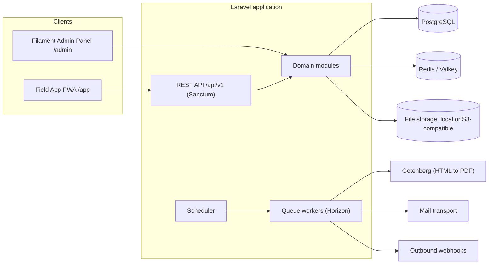
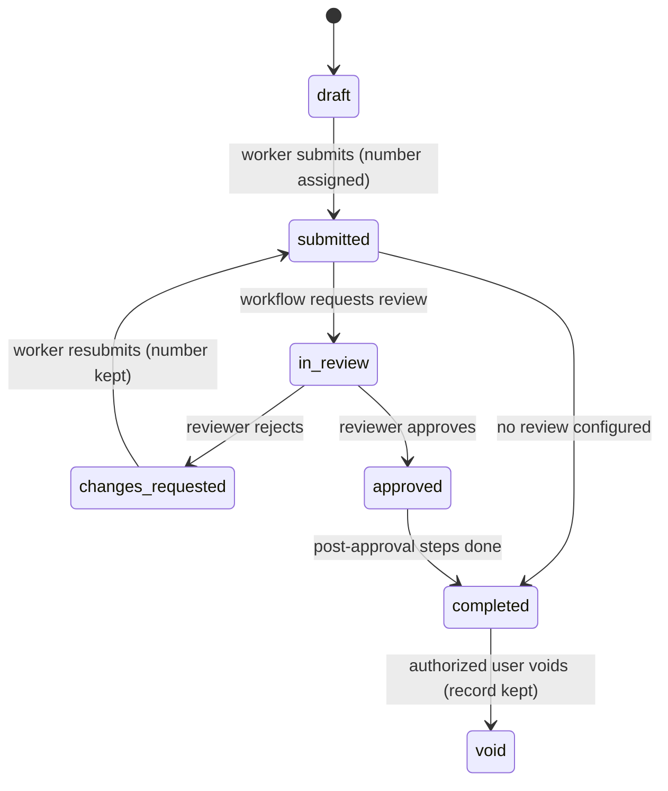

# Development Prompt: Open Source Form Schema Application

> [!info] How to use this document
> The prompt is written for a **fully autonomous run**: the agent never stops to ask, keeps its memory in the repository and hands over to itself across context compaction (§16).
> 1. Optional: go through **§0 Decisions** and change any default. The agent never asks. It applies whatever §0 says.
> 2. Replace `{{APP_NAME}}` and `{{APP_DOMAIN}}`, or leave them. If they are left in, the agent uses the working name `form-schema-app` and `localhost`, and records that in an ADR.
> 3. Run it in an isolated environment (a container or VM) with Docker, PHP 8.4, Node and network access to package registries and docs. Grant tools through a permission allow-list, not by switching permission checks off.
> 4. Paste this **entire document**, including §0 and both appendices, into Claude Code (or another coding agent) in an empty repository. Do not start in plan mode, because it waits for approval.
> 5. In Claude Code you can pin the end condition with `/goal`, for example `/goal Every task in docs/agent/PLAN.md is done or documented as blocked, and docs/agent/FINAL_REPORT.md exists`. In this session `/goal` installed a hook that keeps the session from stopping until the condition holds.
> 6. To resume after an interruption, open a new session in the repository and say "Resume per AGENTS.md".
> 7. Versions and facts were checked on **2026-10-16**. Appendix A lists the sources.

## 0. Decisions (defaults apply unless changed here)

In an autonomous run the agent does not stop to confirm these. It treats each row as decided, records it as an ADR during bootstrap (§16.9), and lists any it considers risky in `docs/agent/QUESTIONS.md` without waiting for an answer.

| # | Decision | Default (used if unanswered) | Alternatives | Why it matters |
|---|---|---|---|---|
| D1 | License | **AGPL-3.0** for the app. **MIT** for the schema spec and the client SDK packages | MIT or Apache-2.0 for everything | AGPL requires anyone who runs a modified version as a hosted service to publish their source. That deters closed SaaS clones. An MIT spec lets other tools adopt the format. Formbricks and Twenty use this split (subagent-reported, see Appendix A) |
| D2 | Distribution | Self-hostable via Docker. The codebase is multi-tenant, so one hosted free instance stays possible | Single-organization self-host only, or hosted only | Shapes tenancy, onboarding and ops |
| D3 | Field app technology | **React + TypeScript SPA**, run as an offline-first PWA, served by Laravel and talking to `/api/v1` | (a) A second Filament panel: fastest to build, no offline. (b) Inertia: hard to take offline because every navigation goes to the server. (c) NativePHP Mobile (see §5) | Offline support drives the field app's architecture more than any other decision |
| D4 | Offline timing | The API is offline-ready from M2 (client UUIDs, idempotent writes). Full offline UX ships in M6, before 1.0 | Online-only MVP, or offline from day one | Retrofitting offline onto an online-only API is expensive |
| D5 | Database | **PostgreSQL** | MySQL 8 or MariaDB | `jsonb` and GIN indexes help with schema-driven reporting |
| D6 | Invoice compliance | v1 produces generic documents, including an invoice layout. **No** XRechnung or ZUGFeRD e-invoice output | Add ZUGFeRD in v1 | Germany requires B2B e-invoice issuing from 2027 for turnover above €800k and from 2028 for all businesses (secondary sources, check BMF guidance). Keep the data model ready for it |
| D7 | Languages | UI in **DE + EN**. Each form's content is in one language in v1 | Multilingual form labels | Affects the schema (`i18n` maps) and the builder UI |
| D8 | Third persona | **Office Coordinator** (designs forms, reviews submissions) | Accountant, or end customer | The source note lists "One more" without naming it |
| D9 | Monetization | None in code. No feature gating | `ee/` commercial folder pattern | Keeps the codebase simple and fits the "free" pitch |
| D10 | Customer, site and asset records | Spec 1.0 reserves a `record` element that **snapshots** record values into the submission (§7.7). The records feature itself ships after 1.0 (Appendix B, B1) | Reference records live instead of snapshotting; build records in the MVP | Snapshots keep old documents re-rendering identically (§7.6). Changing this after the API freezes in M2 is expensive |
| D11 | Semantic field roles | Spec 1.0 includes an optional `role` property with a small starter vocabulary (§7.7). The bundled invoice template uses it | No roles; integrators map each form by hand | Lets webhook payloads, exports and later e-invoice output work across forms without per-form mapping. Additive now, breaking later |
| D12 | Template lineage | Imported or cloned definitions keep a `source` (registry, template key, version) (§7.7). Update propagation ships later (Appendix B, B6) | Cut the link on import, as before | Lets forms receive upstream updates when a norm changes. A cheap field now, a migration later |
| D13 | Multilingual labels in the schema | Spec 1.0 allows optional `i18n` label maps (§7.7). The v1 builder UI stays single-language, so D7 is unchanged | Leave `i18n` out of spec 1.0 | Adding it after 1.0 risks a breaking spec change |

---

# PROMPT START

## 1. Your role and mission

You are a senior Laravel engineer and product-minded software architect. You will build **{{APP_NAME}}**, a free, open-source, self-hostable application. It lets small and medium-sized businesses (SMBs) design structured digital forms in an admin dashboard. Field workers fill those forms on a phone or tablet to produce reports, invoices, checklists and other documents.

The **backend is Laravel**. The **admin dashboard is Filament**. The **Field App** (the source brief calls it the "User App") is a separate offline-capable PWA served by the same Laravel application (see §5 and §9).

**You work fully autonomously.**
- No human is available during the run. Nobody will answer questions, approve plans or review code.
- You make every decision yourself from this document, record it, and keep going.
- A build this size will outgrow your context window several times. Everything you need to continue must therefore live in files in the repository, not in the conversation.

Read this whole document before you write any code.
- §14 says how to work.
- §16 says how to run without a human: where your memory lives, how to hand over to yourself across context resets, and what to do first.

## 2. Product context

### 2.1 Problem

Many companies give field workers Word templates or static PDF forms for reports, invoices and protocols. These break in predictable ways:

- Fixed boxes overflow. When a job has 14 material lines and the form has room for 8, the document fails.
- Forms cannot be extended without someone redesigning the template.
- The data is trapped. People retype it, scan it or lose it, and nobody can report on it.
- Commercial field-form apps solve this, but they charge about **$20–55 per user per month, with 3–5 seat minimums**: GoCanvas, Fulcrum, Appenate (formerly Forms On Fire) and GoFormz (vendor pricing pages, subagent-reported 2026-10-16, Appendix A). For an SMB that is a real cost.

### 2.2 Vision

A free tool that lets an SMB create and scale its documents without breaking the bank. The **Form Schema Spec** is an open, documented, versioned JSON format for form definitions, so they are portable and can be shared as templates.

### 2.3 Product principles (use these to break ties)

1. **Data first, document second.** The schema captures structured data. The PDF is a rendering of that data. Content flows across pages and is never truncated.
2. **Open format.** Form definitions follow a published spec. Everything can be imported and exported as JSON.
3. **Field-proof.** The app works offline, on cheap phones, with gloves on and in direct sunlight.
4. **SMB-simple.** A new organization is productive within 30 minutes thanks to templates. No consultant needed.
5. **Free and self-hostable.** No paid or SaaS-only dependencies. One `docker compose up`.
6. **Never lose data.** Autosave, idempotent sync, immutable published versions and an audit trail.

### 2.4 Glossary (use these terms in code, UI and docs)

| Term | Meaning |
|---|---|
| Organization | A tenant: one company. Users can belong to several |
| Form | A named, versioned definition owned by an organization |
| Form Schema Spec | The published specification in §7 (the format itself) |
| Form Definition | One JSON document that follows the Form Schema Spec |
| Template | A Form Definition file, bundled or exported, used as a starting point. Importing a template creates a new Form |
| Field App | The PWA used by field workers (the "User App" in the source brief) |
| Form Version | An immutable, published snapshot of a definition. A form has one mutable draft and N versions |
| Submission | One filled-in instance of a form version. Its data is JSON |
| Rendition | A generated, immutable PDF of a submission, stored with a hash |
| Design | The document layout settings used to render renditions. Branding (logo, colors, company details) belongs to the Organization |
| Workflow | A trigger, optional conditions and ordered steps, run when events happen |
| Task | A human step assigned to a user or group, such as a review |
| Group | A set of users in an organization, such as a department or crew. Not the same as a spatie "team" (§6.2) |

## 3. Personas

### P1 Field Worker (primary user of the Field App)
- **Context:** Technician, installer, inspector or caregiver. Works on site, with a smartphone or tablet and patchy connectivity, often wearing gloves or in bright light. Not tech-savvy. Fills 5–20 documents a week.
- **Goals:** Finish paperwork on site, get the customer's signature, never retype anything.
- **Pains:** Boxes that are too small, lost paper, illegible scans, no signal.
- **Needs:** Large touch targets, autosave, offline mode, camera and signature capture, unlimited repeatable rows, and the option to send the document to the customer on the spot.
- **Success signal (proposed):** A standard service report is completed in under 5 minutes.

### P2 Small Business Owner (decision maker, admin)
- **Context:** Runs a business with 5–50 employees in trades or services. No IT department. Very cost-sensitive.
- **Goals:** Professional branded documents, faster invoicing, an overview of what happens in the field.
- **Pains:** Per-user SaaS pricing, paper chaos, data scattered everywhere.
- **Needs:** Templates, a quick setup, a dashboard, exports for the accountant, simple roles.
- **Success signal (proposed):** The first form is live within 30 minutes of sign-up.

### P3 Office Coordinator (power user of the admin panel). *Proposal for the missing third persona.*
- **Context:** Back office or dispatcher. Maintains forms, reviews incoming submissions, sends documents to customers, exports data to accounting.
- **Needs:** A drag-and-drop builder with preview, safe versioning, approval queues, bulk export, notifications.

### Secondary roles
- **Document Recipient (end customer):** Has no account. Receives a PDF by email or link and may sign on the worker's device.
- **Platform Operator:** Installs, upgrades and backs up a self-hosted instance.

## 4. Scope

### 4.1 MVP (milestones M0–M4)
Organizations and tenancy, authentication with MFA, roles and groups, the schema spec v1.0, form builder v1 (based on the Filament Builder field), versioning, publishing and rollback, the field app (online, offline-ready API), the core element types, designs and PDF renditions, email delivery, workflows (including review), notifications, audit logging, fillable-PDF import (§8.13), Docker setup.

### 4.2 v1.0 (milestones M5–M8)
Reports and dashboard widgets, full offline mode, OIDC SSO (then SAML), the drag-and-drop canvas builder v2, audit log UI and retention, GDPR tooling, hardening, documentation.

### 4.3 Explicit non-goals for v1
Native app-store apps, a BPMN engine or parallel workflow branches, payments, accounting integrations (use webhooks instead), XRechnung/ZUGFeRD (D6), anonymous public forms, a template marketplace, AI form generation. Deterministic import of fillable PDFs is in scope (§8.13). Model-assisted import of Word files, flat PDFs and photos is a candidate extension (Appendix B, B2).

## 5. Tech stack

These versions were current on 2026-10-16, checked against Packagist, npm and the official docs (Appendix A). Pin major versions. Re-verify before you install anything (§14.2).

| Layer | Choice | Version | Notes |
|---|---|---|---|
| Runtime | PHP | **8.4 baseline** (8.5 OK) | Laravel 13 needs ^8.3, but Pest 5, spatie/laravel-activitylog 5 and spatie/laravel-model-states 2.14 need ^8.4 |
| Framework | Laravel | **13.x** (v13.37.0) | Laravel 13 gets bug fixes until Q3 2027 and security fixes until 2028-03-17. Laravel 12 only gets security fixes. Do not start on 12 |
| Admin | Filament | **5.x** (v5.10.2) | Needs Livewire ^4.4.7. Filament 5 keeps the Filament 4 API, now on Livewire 4. Use the docs at `filamentphp.com/docs/5.x` |
| Reactive UI | Livewire | 4.x (v4.4.7) | Comes in through Filament |
| Database | PostgreSQL | ≥ 16 | `jsonb`, GIN indexes |
| Cache / queue | Redis or Valkey + Laravel Horizon | Horizon 5.50 | Filament import and export need a queue worker, the job-batches table and database notifications |
| Realtime (optional) | Laravel Reverb | 1.12 | Polling fallback |
| API auth | Laravel Sanctum | 4.3 | SPA cookies plus tokens with abilities |
| SPA auth endpoints | Laravel Fortify | check version | Headless login, 2FA and password reset for the field app |
| Roles | spatie/laravel-permission (teams mode) + bezhansalleh/filament-shield | 8.3 + 4.3 | Shield supports Filament ^4 or ^5 and permission ^6 to ^8 |
| Audit | spatie/laravel-activitylog + pxlrbt/filament-activity-log | 5.1 + ≥ 3.1.2 | pxlrbt 3.0.0 had a broken constraint |
| State machine | spatie/laravel-model-states | 2.14 | Submission lifecycle |
| Media | spatie/laravel-medialibrary + filament/spatie-laravel-media-library-plugin | 11.23 + 5.x | Photos, files, signatures |
| PDF | spatie/laravel-pdf with the **Gotenberg** driver, plus Gotenberg (Docker) | 2.14 + Gotenberg 8.x (v8.38.1, MIT) | laravel-pdf v2 drivers: Browsershot, Gotenberg, Cloudflare, WeasyPrint, DOMPDF, Chrome. Gotenberg's README says it supports PDF/A and PDF/UA |
| SSO | laravel/socialite + dutchcodingcompany/filament-socialite; SAML through socialiteproviders/saml2 | 5.31 + 3.3; 4.10 | **Avoid 24slides/laravel-saml2**: it has no tagged Laravel 13 release |
| Schema validation | opis/json-schema | 2.6 | JSON Schema 2020-12, Apache-2.0 |
| Logic | jwadhams/json-logic-php + json-logic-js | 1.5.1 + 2.0.5 | MIT. Both dormant since 2024-07, so wrap them and run the conformance suite |
| PDF import | qpdf (CLI in the queue image) | check version | Apache-2.0. Its JSON output exposes the AcroForm field tree (§8.13). Alternative: pdfjs-dist 6.4 (Apache-2.0) |
| Decimal math | brick/math + decimal.js | 1.0 + 10.6 | brick/math 1.0.0 is a new major (2026-09-12). Check its API |
| API docs | dedoc/scramble | 0.13.x | Generates OpenAPI from code. Pre-1.0 |
| Field app | React + TypeScript (strict), Vite, TanStack Router + Query, Tailwind 4, shadcn/ui | React 19.3, TanStack Router 1.x | Not Inertia (D3). Laravel's React starter kit (Inertia 3) is useful only as a reference for styling and auth flows |
| Offline | Dexie + Workbox (through vite-plugin-pwa) | 4.4 (Apache-2.0) + 7.4 / plugin 2.0 (MIT) | |
| Signature | signature_pad | 5.1 (MIT) | |
| PHP testing | Pest + pest-plugin-browser (Playwright) | 5.3 + 5.x | Pest 5 needs PHP 8.4, PHPUnit 13 and **Laravel ^13.23** (pest-plugin-laravel 5) |
| PHP quality | Larastan, Pint, driftingly/rector-laravel | 3.13 (PHPStan 2), 1.32, 2.6 | PHPStan's highest level is 10 |
| JS testing | Vitest, Playwright | n/a | |
| Dev mail | Mailpit | n/a | |

**NativePHP Mobile (the D3 alternative):** v4.6. The core is MIT, but geolocation, push and scanner are **paid** plugins, which conflicts with principle 5.

## 6. Architecture

### 6.1 System overview



- One Laravel monolith, organized by **domain** rather than by technical type.
- Filament resources, API controllers and console commands are **thin**. Domain logic lives in Actions and services, so the panel, the API and jobs share one implementation.
- The field app is built with Vite and served by Laravel at `/app`. It uses Sanctum SPA cookie authentication on the same domain.
- **One renderer.** The builder's live preview uses the same `form-schema-js` renderer as the Field App. Never maintain a second renderer in Filament.
- **Hosting:**
  - The Field App builds with Vite `base: '/app/'`. Its service worker is served from `/app/sw.js` with scope `/app/`.
  - The preview is a **separate Vite entry**, `preview.html`, served outside that scope. It loads only the renderer: no service worker, no Dexie, no sync. That way preview data can never leak into a designer's offline store.

### 6.2 Multi-tenancy
- Tenancy is row-level in a single database. `Organization` is the Filament tenant model (`->tenant(Organization::class)`), and every tenant-owned table has `organization_id`.
- A `BelongsToOrganization` trait adds a global scope and sets `organization_id` on create.
- **Filament's tenancy only scopes queries inside the panel.** The API, queued jobs, exports, workflow steps, notifications and console commands must set the tenant context explicitly.
  - Store the tenant in Laravel's **`Context`** (`Context::addHidden('organization_id')`). Context travels with queued jobs and is restored **before** the job's models are unserialized. Job middleware runs too late, because restoring models with relations already applies global scopes (reviewer-reported from 13.x source; prove it with a test in M0).
  - Bind `TenantContext` as `scoped()`, so it never leaks between jobs in a long-running worker. Reset the spatie team id on every `JobProcessing` event.
  - The global scope **throws** when no tenant is set. Platform-level code opts out explicitly with `withoutTenant()`.
  - Each API request names its organization with an `X-Organization-Id` header, validated against the user's memberships.
  - Register Filament's tenant middleware as persistent, so Livewire follow-up requests keep the tenant.
- The Filament docs say outright that **tenant scoping is not record authorization**, so policies are still required. Use `scopedUnique()` and `scopedExists()` for validation rules. Raw query-builder queries and `withoutGlobalScopes()` bypass isolation, so avoid them in tenant code or review each use.
- Roles use spatie/laravel-permission in **teams mode**, with team = organization.
- Add an automated **tenant isolation test** that enumerates every tenant-owned model and API endpoint and proves that cross-tenant reads and writes fail.

### 6.3 Repository layout (proposal)

```
app/
  Domain/
    Forms/            # Form, FormVersion, builder mapping, publishing
      Schema/         # spec value objects, linter, validator, logic, JSON Schema export
    Submissions/      # Submission, status machine, numbering, attachments
    Documents/        # Designs, branding, rendering, renditions
    Workflows/        # Workflow, triggers, steps, runs, tasks
    Identity/         # Organization, membership, groups, roles, SSO
    Notifications/
    Audit/
  Filament/
    Admin/            # Resources, Pages, Widgets for the /admin panel
    Platform/         # optional operator panel (/platform)
  Http/Api/V1/
resources/field-app/  # React + TS SPA (field app)
packages/
  form-schema-php/    # path-repo package: spec types, validator, logic (MIT)
  form-schema-js/     # npm workspace: TS types, validator, logic (MIT)
spec/
  form-definition/1.0/  # meta-schema.json, README, CHANGELOG
  conformance/          # shared golden test cases (PHP and JS run them)
  templates/            # bundled form templates (JSON)
docs/adr/
docker/
```

### 6.4 Core data model

| Entity | Key fields | Notes |
|---|---|---|
| `organizations` | name, slug, locale, timezone, branding (json), company_details (json) | Filament tenant |
| `users`, `organization_user` | membership, status, default_group | A user can belong to several organizations |
| `devices` | user_id, device_uuid, secret_hash, name, last_seen_at, revoked_at, wipe_requested_at | Field App installs, for offline re-auth and remote wipe (§9.3) |
| `groups`, `group_user` | name, organization_id | Departments or crews |
| roles / permissions | spatie teams mode | Seeded per organization |
| `forms` | key, name, category, status (draft/active/archived), draft_definition (jsonb), current_version_id | Mutable working copy |
| `form_versions` | form_id, version (int), definition (jsonb), data_json_schema (jsonb), checksum, design_version_id, changelog, published_by, published_at, retired_at | **Immutable** after insert |
| `form_access` | form_id, group_id / role | Who may use a form in the app |
| `designs`, `design_versions` | settings (jsonb), version, checksum | Versioned like forms |
| `submissions` | **uuid (client-generated)**, form_version_id, status, data (jsonb), revision (int), number, submitted_by, submitted_at, device (json), geo (json) | Optimistic concurrency via `revision` |
| `submission_values` | organization_id, form_id, form_version_id, submission_id, status, submitted_at, key, path, value_text, value_num (`numeric`), value_date | Read-model projection for reporting (§8.4). Composite index starts with `(organization_id, form_id, key, …)` |
| `submission_events` | submission_id, from/to status, actor, comment | Status history |
| media | spatie/laravel-medialibrary | Photos, files, signatures |
| `renditions` | submission_id, design_version_id, form_version_id, input_hash, file_sha256, renderer_version, path | Immutable PDFs. `input_hash` covers the canonical render input; `file_sha256` covers the stored file (§8.5) |
| `number_sequences` | organization_id, form_id, period (for example `2026`), next_value. Unique on (organization_id, form_id, period) | Allocated as described in §9.2 |
| `workflows`, `workflow_runs`, `workflow_step_runs` | trigger, conditions (jsonb), steps (jsonb), definition_snapshot | Each run stores the definition it executed |
| `tasks` | type (review), assignee user/group, due_at, outcome, comment | Human steps |
| `identity_providers` | organization_id, type (oidc/saml), config (encrypted), verified_domains | SSO |
| `mail_settings`, `mail_messages` | per-org SMTP override (encrypted); delivery log | Email |
| `webhook_endpoints` | url, secret (encrypted), events | Outbound |
| `activity_log` | spatie/laravel-activitylog | Audit log |
| `notifications` | Laravel database notifications | In-app notifications |

### 6.5 Submission lifecycle



Use a state machine (for example spatie/laravel-model-states) so invalid transitions are impossible and every transition writes a `submission_events` row and an audit entry.

## 7. The Form Schema Specification (the core of the product)

### 7.1 Principles
- A form definition is a JSON document with a `specVersion` (semver). A **meta-schema** (JSON Schema 2020-12) in `spec/form-definition/1.0/meta-schema.json` validates every definition on save, import and publish. Use opis/json-schema on the server; it supports 2020-12.
- The definition describes **structure + logic + presentation hints**. Submission **data** is a JSON object keyed by element `key`. Repeaters produce arrays of row objects.
- Every element has an `id` (UUID, the builder's identity) and a `key` (snake_case, unique within its scope). **Keys are immutable once a version is published.** Labels can change freely. Reports join data across versions by key.
- Logic is written in **JsonLogic**, with a small set of custom operators (§7.4). Both libraries (jwadhams/json-logic-php 1.5.1, json-logic-js 2.0.5, MIT) have had no release since 2024-07 (verified). Wrap them behind an interface in `packages/form-schema-*`. The **shared conformance suite** guarantees that PHP and JS produce identical results.
- **The server is authoritative.** It re-runs validation and recomputes every calculated value. Calculated values sent by the client are ignored.
- Properties prefixed `x-` are allowed as extensions, following the OpenAPI convention. Documented extensions: `x-import` (§8.13).
- For interoperability, a JSON Schema 2020-12 of the **data contract** is generated from each version (`data_json_schema`). It covers structure and types only, and is not the validator.

### 7.2 Definition structure

| Property | Type | Description |
|---|---|---|
| `$schema` | string | URL of the meta-schema |
| `specVersion` | string | For example `1.0.0` |
| `key`, `title`, `description` | string | Identity and display |
| `locale` | string | BCP 47 tag. Drives number, date and currency formatting |
| `settings.layout` | `wizard` \| `scroll` | One page at a time, or one long page |
| `settings.numbering` | object | Format such as `SR-{YYYY}-{SEQ:5}`, reset `never`/`yearly`/`monthly` |
| `settings.document.design` | string | Design key used for renditions |
| `pages[]` | array | Each page has `key`, `title`, `elements[]` |
| `source` | object, optional | Template lineage (D12, §7.7) |

Example (ids omitted for brevity):

```json
{
  "$schema": "https://{{APP_DOMAIN}}/spec/form-definition/1.0/meta-schema.json",
  "specVersion": "1.0.0",
  "key": "service_report",
  "title": "Service Report",
  "locale": "de-DE",
  "settings": {
    "layout": "wizard",
    "numbering": { "format": "SR-{YYYY}-{SEQ:5}", "reset": "yearly" },
    "document": { "design": "default" }
  },
  "pages": [
    {
      "key": "job",
      "title": "Customer & Job",
      "elements": [
        { "type": "text", "key": "customer_name", "label": "Customer", "required": true,
          "validation": { "maxLength": 120 } },
        { "type": "date", "key": "service_date", "label": "Service date",
          "default": { "var": "$today" } },
        { "type": "select", "key": "service_type", "label": "Service type", "required": true,
          "options": [
            { "value": "maintenance", "label": "Maintenance" },
            { "value": "repair", "label": "Repair" }
          ] },
        { "type": "textarea", "key": "defect", "label": "Defect description", "required": true,
          "visibleIf": { "==": [{ "var": "service_type" }, "repair"] } }
      ]
    },
    {
      "key": "work",
      "title": "Work & Material",
      "elements": [
        { "type": "repeater", "key": "items", "label": "Material & labour",
          "display": "table", "minItems": 1, "addLabel": "Add line",
          "elements": [
            { "type": "text", "key": "description", "label": "Description", "required": true },
            { "type": "number", "key": "qty", "label": "Qty",
              "validation": { "min": 0, "step": 0.25 } },
            { "type": "money", "key": "unit_price", "label": "Unit price", "currency": "EUR" },
            { "type": "calculated", "key": "line_total", "label": "Total", "format": "money",
              "expression": { "dec.mul": [{ "var": "qty" }, { "var": "unit_price" }] } }
          ] },
        { "type": "calculated", "key": "net_total", "label": "Net total", "format": "money",
          "expression": { "sum": [{ "var": "items" }, "line_total"] } },
        { "type": "calculated", "key": "vat", "label": "VAT 19 %", "format": "money",
          "expression": { "dec.round": [{ "dec.mul": [{ "var": "net_total" }, "0.19"] }, 2] } },
        { "type": "photo", "key": "photos", "label": "Photos", "multiple": true,
          "validation": { "maxFiles": 20, "maxSizeKb": 8192 } },
        { "type": "signature", "key": "customer_signature", "label": "Customer signature",
          "required": true, "signerNameFrom": "customer_name" }
      ]
    }
  ]
}
```

The resulting submission data:

```json
{
  "customer_name": "Beispiel GmbH",
  "service_date": "2026-10-16",
  "service_type": "repair",
  "defect": "Door switch misaligned",
  "items": [
    { "description": "Safety switch", "qty": "1", "unit_price": "89.00", "line_total": "89.00" },
    { "description": "Labour (h)", "qty": "1.5", "unit_price": "65.00", "line_total": "97.50" }
  ],
  "net_total": "186.50",
  "vat": "35.44",
  "photos": ["0192f1c4-7a1e-7c3b-9a55-1d2e3f4a5b6c"],
  "customer_signature": {
    "attachment": "0192f1c4-8b2f-7d4c-8b66-2e3f4a5b6c7d",
    "signerName": "Beispiel GmbH",
    "signedAt": "2026-10-16T09:41:00+02:00"
  }
}
```

### 7.3 Element types (v1.0)

| Category | Types | Data |
|---|---|---|
| Input | `text`, `textarea`, `email`, `phone`, `number`, `money`, `date`, `time`, `datetime`, `select`, `multiselect`, `radio`, `checkbox`, `toggle`, `rating` | Scalar, or an array for `multiselect` |
| Capture | `photo`, `file`, `signature`, `location` (GPS with accuracy, opt-in) | Attachment UUID(s) or an object |
| Computed | `calculated`, `hidden` | Computed or default value |
| Structure | `repeater` (rows; `display`: `cards` \| `table`; `minItems`/`maxItems`; **unlimited by default**) | Array of row objects |
| Layout (no data) | `section`, `columns`, `heading`, `paragraph` (sanitized Markdown), `divider`, `image`, `page_break` (PDF only) | none |
| Later | `barcode`, `record` (reserved, §7.7; replaces the earlier `lookup` idea), `rich_text` | n/a |

**Common properties:** `id`, `key`, `label`, `help`, `placeholder`, `required`, `visibleIf`, `requiredIf`, `readOnlyIf`, `default` (a literal or JsonLogic), `validation` (`min`, `max`, `minLength`, `maxLength`, `pattern`, `step`, `accept`, `maxFiles`, `maxSizeKb`), `pdf` (`hidden`, `label`, `width`, `keepTogether`), `role` and `i18n` (§7.7), `x-*`.

### 7.4 Logic and calculations
- `visibleIf`, `requiredIf`, `readOnlyIf`, `default` and `expression` all take JsonLogic.
- **A hidden element is excluded** from validation and from the stored data. `required` only applies while the element is visible.
- **Variable scope:** inside a repeater, `var` resolves against the current row first. Use `$root.<key>` for top-level values. Built-in variables: `$today`, `$now`, `$user.name`, `$user.email`, `$org.name`, `$form.version`.
- **Custom operators**, registered identically in PHP and JS: `dec.add`, `dec.sub`, `dec.mul`, `dec.div`, `dec.round` (half-up), `sum` (array path plus row key), `count`, `min`, `max`, `date.diff`, `date.add`. Monetary math uses **decimal arithmetic**, never floats. Money values are decimal **strings**. Suggested libraries: brick/math (PHP) and decimal.js (JS); check current versions.
- **Decimal rules.** Without these, PHP and JS will disagree. Verified 2026-10-16:
  - json-logic-js evaluates `{">":["10.00","9.50"]}` to **false**, while json-logic-php gives **true**.
  - `{"==":["1.00","1"]}` also differs.
  - Built-in `+` and `*` use floats: `0.1 + 0.2 = 0.30000000000000004`.
  - brick/math's `BigDecimal::of(1.5)` silently becomes `1`.

  The rules:
  1. **All `number` and `money` values in submission data are decimal strings** (`"1.5"`, `"89.00"`). The server rejects JSON numbers for these types. Definition properties such as `min` and `step` may stay JSON numbers.
  2. `dec.add` and `dec.sub` produce the larger input scale. `dec.mul` produces the sum of the input scales. Both are exact.
  3. `dec.div` takes a required third argument for the scale and rounds half-up: `{"dec.div": [a, b, 4]}`.
  4. Comparisons use `dec.eq`, `dec.gt`, `dec.gte`, `dec.lt` and `dec.lte`. **The linter rejects built-in arithmetic and comparison operators (`+ - * / < > <= >= == !=`) on number or money values.**
  5. Every `calculated` element has a `scale`: default 2 when `format` is `money`, otherwise 6. Its final result is rounded half-up to that scale and stored as a string with exactly that many digits, so `"1.5" × "65.00"` → `"97.50"`.
- Calculations run in **dependency order**. Row-level values are computed before aggregates. A definition with a cycle is rejected at save time and the builder shows the error.

### 7.5 Validation pipeline
1. **Meta-schema check** of the definition on save, import and publish.
2. **Linter:** unique keys per scope, valid `var` references, no cycles, unique option values, no logic referencing deleted fields, numbering format valid.
3. **Submission validation**, shared semantics in PHP and JS: walk the definition, evaluate visibility per row, apply rules, compute calculated values, strip unknown or hidden keys. Errors are keyed by **JSON Pointer** (`/items/2/qty`) and use stable error codes, so the client can localize them.

### 7.6 Versioning and keys
- `forms.draft_definition` is the mutable working copy.
- **Publish** = meta-schema check, lint, then snapshot into a new `form_versions` row with `version + 1`, a `checksum` (sha256 of canonical JSON), a changelog note and an audit entry.
- `form_versions` rows are immutable. Enforce this in the model and cover it with a test. An optional database trigger may allow exactly one update: `retired_at` going from NULL to a value.
- The linter rejects changing the **type** of a key that already exists in a published version, because reports join data by key.
- **Rollback** to version K creates a **new** version whose content is a copy of K. History is never rewritten.
- **Retire** a version: no new submissions on it. Existing drafts get a prompt to restart on the latest version, carrying data over by key where it is compatible.
- Each submission is pinned to the `form_version_id` it was started on. Each rendition records its form version and design version, so old documents always re-render identically.
- **Diff** between any two versions, shown in human terms (element added, removed or changed, matched by `id`).
- **Import/export:** a definition and its design reference as a JSON file. Ship templates in `spec/templates/`: service report, invoice, inspection checklist, delivery note, timesheet, handover protocol.

### 7.7 Reserved for post-1.0 features (D10–D13)
These properties are defined in spec 1.0 so that the features in Appendix B can arrive later without breaking changes. Unless a bullet says otherwise, v1 only validates and stores them.
- **`role`** (D11): an optional string from a vocabulary file, `spec/form-definition/1.0/roles.json`.
  - Starter vocabulary: `customer.name`, `customer.address`, `customer.email`, `site.address`, `asset.serial`, `document.date`, `line_item.description`, `line_item.qty`, `line_item.unit`, `line_item.unit_price`, `line_item.tax_rate`, `line_item.total`, `totals.net`, `totals.tax`, `totals.gross`, `payment.iban`.
  - Linter: an unknown role is a warning. The same role twice in one scope is an error, except across repeater rows.
  - Webhook payloads and exports include each value's role. The bundled invoice and service-report templates set roles.
- **`source`** (D12): `{ "registry": "<url>", "template": "<key>", "version": "<semver>" }` on the definition. It is set when a template is imported and kept when the form is cloned. v1 has no update mechanism.
- **`i18n`** (D13): an optional map on `label`, `help`, `placeholder` and option labels, for example `{ "pl": "Ilość" }`. The base language is `locale`. The v1 renderer and PDFs use only the base language.
- **`record` element** (D10): the type name is reserved and its semantics are fixed now. When it ships, selecting a record **copies** the record's values into the submission data at that moment (a snapshot), never a live reference. The spec 1.0 meta-schema rejects `record` until the feature exists.

## 8. Feature specifications: Admin Dashboard (Filament)

For each feature: what to build, implementation notes, acceptance criteria (AC). Prefer Filament built-ins over custom code.

### 8.1 Dashboard with widgets
- Role-aware default dashboards:
  - **Owner:** KPIs (submissions this week, pending reviews, stale drafts, documents sent), submissions over time per form, workflow failures.
  - **Reviewer:** review queue, recent submissions.
  - **Designer:** draft forms, recently published versions.
- Built from Filament widgets (stats overview, chart, table), with a date-range filter. Cache results per organization with a short TTL.
- v1.0: saved reports (§8.4) can be pinned as widgets. Later: users can reorder and hide widgets.
- **AC:** Every widget is scoped to the current organization (tested). Widget queries stay index-backed at 100k submissions per organization.

### 8.2 Schema Form Builder with drag and drop
- **Form resource:** list (status, current version, submission count), create from blank, from a template, from an imported JSON file or from a fillable PDF (§8.13). Duplicate, archive.
- **Builder v1 (M1):** a Filament `Builder` field with one block per element type. Nested Builders handle `repeater`, `section` and `columns`. Blocks are reorderable by drag and drop. A **mapper** converts between the Builder's block data and the canonical spec JSON in both directions. Round-trip tests are required.
  - Filament drops state keys that have no declared field. Each block therefore carries a Hidden `id` (the spec id; Filament's item UUIDs are separate) and a Hidden `_extra` that holds all unmapped properties, including `x-*`. The mapper merges `_extra` back in (reviewer-reported from Filament 5 source; confirm with a test).
  - Cloning a block regenerates its `id` and suffixes its `key`.
  - Once an element's `id` appears in a published version, its `key` is locked.
- **Builder v2 (M7):** a custom Filament page with three panes:
  - **Palette** of element types.
  - **Canvas** showing pages and nested containers.
  - **Inspector** with properties and the logic editor.

  It uses Livewire, Alpine and SortableJS. Drag from the palette to the canvas, and reorder within and between containers. **Keyboard alternatives** (move up/down/into) are required for accessibility. v2 edits the same canonical JSON, so the switch needs no data migration.
- **Logic editor (M1, used by v1 and v2):** a visual condition builder that compiles to JsonLogic. In v1 it is a Repeater of field/operator/value rows with AND/OR groups, inside each block's form. Calculated fields get a guided expression editor. Power users get a raw JSON view.
- **Live preview (M2, once the Field App renderer exists):** an iframe loads the `preview.html` entry (§6.1).
  - After each mapper run, the Filament page sends the current, **unsaved** definition to the iframe with an origin-checked `postMessage`.
  - Toggle between phone and tablet sizes.
  - "Preview PDF" (M3) renders with the entered sample data.
- Autosave the draft. A **lint panel** lists problems and blocks publishing while errors remain. Undo and redo ship with v2.
- **AC:**
  - By the end of M2, a designer builds the §7.2 example without touching JSON.
  - Invalid definitions cannot be published.
  - Preview matches the field app exactly, because it is the same renderer.
  - The Builder ↔ spec mapping is lossless, including `x-*` and unknown properties carried in `_extra` (property-based or fixture round-trip tests).

### 8.3 Workflow automation
- A **workflow** = trigger + optional conditions (JsonLogic over the submission context) + ordered steps.
- **Triggers:** `submission.submitted`, `submission.status_changed` (to a given status), `submission.approved`, `submission.rejected`, `form.published`, `schedule` (cron, for example a daily digest), `manual` (a button on a submission).
- **Steps:**
  - `send_email`: recipients can be fixed addresses, a field value, the submitter or a group. Uses a template. Attaches the PDF or a link.
  - `notify`: users, groups or roles, on selected channels.
  - `request_review`: assigns a task to a user or group, with an SLA. Approve continues the workflow. Reject sets `changes_requested` and notifies the submitter.
  - `set_status`.
  - `generate_document`: with a chosen design.
  - `webhook`: POST JSON with an HMAC-SHA256 signature and timestamp headers, retries with exponential backoff, and an **SSRF guard** (resolve DNS, block private, loopback and link-local ranges, no redirects into them).
- **Execution:** an event matches workflows and creates a `WorkflowRun` that stores the definition snapshot. Steps run as queued jobs.
  - Runs are idempotent: one run per (workflow, submission, triggering event id).
  - Retries use backoff.
  - Failures are visible in Filament and notify admins. A manual retry button is available.
- **Filament:** a Workflow resource whose steps are a `Builder` field. A Runs relation manager shows a per-step timeline with logs.
- **Non-goals:** BPMN, parallel branches, loops.
- **AC:**
  - A "review then email PDF to customer" workflow works end to end (E2E test).
  - Duplicate events do not send duplicate emails.
  - Webhooks to `127.0.0.1`, `10.0.0.0/8`, `169.254.169.254` and similar addresses are refused.

### 8.4 Reports
*Interpretation:* analytics and exports over submitted data. The field "reports" themselves are submissions and renditions.
- **Submission explorer per form:** a Filament table with **dynamic columns generated from the schema keys**, taking the union across versions by key.
  - Filters: date, status, submitter, group, and field-value filters for select, boolean, date and number fields.
  - Search.
  - Bulk actions.
- **Read model:** project each value into `submission_values`, denormalized as in §6.4. Reports, filters and aggregates query this table instead of parsing `jsonb` ad hoc. Repeater rows are projected with their path.
  - The projector ships in **M2**, so data exists before reports do.
  - It re-projects on submit, resubmit, void and anonymization.
  - `php artisan app:reproject {form?}` rebuilds the table.
- **Exports:** a custom queued export job (for example with openspout) that reuses Filament's `Export` model and its completion notifications.
  - Filament's built-in Exporter has static columns and writes a single XLSX sheet (reviewer-reported from Filament 5 source), so it cannot produce per-form dynamic columns.
  - Repeaters go to a second sheet, linked by submission number.
  - A bulk PDF ZIP is also available.
- **Saved reports:** form + filters + group-by + metric (count, sum, avg), shown as a table and a chart. They can be pinned to the dashboard.
- v1.0: scheduled report emails (weekly or monthly).
- **AC:**
  - Explorer columns are correct for a form with three versions.
  - An export of 10k submissions completes in the background and notifies the user.
  - Sums of money fields are decimal-exact.

### 8.5 Custom designs (documents and branding)
- **Organization branding:**
  - Logo, primary and accent colors, a font from a bundled list of OFL-licensed fonts.
  - Company details: address, tax ID, bank details, legal footer.
  - Applied to the field app, emails and PDFs.
- **Document designs** (several per organization, one default per form):
  - Paper size (A4 or Letter), orientation, margins.
  - Header and footer as rich text with **tokens**: `{{org.name}}`, `{{submission.number}}`, `{{submission.date}}`, `{{page}}`, `{{pages}}`.
  - Layout style: a two-column label/value layout, or compact.
  - Repeaters as tables or cards. Photo grid size.
  - Show or hide empty fields. Signature block placement.
  - Watermarks (DRAFT, VOID). Locale formats.

  Field-level overrides come from the `pdf` hints in the schema.
- **Rendering:**
  - Blade templates owned by the app, plus print CSS (paged media), rendered to PDF by Gotenberg (Chromium).
  - Content **flows across pages**. Tables repeat their header row on each page. `keepTogether` avoids splitting a block. **Nothing is ever truncated.**
  - The renderer has **no network access**.
    - Run Gotenberg with `--chromium-deny-private-ips=true` and `--chromium-deny-public-ips=true`. Both default to `false` (verified in the v8.38.1 source).
    - Put it on its own Docker network, shared only with `app` and `queue`.
    - Set `--api-body-limit`.
  - **Assets are inlined.** The laravel-pdf Gotenberg driver only sends the HTML files (reviewer-reported), so photos, logos and fonts are base64-inlined. Downscale photos for print (for example a long edge of at most 1600 px). Enforce a request size budget (for example 25 MB) and fail with a clear error.
  - Optional PDF/A for archiving; check engine support.
- **Security:** tenants never author Blade or PHP. If advanced HTML templates are added later, they run only in a sandboxed engine (Twig Sandbox with allow-lists) behind an HTML sanitizer.
- **Renditions** are immutable and stored with their form version, design version and renderer version. Re-rendering creates a new rendition.
- **Two hashes per rendition:**
  - `file_sha256` proves the stored file has not changed.
  - `input_hash` (sha256 of the canonical HTML, data and versions) proves that a re-render used the same input.

  Chromium writes creation and modification dates into every PDF, so the PDF bytes are never reproducible. Do not compare file hashes across renders.
- Designs are versioned and can be rolled back, like forms (§7.6).
- **AC:**
  - A 60-line repeater renders across several pages with repeated headers and correct totals.
  - Re-rendering an old submission after a design change still uses that submission's design version.

### 8.6 Roles and groups
- Seeded, organization-scoped roles: **Owner, Admin, Designer, Reviewer, Field Worker, Viewer**.
  - **Roles are additive**, and a user can hold several. The P3 Office Coordinator is Designer + Reviewer.
  - Custom roles can be built through a Filament Shield-style permission UI.
- **Groups** (departments or crews) drive form access, task assignment, notification targets and submission visibility ("see my group's submissions").
- **Form access:** Owner and Admin can fill every form. Every other role needs a `form_access` grant through a group or role.
- **Reports and exports** follow the "View submissions" row. A Reviewer only exports what they are allowed to see.
- There is a policy for every model. The API uses the same policies. `canAccessPanel()` keeps Field Workers out of `/admin`.

| Capability | Owner | Admin | Designer | Reviewer | Field Worker | Viewer |
|---|---|---|---|---|---|---|
| Organization settings, branding, mail | ✓ | ✓ | | | | |
| Users, roles, groups, SSO | ✓ | ✓ | | | | |
| Build and publish forms, designs | ✓ | ✓ | ✓ | | | |
| Workflows | ✓ | ✓ | ✓ | | | |
| Review and approve | ✓ | ✓ | | ✓ | | |
| Fill forms (field app) | ✓ | ✓ | ✓ | ✓ | ✓ | |
| View all submissions | ✓ | ✓ | own forms | assigned/group | own (+group if granted) | ✓ read |
| Reports and exports | ✓ | ✓ | ✓ | ✓ | | ✓ |
| Audit log | ✓ | ✓ | | | | |
| Delete organization, transfer ownership | ✓ | | | | | |

- **AC:**
  - A permission test for every cell in the matrix.
  - Removing a user from a group takes effect in the API immediately. The Field App applies it **at the next sync**: the form's cache is purged, and the server rejects submits with `form_access_revoked`. Drafts on the device become read-only, with a "contact your office" note, so no data is lost silently.

### 8.7 SSO
- **Local auth:** email and password, email verification, password reset, MFA (TOTP plus recovery codes), rate-limited login. Optional magic-link login for field workers.
- **OIDC per organization** (M7): Microsoft Entra ID, Google Workspace and generic OIDC (Keycloak, Authentik, Zitadel), through Laravel Socialite and SocialiteProviders. Configuration is stored encrypted.
- **SAML 2.0** (after OIDC): through a maintained package; check Laravel compatibility when you get there.
- **Home-realm discovery:** the login page asks for the email address. If the domain has been verified by an organization with SSO, the user is redirected to that identity provider. Domains are verified with a DNS TXT record.
- **JIT provisioning:** creates the user and the membership with a default role and group. Optional mapping from claims to roles or groups (for example the Entra groups claim).
- **Enforce SSO** per organization disables password login for its domains. A break-glass Owner account keeps password plus MFA.
- Every auth event is written to the audit log.
- **AC:** Login through Keycloak (Docker, in CI) creates a user with the mapped role. With enforcement on, password login is rejected for SSO domains.

### 8.8 Email delivery
- Laravel Mail. The transport is configured instance-wide through env (SMTP, SES, Postmark, Mailgun, Resend, and others Laravel supports).
- Optional per-organization SMTP override, with credentials encrypted and a "send test email" button.
- Per-organization sender name and reply-to. The From address stays on the instance domain unless the organization uses its own SMTP. This protects deliverability and prevents spoofing.
- All mail is queued. A `mail_messages` log records recipient, subject, status (queued, sent, failed), the related submission and the message id. Failed mail can be retried. Bounce and complaint webhooks come later.
- Templates are branded Markdown mailables. Subject and body are editable per workflow step, with tokens. Tokens are sanitized and never executed as code.
- PDF delivery is configurable: as an attachment up to a size limit, or as an expiring signed link (default 14 days).
- Use Mailpit in development and CI.
- **AC:** A workflow email arrives in Mailpit with the correct PDF. Expired links return 410. A failed send is visible and can be retried.

### 8.9 Notifications
- **Channels:** in-app (Filament database notifications in the admin, a notification center in the field app) and email. Web push for the installed PWA comes in v1.0; on iOS it needs the home-screen install (unverified, check before M8).
- **Events:** review assigned, changes requested (sent to the worker), submission approved, workflow failed (admins), new form available (workers), export ready, SSO misconfiguration.
- Preferences per user, per event and per channel. Optional daily digest.
- Real-time updates through Laravel Reverb are optional. Without it, polling is the fallback.
- **AC:** Each event reaches the right recipients on their enabled channels. Preferences are respected (tested).

### 8.10 Version control and rollbacks
- Implements §7.6 for **forms and designs**. Workflows store a definition snapshot with every run.
- **UI:**
  - A version history timeline with author, date and changelog.
  - A diff between any two versions.
  - "Publish" with a required changelog note.
  - "Roll back to this version", which creates a new version.
  - "Retire version".
- Every submission and rendition shows the form version and design version it used.
- **AC:**
  - Publishing never changes existing submissions or renditions. Their `file_sha256` stays unchanged, and a re-render produces the same `input_hash`.
  - A rollback creates version N+1.
  - A retired version rejects new submissions with a clear error.

### 8.11 Audit logs
- **Append-only log of:**
  - Auth events.
  - Create, update and delete on configuration entities: forms, versions, designs, workflows, roles, users, groups, SSO, mail settings.
  - The submission lifecycle: created, submitted, status changes, PDF generated, downloaded or sent.
  - Exports, impersonation and settings changes.
- **Fields:** organization, actor (user, system or API token), action, subject, a before/after diff with **secrets redacted**, IP, user agent, request id, timestamp.
- Built on spatie/laravel-activitylog. The app offers no update or delete. Optionally, database permissions or a trigger block UPDATE and DELETE.
- Configurable retention, with a pruning job. Default proposal: 365 days, and longer where the law requires it.
- A read-only Filament resource with filters and CSV export. Records get a "History" tab.
- v1.0, optional: a hash chain (each entry stores the hash of the previous one) for tamper evidence.
- **AC:** Every action in the list above produces exactly one entry (tested). Secrets never appear in diffs.

### 8.12 Supporting admin features (implied, required)
- Organization registration and settings (Filament tenant registration and profile pages).
- User invitations by email and CSV bulk import.
- The submissions inbox and review UI.
- The template gallery.
- An optional `/platform` operator panel: organizations, health, audited impersonation.

### 8.13 Import from a fillable PDF
- **Goal:** a coordinator uploads the fillable PDF the company already uses and gets a draft Form Definition in minutes, **deterministically and without AI**. This hits the brief's pain directly: a fixed 8-row table becomes an unlimited repeater.
- **Where:** an "Import from PDF" action on the Form resource.
  - A queued job parses the file and creates a new Form with a draft definition plus an **import report**.
  - The draft goes through the same meta-schema check, linter and preview as any other draft (§7.5).
  - Nothing is published automatically.
- **Parser:** read the PDF's AcroForm field tree. The default is qpdf's JSON output in the queue container, which exposes `fieldtype`, `fieldflags`, `fullname`, `alternativename`, `choices` and `pageposfrom1`. The alternative is pdf.js `getFieldObjects()` / `getCalculationOrderIds()`. Record the choice in an ADR.
- **Mapping:**

  | PDF field | Becomes |
  |---|---|
  | Single-line text | `text`. Becomes `number`, `money` or `date` when Acrobat number or date formatting is set on the field (verify against samples) |
  | Multi-line text | `textarea` |
  | Character limit or comb | `validation.maxLength` |
  | Checkbox | `checkbox` |
  | Radio group | `radio`, with options from the export values |
  | Dropdown or list (multi-select flag) | `select` / `multiselect`, with options from the field |
  | Signature field | `signature` |
  | Required flag | `required: true` |
  | Read-only flag | `readOnlyIf: true` |
  | Acrobat built-in sum, product, average, min, max (verify against samples) | `calculated` using `sum`, `dec.mul`, `dec.div`, `min`, `max` |
  | Custom JavaScript calculation, push button, hidden field | Not imported, listed in the report |

- **Labels and keys:**
  - The label comes from the field's tooltip (`alternativename`). Failing that, use the nearest text to the left of or above the field, and then the humanized field name.
  - The key is the field name in snake_case, made unique.
  - Each PDF page becomes a page.
- **Repeater detection:** fields whose names differ only by a row index (`Row1Desc` … `Row8Desc`, `desc.0` … `desc.7`, or hierarchical names with numbered children) become one `repeater`. Its row holds one element per column. `maxItems` stays unset, so the number of rows is unlimited.
- **Provenance:** each element gets `x-import: { "source": "acroform", "field": "<full name>", "page": n, "rect": [x1, y1, x2, y2], "confidence": 0–1 }`.
  - The builder highlights elements below a confidence threshold.
  - Keeping page and position leaves room for a later layout-preserving design.
- **Import report:** lists every field that did not map, with page and name. It stays visible on the form until someone dismisses it.
- **Security:** the upload is untrusted.
  - Parse it in the queue worker with page and size limits (for example 50 pages and 20 MB).
  - Never execute embedded JavaScript. Calculation scripts are only matched as text patterns.
  - Discard any values already filled into the source PDF, so sample personal data is never imported.
- **Fixtures:** no real-world sample PDFs are available in an autonomous run, so generate your own.
  - Write a script that creates fillable test PDFs covering every row of the mapping table: numbered rows, Acrobat number and date formatting, built-in calculations, custom JavaScript, push buttons, and pre-filled values.
  - Check the license of any PDF-writing library you use.
  - The "verify against samples" notes above refer to these fixtures. Record any behavior you could not reproduce in `LEARNINGS.md`.
- **Out of scope here (Appendix B, B2):** flat PDFs, Word files, scans and photos, model-assisted import, and a side-by-side review screen.
- **AC:**
  - A fillable PDF with an 8-row materials table imports as a repeater with no row limit.
  - An Acrobat built-in sum field becomes a `calculated` element whose result matches the PDF's.
  - Required flags, tooltip labels and dropdown options carry over.
  - Every unmapped field appears in the import report.
  - Values filled into the source PDF are not imported.
  - A malformed or oversized PDF fails with a clear error and leaves no partial form.
  - The imported draft cannot be published until it passes the linter.

## 9. Feature specifications: Field App (the brief's "User App")

### 9.1 Simple interface
- **Screens:**
  - Login.
  - **Home:** open tasks, "Continue drafts", "Start new" with favorites and recent forms.
  - Form catalog with search and categories.
  - **Fill form:** wizard or scroll layout, a progress indicator, a sticky primary action.
  - Review and sign.
  - My submissions, with status.
  - Document (PDF) view.
  - Notifications.
  - Settings: language, offline storage usage, "Sync now", logout.
- **UX rules:**
  - Mobile-first. Touch targets of at least 44 px. High contrast, with an optional larger text size. One primary action per screen.
  - Native inputs: `inputmode` for numeric keyboards, the camera, date pickers.
  - Errors appear next to the field, plus a summary on submit.
  - Long repeaters use list virtualization.
- **Stack** (D3): React, TypeScript in strict mode, Vite, TanStack Router and TanStack Query, Tailwind v4, shadcn/ui, Dexie (IndexedDB), Workbox through vite-plugin-pwa. The renderer and the logic come from `packages/form-schema-js`.

### 9.2 Document creation from schemas
- The renderer supports every v1.0 element type in §7.3 and live calculated values.
- **Autosave:** every change is written to IndexedDB (debounced) and synced to the server when online.
- **Photos:** client-side compression (for example a long edge of at most 2048 px). EXIF is stripped, except GPS when the user has opted in.
- **Signature:** a signature pad that also captures signer name, timestamp and device information. The document hash is stored with the rendition. Legally this is a *simple electronic signature* under eIDAS: admissible as evidence but with a weaker presumption than a qualified signature (Regulation (EU) 910/2014 Art. 25, subagent-reported, Appendix A; not legal advice). Do not market it as more than that.
- **Submit:**
  1. Validate on the client.
  2. Upload all attachments, using the attachment manifest.
  3. Call `submit` with an `Idempotency-Key`.

  The server then validates, assigns a number, renders the PDF asynchronously and triggers workflows. While offline, the submission is queued and shows "number pending".
- **Numbering:** numbers are only assigned on the server, which keeps sequences unique and gap-free.
  - In the same transaction as the status change, run `INSERT … ON CONFLICT DO NOTHING` on the period's sequence row, then `SELECT … FOR UPDATE`. Assign a number only if `number` is null.
  - Resubmits and voids keep their number.
- **Send to customer:** if the form allows it, the worker can send the document from the device. While offline, the send is **queued** and goes out after sync, once the number and PDF exist. The UI says so.
- **Offline sync** (M6; the API is ready from M2):
  - Background Sync is **not supported** in Safari or iOS Safari, and Firefox is not listed as supporting it (caniuse data, verified). Sync on app start, on the `online` event, on `visibilitychange` and through manual "Sync now". Use Background Sync only as a Chromium enhancement.
  - iOS deletes script-writable storage after 7 days without interaction, but **home-screen web apps are exempt** (WebKit, verified). Prompt iOS users to install the app. Call `navigator.storage.persist()`. Warn about unsynced data when the app is not installed.
  - Cache every assigned form's published versions, designs and option lists. Refresh them through `/sync/manifest?since=`.
  - **Idempotency:** the client generates UUIDv7 ids for submissions and attachments. Drafts are upserted with `PUT`.
  - **Conflicts:** use the `revision` counter. On a `409`, show both versions and let the user choose. Drafts belong to one owner by default.
- **AC:**
  - A worker goes offline, fills a form with 30 lines, a photo and a signature, reconnects, and the submission syncs exactly once.
  - A killed tab loses no data.
  - The calculated totals on the device match the server's.

### 9.3 Access control
- The catalog shows only forms granted to the user's groups or roles. **The server enforces this on every call**; hiding items in the UI is not enough.
- Visibility: own submissions, plus the group's submissions if granted.
- **Device sessions** (designed in M2, because sessions will expire while workers are offline):
  - On first login the app registers a **device**: a UUID plus a random secret kept in IndexedDB. The server stores only a hash.
  - The Field App's session lifetime is long and rolling, and configurable (for example 30 days). Laravel's default of 120 minutes is far too short for field work.
  - On any `401` or `419`, the app calls `POST /auth/device-status`, authenticated by the device secret rather than the session. The answer is `ok`, `reauth` or `wipe`.
  - `reauth` keeps the outbox intact, asks the user to log in, then resumes syncing. Expiry never destroys data.
- **Deactivating a user**, or revoking a device, revokes its sessions and tokens and sets `wipe_requested_at`. At the next contact the device receives `wipe` and clears local data.
- **One MFA secret:** Filament's built-in MFA and Fortify's 2FA must share a single TOTP secret per user, so a user never enrolls twice. Verify the column contracts of both in M0.
- **Logout** clears IndexedDB and cached files. If unsynced items exist, the app warns first.
- **AC:**
  - Every API endpoint rejects access to forms, submissions or attachments outside the user's grants and organization.
  - After a deactivated user's next sync, no local data remains.

## 10. API (`/api/v1`)

- REST and JSON. Auth uses Sanctum: SPA cookies for the Field App (plus device status, §9.3), and personal access tokens with abilities for integrations. Rate-limited per user and per token.
- Every tenant-scoped request sends `X-Organization-Id` (§6.2).
- **Response envelope:** `{ "success": bool, "data": …, "error": { "code", "message", "details" } | null, "meta": { pagination… } }`. Validation errors carry JSON Pointers.
- Publish an OpenAPI 3.1 document. A generator such as dedoc/scramble works; check its compatibility.

| Method & path | Purpose |
|---|---|
| `GET /me` | User, organizations, roles, groups, organization settings the app needs (branding, locale) |
| `POST /auth/device-status` | Authenticated by the device secret. Returns `ok`, `reauth` or `wipe` |
| `GET /forms` | Forms the user may fill, with their current published version ids |
| `GET /forms/{form}/versions/{version}` | Definition, design reference, checksum |
| `GET /sync/manifest?since=` | What changed since the cursor: forms, versions, designs, tasks, revocations |
| `PUT /submissions/{uuid}` | Create or update a draft (`revision` required on update) |
| `POST /submissions/{uuid}/attachments` | Upload an attachment (client UUID, idempotent) |
| `POST /submissions/{uuid}/submit` | Submit (`Idempotency-Key`). Returns the number and status |
| `GET /submissions`, `GET /submissions/{uuid}` | List (filter by status or form) and detail |
| `GET /submissions/{uuid}/document` | Signed URL of the latest rendition |
| `POST /submissions/{uuid}/send` | Email the document to a recipient |
| `GET /tasks`, `POST /tasks/{id}/complete` | Review tasks: approve or reject with a comment |
| `GET /notifications`, `POST /notifications/read` | Notification center |

**Outbound webhooks:** the event name, the payload with ids and a data snapshot, and the `X-Signature: sha256=…` and `X-Timestamp` headers. Receivers should reject requests older than 5 minutes.

## 11. Non-functional requirements

**Security** (target: OWASP ASVS Level 2)
- The tenant isolation suite (§6.2) and policies on every model and endpoint.
- No tenant-authored executable templates.
- **Upload validation:** content sniffing, an extension allow-list, size limits, re-encoded images. An optional ClamAV hook for self-hosters.
- Private storage with signed, expiring URLs only.
- Secrets stored with encrypted casts. Secrets never appear in logs or audit diffs.
- CSP, HSTS, secure SameSite cookies, CSRF protection on web routes, rate limits on auth and API.
- An SSRF guard for every outbound HTTP call.
- `composer audit` and `npm audit` in CI. A `SECURITY.md` with a disclosure policy.

**Privacy (GDPR)**
- Data minimization. GPS only with opt-in.
- **Per-form retention** that deletes or anonymizes after N months, plus a **legal hold**, because invoices must be kept for years under German law.
- User data export and erasure.
- No third-party trackers. Telemetry off by default.
- The hosted instance stays in the EU.

**Reliability**
- Autosave and idempotent writes.
- Queued jobs with retries and visible failed jobs (Horizon).
- `/up` health checks.
- Documented backups (database and storage) and restore drills.

**Performance targets (proposed)**
- Admin pages p95 under 500 ms at 100k submissions per organization.
- API p95 under 300 ms.
- A 10-page PDF in under 10 s (queued).
- Field app first load under 3 s on a mid-range Android phone over 4G. Repeat loads are instant from cache.
- A 300-element form or a 500-row repeater stays responsive.

**Accessibility**
- WCAG 2.2 AA for the field app.
- The builder v2 must be keyboard-operable.

**Internationalization**
- Every string is translatable. DE and EN ship with v1.
- Numbers, dates and currency are formatted with `Intl` according to the locale.
- Timezones are set per organization and per user.

**Operability**
- Docker Compose with these services: `app`, `queue` (Horizon), `scheduler`, `postgres`, `redis`, `gotenberg`, and `mailpit` (dev only).
- `php artisan app:install` creates the first organization and its owner.
- An upgrade guide. Structured JSON logs. Optional Sentry-compatible error reporting.

**License hygiene**
- Every dependency must use an OSI-approved license compatible with D1.
- A license check runs in CI.
- No paid or SaaS-only services are required.

## 12. Testing and quality gates

- **TDD:** write the failing test first. Use Pest.
- **Coverage:** at least 80% overall, and at least 95% for `Domain/Forms/Schema` and the tenancy code (proposed).
- **Test types:**
  - **Unit:** linter, validator, logic operators, numbering, mappers.
  - **Feature:** Filament resources and pages through the Livewire test helpers, API endpoints, policies, workflows with `Queue`, `Mail` and `Notification` fakes.
  - **Integration:** PDF rendering against a Gotenberg container in CI; assert on the extracted text and the page count.
  - **E2E:** Pest browser testing or Playwright.
- **Conformance suite:** `spec/conformance/*.json` holds cases of the form `{definition, data, expected: {visibility, errors, calculated}}`. The **PHP and JS runners both execute every case**, and CI fails on any difference.
- **Static analysis and formatting:**
  - PHP: Larastan (level 8 or higher overall, level 10 for `Domain/Forms/Schema`), Pint, Rector.
  - JS/TS: strict TypeScript, ESLint, Prettier, Vitest.
- **CI (GitHub Actions):** lint → static analysis → PHP tests → JS tests → conformance → E2E → build image. The license check and dependency audits run on every PR.

**Critical E2E journeys**
1. An owner registers an organization and invites a designer and a field worker.
2. The designer creates a form from the "Service Report" template, edits it, previews it and publishes v1.
3. The field worker, on a mobile viewport and **offline**, fills the form with 30 lines, a photo and a signature, reconnects, syncs and submits. A number is assigned.
4. A reviewer rejects the submission with a comment. The worker fixes it and resubmits. The reviewer approves. The PDF arrives in Mailpit with correct totals.
5. The designer publishes v2 with a renamed label and a new field. A re-render of the v1 submission keeps the same `input_hash`, extracted text and page count. A rollback to v1 creates v3.
6. Every API endpoint denies cross-tenant access.
7. A worker's session expires while offline. After reconnecting and logging in again, the outbox syncs with no data loss.
8. The designer imports a fillable PDF with an 8-row materials table. The draft has an unlimited repeater, passes the linter after review and is published as v1.

## 13. Delivery plan

Every milestone ends in a demoable state (CI green, docs updated, demo seeders) and passes the milestone gate in §16.6.

| Milestone | Contents |
|---|---|
| **M0 Foundation** | Repo, Docker, CI. Laravel + Filament install. Organization tenancy with `Context`-based `TenantContext` and its job and worker tests. Auth with one shared MFA secret. Seeded roles and policies. Audit log plumbing. i18n setup. First ADRs |
| **M1 Schema core + Builder v1** | Spec 1.0, meta-schema, linter, validator and logic in **both PHP and JS** (`form-schema-php`, `form-schema-js`), with **both conformance runners in CI** before the spec is frozen. Form and FormVersion models. Builder v1 with the mapper and the logic editor. Publish, rollback, retire, diff. Import and export. 3 templates |
| **M2 Field App (online)** | SPA shell, auth with device registration and `device-status`, catalog. Renderer for all v1.0 types. Server drafts, attachments, signature, submit with **numbering** (`number_sequences`). `submission_values` projector and `app:reproject`. Access control. Builder preview through the `preview.html` entry. Fillable-PDF import (§8.13). **The API is already offline-ready** |
| **M3 Documents + email** | Branding, designs and design versions. Gotenberg rendering, renditions, "Preview PDF". Mail delivery and the mail log. Send to customer |
| **M4 Workflows + notifications** | Triggers, steps, review tasks, run log, webhooks. In-app and email notifications. **MVP release (0.x)** |
| **M5 Reports + dashboards** | Explorer with dynamic columns over `submission_values`, custom export job, saved reports, widgets |
| **M6 Offline-first** | IndexedDB drafts, sync engine, attachment queue, conflict handling, storage persistence, install prompts |
| **M7 SSO + Builder v2** | OIDC, domain verification, JIT, enforced SSO. The drag-and-drop canvas builder. SAML |
| **M8 Hardening → 1.0** | Audit UI and retention, GDPR tools, accessibility audit, load tests, security review, docs site, install and upgrade guides |

## 14. Working agreements (how you work)

1. **Plan before code.** Before each milestone, write its task breakdown into `docs/agent/PLAN.md` (§16.2). Check it against this document: every in-scope acceptance criterion must map to at least one task. Then start. No approval is needed.
2. **Verify, don't guess.** Check every package version and API against official docs (Context7, Packagist, GitHub) before using it. Record the chosen versions in an ADR. Never invent framework APIs.
3. **Built-ins first.** Prefer Laravel and Filament built-ins, then maintained packages with compatible licenses, then custom code.
4. **TDD**, small focused commits, conventional commit messages (`feat:`, `fix:`, `refactor:`, `test:`, `docs:`, `chore:`).
5. **Thin edges.** Filament resources, controllers and jobs call domain Actions. No business logic in UI classes.
6. **Immutability.** Spec value objects are `readonly`. Never mutate a definition in place; return new instances.
7. **Small units.** Files usually stay under 400 lines and never exceed 800. Functions stay under 50 lines. No more than 4 levels of nesting.
8. **The spec is the single source of truth.** Any change to definition semantics updates `spec/…/README`, its `CHANGELOG`, the meta-schema and the conformance cases in the same PR.
9. **Ambiguity.** Pick the simplest option that fits the product principles (§2.3), record it in an ADR, and continue. Never stop to ask. If a choice is expensive to reverse, prefer the more reversible option and also log it in `docs/agent/QUESTIONS.md`.
10. **Scope discipline.** Nothing from §4.3, Appendix B or outside this document gets built in this run, even when it would be easy.
11. **Security.** No secrets in the repo; keep `.env.example` current. Run the security review in each milestone gate (§16.6).

## 15. Definition of Done (per feature)

- [ ] Acceptance criteria are met, with automated tests
- [ ] Policies and tenant scoping are tested
- [ ] Audit events are emitted where §8.11 requires them
- [ ] DE and EN translations exist
- [ ] Docs, spec and ADRs are updated
- [ ] Larastan, Pint, ESLint and type checks are clean. Coverage thresholds are met
- [ ] Accessibility is checked (field app)
- [ ] Demo seed data is updated
- [ ] The task is ticked in `PLAN.md`, `STATE.md` and `JOURNAL.md` are updated, and everything is committed (§16.5)

## 16. Autonomous operation

### 16.1 Ground rules
- **No human is available.**
  - Never end a turn with a question.
  - Never wait for approval or ask for confirmation.
  - If something needs a human, write it to `docs/agent/QUESTIONS.md` with the option you chose, and continue.
- **The repository is your memory.** Anything not written to a file can be lost at the next context compaction.
- **Never stop early.** The run ends only when §16.10 holds.
- **Stay inside the repository and its Docker services.**
  - Do not touch other directories, global configuration or real external accounts.
  - Use local substitutes: Mailpit for mail, Keycloak in Docker for SSO, a fake DNS resolver for domain verification, generated fixtures for PDFs.
- **Never weaken, skip or delete a test, and never lower a quality gate, to get green.** If a test contradicts this document, fix the test and explain why in the journal.

### 16.2 Memory files
Create these during bootstrap (§16.9) and keep them current. Keep them short, so re-reading them is cheap.

| File | Purpose | Rules |
|---|---|---|
| `AGENTS.md` at the repo root, plus `CLAUDE.md` containing `@AGENTS.md` | Standing instructions read at every session start: the restart protocol (§16.3), key commands, conventions | At most 80 lines. Rarely changes |
| `docs/agent/BUILD_PROMPT.md` | A verbatim copy of this document | Never edited. Re-read the sections you need instead of relying on memory |
| `docs/agent/PLAN.md` | All milestones and tasks, with IDs (`M2-T04`), checkboxes and acceptance-criteria references | The single record of progress. Tick a task only when its DoD (§15) holds. Mark tasks you cannot finish `blocked` with a reason |
| `docs/agent/STATE.md` | The handover: where you are now and what to do next (template in §16.4) | Overwritten, never appended. At most 60 lines. Updated in every commit |
| `docs/agent/JOURNAL.md` | Append-only log: one short entry per task or session (what, outcome, commit) | At most 10 lines per entry. When resuming, read only the last five entries |
| `docs/adr/NNNN-*.md` | Decisions, with context and consequences | One per decision. Covers every §0 decision and every ambiguity resolved under §14.9 |
| `docs/agent/QUESTIONS.md` | Things a human should review later: the question, the option you chose, the impact, how to reverse it | Never blocks work |
| `docs/agent/LEARNINGS.md` | Gotchas you discovered: package quirks, approaches that failed, environment facts | Check it before retrying a fix |
| `docs/agent/milestones/Mx.md` | The milestone gate report (§16.6) | One per milestone |

### 16.3 Restart protocol (new session, or after context compaction)
Run this whenever you start or resume, and whenever you notice you have lost earlier details, for example after a compaction summary:
1. Read `AGENTS.md`, then `docs/agent/STATE.md`, then `docs/agent/PLAN.md`.
2. Read the last five entries of `docs/agent/JOURNAL.md`, then `LEARNINGS.md`.
3. Run `git status` and `git log --oneline -15`.
   - If there are uncommitted changes, use `STATE.md` to decide whether to finish or discard them.
   - If `STATE.md` does not describe the changes, save them on a branch before discarding anything.
4. Start the services and run the fast test suite, to confirm that the recorded state matches reality. If it does not, correct `STATE.md` first.
5. Re-read the sections of `BUILD_PROMPT.md` that the current task depends on.
6. Continue with the first item under "Next actions" in `STATE.md`.

### 16.4 Handover protocol
Update `STATE.md` and commit at each of these points:
- After every completed task. The update is part of the task's commit.
- Before starting anything that produces long output or takes many steps: a large refactor, a long debugging session, a dependency upgrade.
- When the conversation has grown long (many files read, long tool outputs), even mid-task. Commit the work in progress on the milestone branch with a `wip:` message.
- Before ending a session for any reason.

Template for `STATE.md`:

```markdown
# State: 2026-10-16T14:05Z
Milestone: M2 Field App · Task: M2-T04 Attachment upload endpoint
Status: in progress. Tests written and failing as expected; action half done
Branch: m2-field-app · Last commit: a1b2c3d wip: attachment upload validation

## Next actions
1. Finish size and MIME validation in StoreAttachmentAction
2. Make tests/Feature/Api/AttachmentUploadTest.php pass
3. Tick M2-T04, then start M2-T05 (submit endpoint)

## Files in flight
- app/Domain/Submissions/Actions/StoreAttachmentAction.php
- tests/Feature/Api/AttachmentUploadTest.php

## Known problems
- Media conversions run synchronously in tests (LEARNINGS.md #7)

## Tried and rejected
- Validating MIME type from the client header: unreliable, switched to content sniffing

## Resume commands
docker compose up -d
php artisan test --filter=Attachment
```

Write it for a reader who has none of your current context: a future you after compaction.
- Name files, branches and commands exactly.
- Never write "as discussed" or "the fix above".

### 16.5 Work loop
For each task in `PLAN.md`, in order:
1. Re-read the task's acceptance criteria in `BUILD_PROMPT.md`.
2. Write the failing tests first.
3. Implement until they pass.
   - While iterating, run focused tests.
   - Before ticking the task, run the full suite and static analysis.
4. Check the Definition of Done (§15).
5. Commit with a conventional message. In the same commit, tick the task in `PLAN.md`, update `STATE.md` and append to `JOURNAL.md`.

Git rules:
- Use one branch per milestone, for example `m2-field-app`.
- Merge into `main` with `--no-ff` only after the milestone gate passes, then tag it (`m2-done`).
- If a Git remote is configured, push branches and tags after each gate.
- Never force-push, and never rewrite `main`.

### 16.6 Milestone gate (replaces human review)
Before merging a milestone:
1. **Everything green:** the full test suite, the conformance suite, the E2E journeys that exist so far, Larastan, Pint, ESLint, type checks and the coverage thresholds.
2. **Demo:** start the app with Docker and walk through the milestone's demo with browser tests. Save screenshots under `docs/agent/milestones/evidence/Mx/`.
3. **Review the milestone's diff against `main` as if seeing it for the first time.** Cover correctness, security (§11), tenant isolation (§6.2), test quality and conformance to this document.
   - If your harness can dispatch independent reviewer subagents, use them, one per concern. Otherwise review against a written checklist.
   - Fix every critical and high finding.
   - Log the rest as tasks or in `QUESTIONS.md`.
4. **Report:** write `docs/agent/milestones/Mx.md` with these parts:
   - what was built
   - an acceptance-criteria coverage table (AC → test)
   - deviations from this document, with ADR links
   - open questions and known issues
5. **Advance:** merge and tag. Point `STATE.md` at the next milestone and write that milestone's task breakdown into `PLAN.md` (§14.1).

### 16.7 When you are stuck
- **After three genuinely different attempts at the same problem have failed, stop.**
  - Write what you tried to `LEARNINGS.md`.
  - Mark the task `blocked` in `PLAN.md`, with the reason.
  - Then take one of these routes:
    1. Implement the documented minimum and log the gap.
    2. Isolate the problem behind an interface with a fake, and continue.
    3. Move on to the next task that does not depend on it.
- **Revisit blocked tasks at the milestone gate.** Carry any that are still blocked into the next milestone's plan and into the final report. A blocked task never stops the run, unless no unblocked task remains.
- **For version or API surprises,** check the official docs, Packagist and npm again, record the finding in `LEARNINGS.md`, and adapt (§14.2).

### 16.8 Context hygiene
- Keep tool output small. Run tests with filters and compact reporters. Send long logs to `storage/agent-logs/` (git-ignored) and read only the summary or the tail.
- Do not read a whole large file when you need one section. Search first.
- Keep conclusions in files, not in the conversation. When you work something out, write it to the journal, an ADR or `LEARNINGS.md` before moving on.
- If your harness offers subagents, use them for broad searches and reviews, so their output stays out of your context.

### 16.9 Bootstrap (your first actions)
1. Create the repository skeleton, `AGENTS.md`, `CLAUDE.md` and `docs/agent/`. Save this document verbatim as `docs/agent/BUILD_PROMPT.md`. Commit.
2. Verify the stack versions (§5, §14.2). Write ADRs for them and for every §0 decision (D1–D13), using the defaults unless §0 has been changed. Log any you consider risky in `QUESTIONS.md`.
3. Write `PLAN.md`: every milestone M0–M8 with task titles, and M0 and M1 broken down fully. Each task gets an ID, its acceptance-criteria references and a test approach.
4. Write `STATE.md` pointing at the first M0 task. Commit.
5. Start the work loop (§16.5). Do not wait for anyone.

### 16.10 Completion
The run is complete when either:
- every task in `PLAN.md` is ticked, or
- every remaining task is marked `blocked` with a documented reason and no unblocked task remains.

Then:
1. Run the full milestone gate once more on `main`.
2. Write `docs/agent/FINAL_REPORT.md`:
   - what was built, and how to install and run it
   - test and coverage results
   - deviations from this document, with ADRs
   - open questions and blocked items
   - recommended next steps
3. Set `STATE.md` to "Run complete" and commit.

# PROMPT END

---

## Appendix A: Sources and verification notes (checked 2026-10-16)

| Claim | Status | Source |
|---|---|---|
| Laravel 13.37.0, PHP ^8.3, support window | Verified | [Packagist](https://packagist.org/packages/laravel/framework), [Laravel 13 releases](https://laravel.com/docs/13.x/releases) |
| Filament 5.10.2, Livewire ^4.4.7, Laravel ^11.28 to ^13 | Verified | [Packagist](https://packagist.org/packages/filament/support), [Filament 5 install](https://filamentphp.com/docs/5.x/introduction/installation) |
| Filament 5 is Filament 4 on Livewire 4 | Subagent-reported from the upgrade guide | [Filament 5 upgrade guide](https://filamentphp.com/docs/5.x/upgrade-guide) |
| Tenancy caveats (not record authorization, `scopedUnique`, `withoutGlobalScopes`) | Verified (strings present in the docs) | [Filament 5 tenancy](https://filamentphp.com/docs/5.x/users/tenancy) |
| Export action needs job batches | Verified (string present in the docs) | [Filament 5 export](https://filamentphp.com/docs/5.x/actions/export) |
| Pest 5.3.2 needs PHP ^8.4 and PHPUnit ^13.4 | Verified | [Packagist](https://packagist.org/packages/pestphp/pest) |
| pest-plugin-laravel 5 needs Laravel ^13.23. Browser plugin is Playwright-based | Subagent-reported | [Pest browser testing](https://pestphp.com/docs/browser-testing) |
| spatie/laravel-pdf 2.14 and its driver list | Version verified. Drivers subagent-reported | [Packagist](https://packagist.org/packages/spatie/laravel-pdf), [laravel-pdf v2 docs](https://spatie.be/docs/laravel-pdf/v2/introduction) |
| Gotenberg v8.38.1, MIT, PDF/A and PDF/UA | Verified (GitHub release and README) | [gotenberg/gotenberg](https://github.com/gotenberg/gotenberg) |
| activitylog 5.1.1, permission 8.3.0, model-states 2.14.2, Shield 4.3.1 | Verified | Packagist |
| 24slides/laravel-saml2 has no tagged Laravel 13 release; socialiteproviders/saml2 4.10 | 4.10 verified. 24slides subagent-reported | Packagist |
| opis/json-schema 2.6.0 (2020-12); json-logic-php 1.5.1 and json-logic-js 2.0.5 dormant since 2024-07 | Verified (Packagist, npm, opis README) | [opis/json-schema](https://github.com/opis/json-schema) |
| brick/math 1.0.0, decimal.js 10.6.0, Dexie 4.4.6, Workbox 7.4.1, vite-plugin-pwa 2.0.0, signature_pad 5.1.4, React 19.3.1 | Verified | Packagist, npm registry |
| dedoc/scramble 0.13.48, Laravel ^10 to ^13 | Verified | Packagist |
| NativePHP Mobile v4.6, MIT core, paid premium plugins | Subagent-reported | [nativephp.com/mobile](https://nativephp.com/mobile) |
| Competitor pricing: GoCanvas $29–49 (3-user minimum), Fulcrum $43–55 (5-user minimum), Appenate $20–45 (5-user minimum) per user per month, GoFormz $499/mo for 10 users | Subagent-reported from vendor pages | [GoCanvas](https://www.gocanvas.com/pricing/), [Fulcrum](https://www.fulcrumapp.com/pricing/), [Appenate](https://www.appenate.com/pricing/), [GoFormz](https://www.goformz.com/pricing) |
| SurveyJS Creator is commercial; Form Library is MIT | Subagent-reported | [SurveyJS licensing](https://surveyjs.io/licensing) |
| AGPL core with MIT SDKs (Formbricks, Twenty); Documenso AGPL | Subagent-reported | [Formbricks](https://github.com/Formbricks/formbricks), [Twenty](https://github.com/twentyhq/twenty), [Documenso](https://github.com/documenso/documenso) |
| Background Sync unsupported in Safari TP and iOS Safari 27.2; Firefox "unknown"; Chrome supported | Verified (caniuse raw data) | [caniuse](https://caniuse.com/background-sync) |
| iOS 7-day storage deletion; home-screen apps exempt | Exemption verified (WebKit page text) | [WebKit tracking prevention](https://webkit.org/tracking-prevention/), [WebKit storage policy](https://webkit.org/blog/14403/updates-to-storage-policy/) |
| eIDAS Art. 25: simple e-signatures are admissible; QES equals handwritten | Subagent-reported. Not legal advice | [Regulation (EU) 910/2014](https://eur-lex.europa.eu/eli/reg/2014/910/oj/eng) |
| German B2B e-invoicing: receiving from 2025, issuing from 2027 (turnover above €800k) and from 2028 (all) | Secondary sources only. Verify with BMF | [vatit.com](https://vatit.com/e-invoicing-guide/germany/), [fiscal-requirements.com](https://www.fiscal-requirements.com/news/4525-germanys-road-to-full-b2b-e-invoicing-by-2028) |
| JsonLogic PHP vs JS divergence on decimal strings; float `+`; `BigDecimal::of(1.5)` → 1 | Verified (ran json-logic-php 1.5.1, json-logic-js 2.0.5, brick/math 1.0.0, decimal.js 10.6 locally) | n/a |
| Gotenberg `--chromium-deny-private-ips` / `--chromium-deny-public-ips` default `false` | Verified (v8.38.1 source, `pkg/modules/chromium/chromium.go`) | [gotenberg v8.38.1](https://github.com/gotenberg/gotenberg/tree/v8.38.1) |
| Chromium PDFs embed creation and modification dates, so byte hashes differ per render | Reviewer-reported (tested with local Chrome) | n/a |
| Job model restore applies global scopes before job middleware; `Context` is hydrated earlier | Reviewer-reported from Laravel 13 source. Prove with a test in M0 | n/a |
| Filament `getState()` drops undeclared keys; Exporter has static columns and one XLSX sheet | Reviewer-reported from Filament 5 source | n/a |
| Laravel default `SESSION_LIFETIME=120`; Sanctum `expiration` does not cover SPA sessions | Reviewer-reported from laravel/laravel 13.x and Sanctum 4 config | n/a |
| Web push on iOS requires a home-screen install | Unverified | n/a |
| qpdf JSON exposes AcroForm keys `fieldtype`, `fieldflags`, `fullname`, `alternativename`, `choices`, `pageposfrom1`; qpdf is Apache-2.0 | Verified (qpdf source `libqpdf/QPDFJob.cc`, LICENSE) | [qpdf/qpdf](https://github.com/qpdf/qpdf) |
| pdf.js has `getFieldObjects()` and `getCalculationOrderIds()`; pdfjs-dist 6.4 is Apache-2.0 | Verified (pdf.js `src/display/api.js`, npm) | [mozilla/pdf.js](https://github.com/mozilla/pdf.js) |
| Acrobat number/date formatting and built-in sum/product/average/min/max fields can be read from field actions | From Acrobat practice, unverified. Test against real samples | n/a |
| Ollama accepts a JSON schema in `format` to constrain output (relevant to B2) | Verified (Ollama `docs/api.md`) | [ollama/ollama](https://github.com/ollama/ollama) |
| Performance targets, coverage thresholds, retention defaults, persona success signals | Proposals, not facts | n/a |

## Appendix B: Candidate extensions (out of scope until approved)

These come from a structured ideation session on 2026-10-16. None of them is in scope. D10–D13 reserve the spec fields some of them need, so they can arrive after 1.0 without breaking changes.

| # | Idea | What it adds | Reserved now | Main open question |
|---|---|---|---|---|
| B1 | Asset logbook | Customer, site and asset records; a `record` element with snapshot; a per-record timeline; a `create_submission` workflow step for next-due dates and failed checks; in-app QR scanning | D10 | Scope creep toward dispatch. GDPR erasure of snapshotted data. iOS opens camera-scanned QR links in Safari, not the installed PWA, so scanning must happen in-app (reviewer-reported) |
| B2 | Import, phases B–C | Flat PDFs and Word (rule-based). A side-by-side review screen. An optional bring-your-own model endpoint (self-hosted Ollama or OpenAI-compatible, off by default) for scans and photos, with output constrained by the meta-schema | `x-import` (§8.13) | The share of target SMBs using fillable PDFs vs Word vs paper is unknown. Collect 20–30 real forms first |
| B3 | Recipient page | A per-submission token page: doorstep QR copy, verification (number, issuer, hash, void status), acknowledge or dispute. Remote signing later | n/a | The boundary against the "anonymous public forms" non-goal. Invoice-fraud risk on a hosted instance |
| B4 | Tax profile and e-invoicing | `$org.tax.*` (standard and reduced rates, the §19 and §13b UStG notices) replacing the hardcoded 19 %. Later, EN 16931 mapping and ZUGFeRD in PDF/A-3 | D11 (`role`) | Needs a tax advisor's review. Whether Gotenberg can embed PDF/A-3 attachments is unverified |
| B5 | Federated operator network | An operator kit (branded `/platform`, multi-org provisioning, pre-flight upgrades, restore-drill reports, abuse controls, usage numbers) and a directory of certified local IT providers | n/a | It is unproven that providers would fund certification |
| B6 | Template updates | Notify forks of new upstream template versions with a three-way diff. A Git-based community registry with CI | D12 (`source`) | Merge UX for definitions. A trust process for publishers |
| B7 | Multilingual filling | Workers fill in their own language; the PDF renders in the customer's | D13 (`i18n`) | Translation workload. Machine translation would need a provider |
