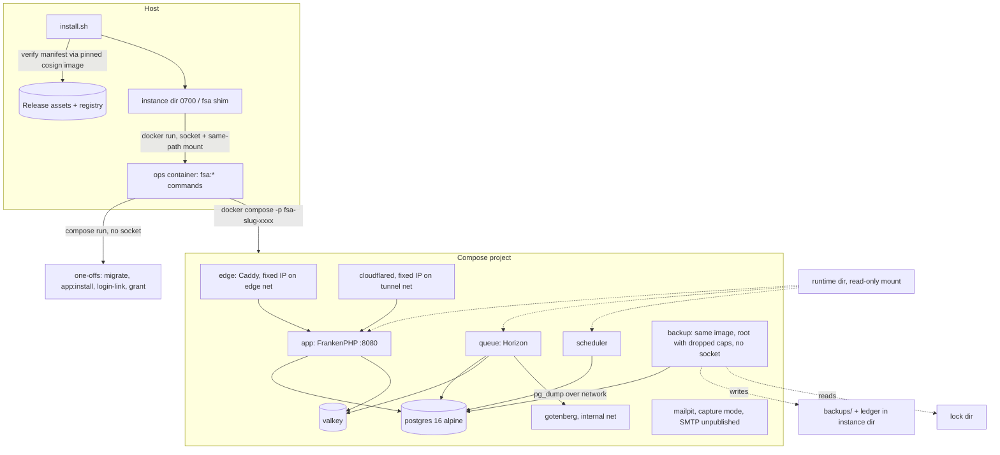
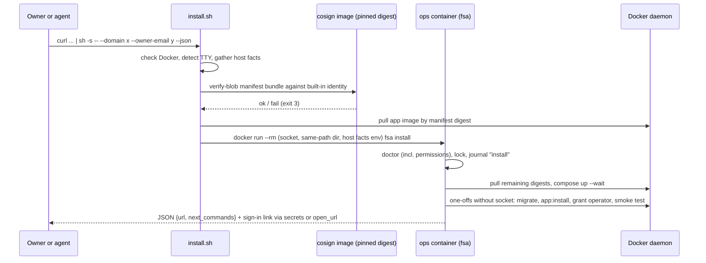
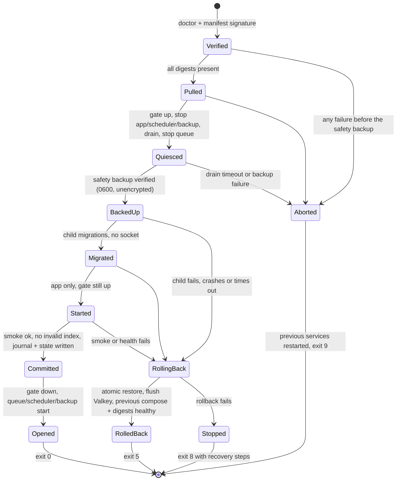

# feat: form-schema-app 2.0 — published images and the self-managing fsa command

## Summary

Ship form-schema-app 2.0.0 as signed multi-arch images plus an `fsa` command that installs and runs an instance's whole lifecycle with only Docker on the host. The management logic is Laravel console code in the app image, run in a throwaway ops container; a short `install.sh` bootstraps it. The plan covers the full origin scope in five phases that match milestones M9–M13. It adds the journal, lock, runtime-URL resolver, image changes, data-integrity rules and security controls that research and review showed are needed.

---

## Problem Frame

Installing 1.0 means cloning, building a 2.12 GB image on the server and putting a TLS proxy in front by hand; upgrades and backups run from that checkout (see origin: docs/agent/BUILD_PROMPT_V2.md §2.2). The primary users are the technical owner and coding agents acting for them. They need one non-interactive command per lifecycle step and machine-readable results.

Nothing like an installer exists in the repository today. There is no registry push, no release workflow, and no Docker or Postgres client in the image. The image cannot run as a CLI container either: it runs as `www-data`, and its entrypoint always runs `artisan optimize`.

---

## Requirements

The origin's R1–R53, flows F1–F7 and acceptance examples AE1–AE9 are this plan's requirements. Research, flow analysis and review added R54–R69. Three of them change origin text, noted inline.

**Operation safety**
- R54. Every state-changing operation (install, upgrade, rollback, restore, reset, adopt, `config set`, tunnel) runs under an instance lock and records its phases in an operation journal; any later `fsa` command detects an unfinished journal and offers resume or rollback.
- R55. A failed rollback ends with the instance stopped and exit code 8; the JSON carries the safety-backup path, both digest sets and the recovery steps.
- R57. Safety backups (before upgrade, restore, reset and rollback) are stored with mode 0600 and never pruned by retention.
  - Pre-upgrade safety backups replace each other only after a successful commit.
  - Restore, reset and pre-rollback safety backups stay until the operator deletes them.
  - Every safety backup is encrypted to the backup recipient once its operation completes, when encryption is on. `fsa status` and `/platform` show the age and size of retained safety backups.
- R62. During an upgrade's health gate, every mode answers external requests with 503 until the new version commits. Only the app runs during the gate. The smoke test reaches it on the internal network.
- R63. Every container, network and volume `fsa` creates carries the instance UUID label; a reinstall that finds orphans names them and offers `fsa uninstall --orphans <uuid>`.
- R69. An operation that fails before it changes anything exits 9 and leaves the previous services running.

**Trust and addresses**
- R56. The app resolves its public URL, trusted hosts, Sanctum stateful domains, HTTPS expectation and session-cookie security from instance runtime state at request and job time. An expired tunnel host gets 503 with `Retry-After`.
- R58. Install and upgrade verify the release manifest's signature against an identity built into `install.sh` and the image, before using any digest. Only harness builds accept a local test key; production has no skip switch.
- R61. Phone HTTPS is demo-grade: URL changes warn that unsynced phone data stays behind, the tunnel is the recommended path on Android, and tunnel, local CA, domain and proxy are mutually exclusive.
- R65. The tunnel host serves only the Field App, the API, sign-in and assets. `/platform`, Horizon and the API docs are never reachable through it, and `/admin` only with `--tunnel-admin`. Starting a tunnel on an instance that holds non-demo organizations needs `--yes`.

**Mail and adoption**
- R59. In capture mode, organizations with their own SMTP see a narrower banner, because invitations and password resets always use the instance mailer. This narrows origin R24 and AE1.
- R60. Adopt copies the 1.0 volumes into new labelled volumes and leaves 1.0 restartable; `fsa install --from-backup` also accepts 1.0-format backups. This replaces origin R46's in-place takeover.
- R66. In domain mode the catcher UI needs a `/platform` session with MFA in addition to its own credentials, and every opening is audited. This strengthens origin R23.

**Data integrity**
- R64. Restore and rollback re-apply security state that changed after the backup and clear stale credentials. Number sequences never go backwards.
  - Security state means device revocations and wipes, user and membership deactivations, erasures, password hashes and MFA settings changed after the backup, deleted API tokens, operator revocations and role removals.
  - Stale credentials means sessions, password-reset tokens and sign-in link nonces.
- R67. Every backup carries an HMAC over its checksums. Restore refuses unauthenticated archives, including the 1.0 format, unless `--accept-unauthenticated` is given.
- R68. Audit chains carry an epoch. Restore, rollback and reset start a new epoch and record the old and new heads of each chain, so heads shipped outside the database stay verifiable.

---

## Key Technical Decisions

**Ops container and command surface**
- KTD1. `fsa` is a set of `fsa:*` artisan commands behind a two-line wrapper in the image, with domain code in `app/Domain/Instance`. Docker is reached only through a `DockerGateway` interface implemented with Symfony Process; the repo's only process precedent is `app/Domain/Forms/Import/Qpdf/QpdfAcroFormReader.php`.
  - Tradeoff: artisan boots all providers inside an ops container that has no database or cache, and `fsa:*` also exists in app containers. A separate `bin/fsa` kernel would isolate the ops role but duplicate the console and test helpers.
  - Rules: provider boot never opens database or cache connections, and every `fsa:*` command except `fsa:version` refuses to run without the instance-directory marker. `DockerGateway` is bound only in the ops context.
- KTD2. The ops container runs as the host user's UID. On rootful Docker it adds the socket's group; on rootless Docker and Docker Desktop it runs as container root.
  - It sets `HOME` and `DOCKER_CONFIG` under `/tmp` and bypasses the image entrypoint.
  - The shim mounts the instance directory at the same absolute path and drops a nonce file the container must see. An unshared path on Docker Desktop or Colima therefore fails fast with exit 3.
  - The instance directory is 0700 and owned by the owner. The journal records the caller's host UID.
  - The shim and `install.sh` also mount the parent directory of every file-path flag at the same absolute path, read-only for inputs and read-write for outputs. `fsa` rejects a file path outside a mounted directory with exit 2.
  - The instance state records an in-container owner UID: the host UID on rootful Docker, 0 on rootless Docker and Docker Desktop. Backup chown, restore ownership and the doctor's ownership check use it.
- KTD3. Results use one envelope. A final JSON document goes to stdout (`schema_version`, `command`, `status`, `changed`, `data`, `secrets`, `warnings`, `errors`). With `--json`, NDJSON progress events go to stderr.
  - `--secrets-file` writes one-time secrets to a 0600 file instead of stdout. A sign-in link can also be opened through the shim's `open_url`, so an agent never sees it.
  - Exit codes are origin §7 plus 8 ("rollback failed, instance stopped") and 9 ("aborted before any change").
- KTD4. The instance lock is an atomically created lock directory with owner, operation and a heartbeat written by an independent ticker. `mkdir` atomicity avoids depending on `flock` over virtiofs.
  - The lock records the holder's container ID and start time. A lock is stale when that container is gone or has restarted since the lock was taken; heartbeat age alone is not enough.
  - The backup daemon takes the lock for each run, releases a lock it still holds from an earlier start, and never takes over anyone else's lock. Restore, reset and adopt stop the backup service first.
- KTD5. Long operations (upgrade, restore, adopt, reset) run their supervisor as a detached ops container of the installed image: `--rm`, `restart: "no"`, one per instance, labelled. The foreground `fsa` starts it and tails the journal.
  - Rejected alternatives: a foreground supervisor dies with the SSH session, and a host systemd unit breaks "only Docker".
  - After a daemon restart or host reboot the instance stays in its last journaled phase. Queue, scheduler and backup refuse to start while the runtime gate says an operation is in progress; the app always starts and answers external requests with 503 behind the gate. The next `fsa` call resolves the operation.

**Images and compose**
- KTD6. `fsa` generates one compose file per instance from the instance state; nobody edits it.
  - The project name is `fsa-<slug>-<4 hex>`, with the absolute directory path and an instance UUID in state. Labels use the `app.form-schema.*` prefix, because Compose reserves `com.docker.compose`.
  - The instance state is the single authority. The env files, the compose file and the runtime directory are rendered from it on every mutating command.
  - Every write in the instance directory goes to a temporary file and is then renamed. Files read by two versions (state, runtime, journal, backup manifest, shim contract) carry `schema_version` and ignore unknown keys.
  - The generated file never sets `RUN_MIGRATIONS`. Migrations run only in supervised one-off containers (install, upgrade, restore, adopt).
- KTD7. Each service gets its own mode-0600 env file holding only the keys it needs; Caddy, Mailpit, cloudflared and Gotenberg never receive APP_KEY or database passwords. The backup service gets credentials for a read-only dump role (`pg_read_all_data`), a key derived from APP_KEY for the HMAC, and the age public key. Values are visible through `docker inspect` only to socket holders, who are root-equivalent anyway. Compose file secrets ignore `uid`/`gid`, which makes host-owned 0600 secret files unreadable in the containers.
- KTD8. The app image carries static, checksum-verified binaries per `TARGETARCH`:
  - Docker CLI 29.9.x and Compose 5.6.x;
  - `postgresql-client-16` from PGDG;
  - age 1.3.x with `age-plugin-batchpass`;
  - cosign 3.1.x.

  Their size counts against E17, which the slimming in U1 has to pay for. cosign has a requirement (R58).
- KTD9. The version comes from an `APP_VERSION` build argument, exposed as `config('app.version')`, OCI labels, the `/platform` instance page and `fsa version`. Today `package.json` is the only version marker.

**Edge, modes and addresses**
- KTD10. The edge is the official Caddy image run as non-root with `NET_BIND_SERVICE`, configured by a generated Caddyfile per mode. It only proxies, so the app's own headers (preview CORS, CSP rewrites of the SPA shells) pass through unchanged.
  - It sits on a dedicated edge-to-app network with a fixed address, and the app trusts exactly that address.
  - Pebble is configured through `acme_ca` and `acme_ca_root`; the root is Pebble's HTTPS CA, not its issuing CA.
  - Local-CA certificates for an IP need an explicit `tls internal` site plus `default_sni`.
  - In local-CA mode, port 80 serves only the trust page and the root certificate; everything else gets 308 to HTTPS. Turning the local CA off deletes its key.
  - In domain mode, `/_mail/` sits behind Caddy `forward_auth` to an app endpoint that requires a `/platform` session with MFA (R66). The edge adds `X-Frame-Options: DENY`, `nosniff` and a CSP there.
- KTD11. A runtime directory in the instance directory is mounted read-only into app, queue, scheduler and every one-off. A directory, because a single-file bind mount pins the inode and would hide atomic renames. Its `runtime.json` carries the instance URL, extra hosts, the tunnel hostname and expiry, and the operation gate.
  - Validation: the tunnel host must match `^[a-z0-9-]+\.trycloudflare\.com$`; extra hosts are plain names or IPs without wildcards.
  - The directory is 0755 and the file 0644, set explicitly, because the app runs as `www-data`. Reads are cached in process, keyed on mtime, inode and size, not in Valkey.
  - A missing or invalid file falls back to the last good value, then to `APP_URL`, and raises a health warning; it never causes a 500. The gate fails closed: with the runtime path configured but the file unreadable or invalid, and no last good value in the process, the gate counts as raised.
  - The URL root is the request's origin when its host is one of the file's allowed hosts (local URL, instance URL, extra hosts, active tunnel host); for any other host and for jobs it is the instance URL from the file. `SecureTransport::expected()` and the cookie flag use the scheme resolved for the request host.
  - Rejected alternative: writing `APP_URL` to env and recreating app, queue and scheduler. That needs a restart and an `fsa` call at tunnel expiry, but avoids a second URL source and a per-request read.
- KTD12. cloudflared connects straight to the app on its own network with a fixed address, which is the only trusted proxy for the tunnel host. It runs with `restart: "no"`, because every restart creates a new hostname.
  - `fsa tunnel start` reads the hostname from cloudflared's metrics endpoint `/quicktunnel` and writes it with the expiry into the runtime directory.
  - After expiry the app answers the tunnel host with 503, which the Field App's sync backoff treats as retryable.
  - The next mutating `fsa` command removes the expired container. `fsa status` stays read-only and only reports it.
  - The path restrictions of R65 live in app middleware, because local mode has no edge. They apply to every request whose TCP peer is cloudflared's fixed address, whatever `Host` or `X-Forwarded-Host` says; for that peer the host comes only from the runtime tunnel hostname.

**Mail**
- KTD13. In capture mode the instance mailer is SMTP to the bundled Mailpit, set on app, queue and scheduler alike.
  - Mailpit runs with `MP_UI_AUTH` (generated), a bounded `MP_MAX_MESSAGES` and `MP_DATABASE` on a volume.
  - Its SMTP port is never published. Its UI is published only on loopback (local and proxy modes) or behind the edge's `forward_auth` (domain mode).
  - Switching to real SMTP keeps the catcher volume and UI read-only until the operator confirms its removal.
- KTD14. The banner is a Filament `BODY_START` render hook in the admin panel with inline styles, following `app/Filament/Platform/ImpersonationBanner.php`. One variant serves organizations on the instance mailer, a narrower one serves organizations with their own SMTP (R59). Only operators see the `fsa` command.

**Backups, restore, upgrade**
- KTD15. Scheduled backups run in a dedicated `backup` service of the app image. It runs as container root with all capabilities dropped except `DAC_READ_SEARCH`, `DAC_OVERRIDE`, `CHOWN` and `FOWNER`, and chowns its output to the in-container owner UID (KTD2). Root is needed because the Laravel private disk creates directories 0700 owned by `www-data`, which any other UID could not read.
  - Mounts: storage read-only, the instance state and marker read-only, the backups directory read-write, the lock directory, and a network route to Postgres.
  - The next run is computed from the ledger's last success, so a service restart loses nothing.
  - Rejected alternative: a scheduler-triggered job. It saves a process within E16 but would put the backups mount and file ownership into the app roles.
- KTD16. A backup is a directory holding:
  - `database.dump` in custom format;
  - `storage.tar.gz`;
  - portable `settings.json`;
  - `manifest.json`, `SHA256SUMS` and `audit-heads.json`;
  - an HMAC over `SHA256SUMS`, keyed from a key derived from APP_KEY (R67); `fsa backup` prints the APP_KEY fingerprint.

  The dump, the chain heads and the file-reference list come from one exported Postgres snapshot (`pg_export_snapshot`, then `pg_dump --snapshot`). An encrypted backup is one age file of that set. A reader for the 1.0 format (`scripts/backup.sh`) serves adopt and `--from-backup`. Extraction and decryption run in a one-off container with no socket and no network. An encrypted backup is decrypted there first; the HMAC is then checked with keys supplied outside the archive (the instance's APP keys, or a key file given with `--from-backup`), never with secrets carried inside it.
- KTD17. Backups are encrypted to an age X25519 recipient; only the public key lives in the instance.
  - The private key is passphrase-protected, written once to a path outside the instance directory chosen by the operator, and test-decrypted at setup.
  - Rotation adds a recipient and keeps older public keys listed, so old backups stay restorable with their own key.
  - Non-TTY decryption uses `age-plugin-batchpass` through a file descriptor.
- KTD18. Restore is data-only and atomic. Digests, compose content and ops parameters come from the release manifest and the instance state, never from the backup.
  - The database is restored into `<db>_restore_<ts>` and storage into a fresh volume, extracted as the app UID with numeric owners. Both are verified, then swapped in; the old ones are kept until verification after the swap passes.
  - Before the swap, the security state of R64 is read from the pre-restore database and re-applied, and number sequences are advanced past their pre-restore values.
  - Settings split into portable ones (URL, mail, backup policy) and host-bound ones (directory, UID:GID, ports, LAN address, proxy network, tunnel, CA), which are re-derived. For `--from-backup`, a `--domain` or `--url` flag overrides the backup's URL.
  - Archives that failed or skipped the HMAC are restored by a non-superuser role that owns only the scratch database, with `--no-owner --no-acl`. Archives listing extensions, event triggers or other objects outside an allow-list are rejected.
  - The manifest lists the fingerprints of every APP key, including previous keys, and restore installs all of them.
  - Restoring a backup from an older version runs the upgrade child, so migrations and version steps match. A backup below the manifest's oldest upgrade source exits 7. "Newer" is decided by comparing migration sets.
- KTD19. The upgrade order is:
  1. Doctor (including free space for the safety backup, a second database and a second storage volume), then verify the manifest.
  2. Pull all digests.
  3. Raise the gate, then stop app, scheduler and backup.
  4. Drain Horizon with a bounded wait, then stop the queue. On timeout, exit 9 unless `--drop-jobs`, in which case the dropped payloads are saved with the safety backup.
  5. Take the safety backup and verify its checksums and `pg_restore --list`.
  6. Run the target image's migrations in a child container without the socket, with `lock_timeout` and liveness read from `pg_stat_activity`. The child also renders the target's compose file and env files into a staging path, which the supervisor validates with `docker compose config`.
  7. Start the app from the staged files, still behind the gate, and recreate every other service whose digest or rendered configuration changed, except queue, scheduler and backup.
  8. Run the internal smoke test (through the edge in edge modes) and check that no index is invalid.
  9. Commit: journal "committed" and write the state.
  10. Lower the gate and start queue, scheduler and backup.

  A failure before step 5 lowers the gate, restarts the previous services and exits 9. A failure from step 5 until the commit triggers rollback: restore the safety backup through the atomic path of KTD18, without the R64 carry and sequence advance (writers were stopped since the safety backup); flush Valkey; re-render the previous version's compose file from the current state (previous digests, current volume names); start it, verify, lower the gate and exit 5. After the commit nothing restores automatically. The installed version supervises the whole sequence, and the shim reads the ops digest from the state, so a failed shim swap cannot lock the owner out.
- KTD20. Adopt runs in this order:
  1. Stop 1.0's app, queue and scheduler, and drain Horizon.
  2. Take a 1.0-format backup.
  3. Stop 1.0's Postgres cleanly.
  4. Copy each volume into a new labelled volume.
  5. Check counts and chain heads against the backup.
  6. Start 2.0.

  Postgres stays on the same libc family (`postgres:16-alpine`), because a binary copy into a glibc image would corrupt text indexes. The mode is inferred from an allow-listed subset of the 1.0 `.env`. `SSO_ALLOW_INSECURE_IDP=false`, `SSO_DNS_DRIVER=dns` and `APP_DEBUG=false` are forced, and `TRUSTED_PROXIES=*` is dropped. The way back is `fsa uninstall`, which takes a final backup of an adopted instance unless `--no-backup`, followed by `docker compose up` in the checkout.

**Access, audit and release**
- KTD21. The owner's first link reuses the Fortify password-reset broker (60 minutes, single use) and its SSO gate.
  - `fsa login-link` issues a single-use link for an existing admin. It lives at most 15 minutes and its token is stored hashed.
  - The token travels in the URL fragment and the landing page POSTs it, so it never reaches access logs.
  - The link ends in a normal `/admin` login with the MFA challenge, never a `/platform` session.
  - Install grants the owner the operator role through `GrantPlatformAdmin`.
  - Horizon switches from `PLATFORM_ADMIN_EMAILS` to the operator check plus a `/platform` session (ADR 0041). CLI-issued links are audited with actor "cli" and the host UID.
- KTD22. The release workflow:
  - builds with buildx (`--sbom=true --provenance=mode=max`) and pushes;
  - signs every image by digest, recursively, with cosign v3 keyless;
  - signs the manifest and `install.sh` with `sign-blob --bundle`;
  - runs Trivy on the app image and on every third-party digest in the manifest;
  - publishes the versioned assets, then pulls the published digests anonymously.

  The signer identity is pinned with an anchored `--certificate-identity-regexp` for `https://github.com/beyerenrico/form-schema-app/.github/workflows/release.yml@refs/tags/v<semver>` and the issuer `https://token.actions.githubusercontent.com`, with trigger `push`, protected tags and a release environment. That identity is built into `install.sh` and the image and is never read from the manifest. Pre-release tags publish only their own version.
- KTD23. Install journeys are a separate Pest test suite (`Install`), excluded from the default run and from coverage gates. It drives real Docker against a harness compose project: `registry:3`, a static release server, Pebble with challtestsrv, Traefik and a fake tunnel. Browser checks reuse Playwright with `E2E_BASE_URL` pointed at the instance.
- KTD24. `App\Domain\Instance\Runtime` (URL resolution, gate, path restrictions) has no ops dependencies, and it is the only instance code that web and queue processes load. A Pest arch test enforces the boundary. The runtime directory is the only channel from ops to app; the journal stays private to the ops side.
- KTD25. The socket-holding process never opens database or cache connections. Migrate, `app:install`, login-link, demo seeding, the operator grant and audit writes run as one-off `compose run` containers without the socket. The upgrade child gets no socket either. A test asserts that only the ops and supervisor containers mount the socket.
- KTD26. `audit:verify --heads` gains a chain epoch (amending ADR 0038). Restore, rollback and reset first stop writers and seal pending entries, then append the final heads to the host-side ledger. They bump the epoch in the restored or new database before anything else can write to it, seeding the epoch number from the ledger, and make the `instance.*` entry, with the old and new heads of each chain, the first entry of the new epoch. New audit events: `instance.config_changed`, `instance.restored`, `instance.rolled_back`, `instance.reset`, `tunnel_started`, `tunnel_stopped`, `upgraded`, `backup_key_rotated`, `catcher_opened`.

---

## High-Level Technical Design

### Topology



### Install handshake



### Upgrade journal



Every state is written to the journal before its step starts. `fsa upgrade --resume` and `fsa rollback` read it. After `Committed` nothing is restored automatically. A failure while opening is reported for the operator to act on.

### Mode and option combinations

| | edge | published ports | instance URL | trusted proxy | 503 gate | catcher UI | tunnel | local CA |
|---|---|---|---|---|---|---|---|---|
| local | no | loopback port | `http://localhost:<port>` | none | app-level | loopback port | allowed | allowed |
| local + local CA | yes | 80/443 on the LAN address | `https://<LAN address>` | edge IP | app-level | loopback port | no (R61) | — |
| local + tunnel | no | loopback port | tunnel host while active, local otherwise | cloudflared IP | app-level | loopback port | — | no (R61) |
| domain | yes | 80, 443, 443/udp | `https://<domain>` | edge IP | app-level | `/_mail/` via edge `forward_auth` (R66) | no | no |
| proxy | no | loopback port or none (shared network) | `--url` | the proxy's IP | app-level | loopback port | no | no |

### Result envelope (directional)

```text
stdout (final, one document):
{ schema_version: 1, command: "install",
  status: "ok|failed|aborted|rolled_back|rollback_failed",
  changed: true, data: { url, version, mode, ... },
  secrets: [ { name: "sign_in_link", value, expires_at } ],   // or written to --secrets-file
  warnings: [ { code, message, hint } ], errors: [ { code, message, hint, retryable } ] }
stderr with --json: NDJSON events { ts, phase, level, message }
```

---

## Output Structure

```text
app/Domain/Instance/
  Runtime/          RuntimeState, RuntimeUrl, OperationGate, TunnelPathPolicy  (no ops dependencies)
  Console/          fsa:* commands (install, doctor, status, logs, config, login-link, demo, reset,
                    upgrade, rollback, backup, restore, tunnel, adopt, uninstall, version, backup-daemon)
  Docker/           DockerGateway, CliDockerGateway
  State/            InstanceState (versioned), InstanceDirectory, RuntimeWriter, EnvFiles
  Operations/       OperationJournal, InstanceLock, Supervisor
  Compose/          ComposeRenderer, CaddyfileRenderer, ResourceBudget
  Doctor/           checks (docker, arch, memory, disk, ports, dns, clock, registry, path-share, permissions)
  Backup/ Restore/ Upgrade/ Adopt/ Tunnel/ Release/ Output/
app/Http/Middleware/ResolveInstanceRuntime.php
distribution/
  install.sh
  shim.sh
  stack/compose.stack.yaml
.github/workflows/release.yml
tests/Unit/Instance/  tests/Feature/Instance/  tests/Arch/InstanceBoundaryTest.php
tests/Support/Instance/RecordingDockerGateway.php
tests/Install/        Harness/compose.harness.yaml, Journeys/J1…J12
tests/e2e/fsa-*.spec.ts
docs/guide/agent-guide.md
RELEASING.md
```

The per-unit **Files** lists are authoritative. Implementation may adjust this layout.

---

## Implementation Units

All units follow the project's test-first rule (AGENTS.md): unit and feature tests against the recording Docker fake first, install journeys where a unit touches real Docker.

### Phase 1 — Release foundation (M9, pre-release 2.0.0-alpha.1)

### U1. Image: ops role, slimming, version metadata

**Goal:** The app image can run as an app service, an ops container or the backup daemon, carries the ops binaries, and meets E17.

**Requirements:** R1, R5, R6, E17, KTD8, KTD9

**Dependencies:** none

**Files:**
- Modify: `docker/app/Dockerfile`, `.dockerignore`, `docker/app/entrypoint.sh`, `docker/app/Caddyfile`, `config/app.php`
- Create: `docker/app/fsa` (in-image wrapper)
- Test: `tests/Unit/Docker/ImageContractTest.php`, `tests/Install/Journeys/ImageContractJourneyTest.php`

**Approach:**
- Turn `.dockerignore` into an allow-list. Drop `tests/`, `docs/`, `scripts/`, `.github/`, package tests and the runtime `composer` binary.
- Keep `spec/form-definition/1.0`, which `packages/form-schema-php/src/Support/SpecPaths.php` reads at runtime.
- Set `XDG_CONFIG_HOME` and `XDG_DATA_HOME` to writable paths, which fixes the Caddy autosave and storage errors.
- The entrypoint skips `optimize` and migrations when started as `fsa` or as the backup daemon.
- Build args `APP_VERSION` and `APP_REVISION` feed the OCI labels and `config('app.version')`.
- Download binaries per `TARGETARCH` with pinned SHA-256s. PGDG uses the deb822 source without a hard-coded architecture.

**Patterns to follow:** existing multi-stage layout in `docker/app/Dockerfile`; LEARNINGS #63 (writable config dir).

**Test scenarios:**
- The image runs as a non-root user, and `config('app.version')` reports `APP_VERSION`.
- `docker`, `docker compose`, `pg_dump --version` (major 16), `age`, `age-plugin-batchpass` and `cosign` are present and executable on both architectures. J1 runs the arm64 check natively and the amd64 one under emulation.
- `tests/`, `docs/agent/` and `/usr/bin/composer` are absent from the image; `spec/form-definition/1.0/meta-schema.json` is present.
- Starting the app service logs no `permission denied` from Caddy.
- The uncompressed image size per architecture is at most 1.0 GB. A miss is recorded with an ADR, never silently accepted.

**Verification:** The image contract journey passes on both architectures, and the measured size is written to the M9 evidence.

### U2. Instance domain core

**Goal:** The shared base every `fsa` command uses: Docker gateway, instance state and directory, lock, journal, result envelope, exit codes.

**Requirements:** R49, R50, R54, R55, R63, R69, KTD1–KTD7, KTD24, KTD25

**Dependencies:** none (U1 needed only for journeys)

**Files:**
- Create:
  - `app/Domain/Instance/Docker/DockerGateway.php`, `app/Domain/Instance/Docker/CliDockerGateway.php`
  - `app/Domain/Instance/State/InstanceState.php`, `app/Domain/Instance/State/InstanceDirectory.php`, `app/Domain/Instance/State/EnvFiles.php`
  - `app/Domain/Instance/Operations/InstanceLock.php`, `app/Domain/Instance/Operations/OperationJournal.php`, `app/Domain/Instance/Operations/Supervisor.php`
  - `app/Domain/Instance/Output/CommandResult.php`, `app/Domain/Instance/Output/ExitCode.php`
  - `app/Domain/Instance/InstanceServiceProvider.php`
- Modify: `bootstrap/providers.php`, `scripts/coverage-thresholds.php` (add `app/Domain/Instance/` at 90)
- Test: `tests/Unit/Instance/InstanceStateTest.php`, `tests/Unit/Instance/InstanceLockTest.php`, `tests/Unit/Instance/OperationJournalTest.php`, `tests/Unit/Instance/CommandResultTest.php`, `tests/Arch/InstanceBoundaryTest.php`, `tests/Support/Instance/RecordingDockerGateway.php`

**Approach:**
- The state is a versioned JSON document. It carries slug, UUID, absolute path, owner UID:GID, mode, URL, digests, previous digests with the compose snapshot, and encryption recipients.
- Secrets live only in per-service env files.
- Every write is temp-file-plus-rename and refuses to follow symlinks out of the instance directory.
- The gateway exposes compose operations (up --wait, stop, rm, run one-off, logs, ps), image pull and inspect, and container, volume and network listing by label.
- `DockerGateway` is bound only when an `fsa:*` command runs inside a marked instance directory.

**Execution note:** Start with the lock and journal tests; every later unit depends on their semantics.

**Patterns to follow:** `tests/Support/Sso/FakeTxtRecordResolver.php` (scripted fake with a call log); `#[Bind]` on the interface as in `app/Domain/Submissions/Support/UploadScanner.php`.

**Test scenarios:**
- A second lock attempt while one is held fails and names the holder.
- A stale lock is taken over only when the gateway reports the holder's container gone or restarted since the lock was taken, and the takeover is journaled. A backup daemon restarted mid-run releases its own lock on start.
- The journal survives a process kill between phases; reading it reports the last started phase and the data needed to resume.
- The envelope always includes `schema_version` and `status`. Secrets appear only under `secrets` or in the `--secrets-file`, never in `data`, `warnings`, logs or the NDJSON stream.
- A command given a secret as a flag value exits 2 with a stdin/file hint (Covers AE9).
- Without a TTY and without `--yes`, a destructive command exits 6.
- A state file with an unknown higher `schema_version` makes commands exit 7 instead of rewriting it. Unknown keys from a newer minor version are preserved.
- The arch test fails if `App\Domain\Instance\Runtime` imports anything from the ops namespaces, or if web code imports `DockerGateway`.

**Verification:** Coverage for `app/Domain/Instance/` is at least 90 %. PHPStan level 8 and the arch test are clean.

### U3. Compose renderer, env files and resource budget

**Goal:** Generate the instance's compose project for local mode, with capture mail, labels, networks, limits and per-service secrets.

**Requirements:** R9, R22, R63, E16, KTD6, KTD7, KTD11, KTD13, KTD25

**Dependencies:** U2

**Files:**
- Create: `app/Domain/Instance/Compose/ComposeRenderer.php`, `app/Domain/Instance/Compose/ResourceBudget.php`, `app/Domain/Instance/State/RuntimeWriter.php`
- Modify: `config/horizon.php` (worker counts from env)
- Test: `tests/Unit/Instance/ComposeRendererTest.php`, `tests/Unit/Instance/ResourceBudgetTest.php`

**Approach:**
- Render services from state, with images by digest.
- Every resource gets the `app.form-schema.instance` label. Every service gets a memory limit from `ResourceBudget`, and the sum stays within E16 minus OS headroom.
- In capture mode, `MAIL_*` points app, queue and scheduler at Mailpit. Mailpit's SMTP port is never published.
- The runtime directory is mounted read-only into app, queue, scheduler and one-offs.
- Each service gets only its own env file.
- `restart: unless-stopped` everywhere except the tunnel, and no `RUN_MIGRATIONS`.
- Dedicated networks with fixed addresses serve the edge and the tunnel (U8, U14). The backup service is added in U16.
- Postgres gets `shm_size` and small-host settings. Gotenberg gets `CHROMIUM_MAX_CONCURRENCY` and a queue bound.
- Every renderer input is validated against a strict grammar when it is written to state: RFC 1123 hostname or IP, http(s) URL without userinfo, port range, slug pattern. This covers values from flags, backups and 1.0 `.env` files. YAML is emitted structurally and Caddyfile values are quoted; nothing is built by string concatenation.

**Patterns to follow:** current `compose.yaml` structure (healthchecks, internal `renderer` network).

**Test scenarios:**
- A local-mode render yields a project named `fsa-<slug>-<hex>` that matches Compose's name pattern, even when the directory name has dots or capitals.
- Every service, volume and network carries the instance UUID label. No label uses the `com.docker.compose` prefix.
- The sum of memory limits never exceeds the budget for E16. Raising the instance size scales Horizon processes and Gotenberg concurrency.
- In capture mode, app, queue and scheduler all point at Mailpit, and Mailpit publishes no SMTP port. With SMTP configured, no Mailpit service is rendered.
- Only app, queue, scheduler and the one-offs receive APP_KEY and full database credentials. The backup service receives only the read-only dump role, the derived HMAC key and the age public key. Gotenberg, Valkey, Mailpit, edge and tunnel receive none of these.
- No rendered service mounts the Docker socket.
- Inputs containing newlines, quotes or `${}` are rejected at state-write time, and a `--from-backup` with a hostile `settings.json` fails validation.
- No service sets `RUN_MIGRATIONS`, and the tunnel service has `restart: "no"`.

**Verification:** The rendered file passes `docker compose config` in the J1 journey.

### U4. install.sh, shim and host facts

**Goal:** A POSIX bootstrap that verifies the release, pulls by digest and hands over to `fsa install`, and a shim for later commands.

**Requirements:** R7, R8, R58, KTD2, KTD22 (verification side)

**Dependencies:** U1, U2, U7

**Files:**
- Create: `distribution/install.sh`, `distribution/shim.sh`, `app/Domain/Instance/Release/ManifestVerifier.php`
- Test: `tests/Install/Journeys/BootstrapJourneyTest.php`, `tests/Unit/Instance/ManifestVerifierTest.php`

**Approach:**
- The whole script sits in one function called on its last line, with `set -eu` and `curl --proto '=https' --tlsv1.2 -fsSL`.
- Prompts read from `/dev/tty` when one exists, and only then does the ops container get `-it`.
- The manifest bundle is verified by the official cosign image, pinned by digest inside `install.sh`, against the identity built into `install.sh`.
- `FSA_RELEASE_URL` and `FSA_REGISTRY` point at mirrors or the test harness. A local test key (`FSA_TRUST_KEY`) is honoured only by harness builds, set through a build argument; production builds exit 2 when it is set.
- Host facts pass as env: OS, TTY, LAN candidates, desktop session, UID:GID, TZ.
- The shim mounts the parent directory of each file-path flag (`--secrets-file`, `--passphrase-file`, `--password-file`, key files, backup files, the identity path) at the same absolute path.
- The shim writes the nonce file, mounts the directory at the same path, reads the ops digest from the state, and opens `open_url` from the JSON when present.

**Patterns to follow:** get.docker.com and rustup structure (function wrapping), as cited in Sources.

**Test scenarios:**
- A truncated download of `install.sh` executes nothing, because the function is never called.
- A manifest whose signature does not match the built-in identity fails with exit 3 before any image is pulled. A tampered manifest with a matching checksum file still fails.
- A production build with `FSA_TRUST_KEY` set exits 2.
- A `--secrets-file` in the home directory is written on the host. A file path outside any mounted directory exits 2.
- The production verify path accepts a checked-in real GitHub Actions keyless bundle offline against a pinned trusted root, and rejects a bundle from a different workflow path.
- Without a TTY, a missing required flag exits 6 instead of prompting.
- The shim, run from a directory Docker Desktop does not share, fails the nonce check with exit 3 and a file-sharing hint.
- `shellcheck` reports nothing for both scripts.

**Verification:** The bootstrap journey installs from the local harness with a harness build. A run with a wrong key fails.

### U5. Lifecycle commands for local mode

**Goal:** install (local), doctor, status, logs, version and uninstall, with resumable installs and idempotence.

**Requirements:** R9–R15, R44, R45, R54, R63, R69, F2 (local part), AE3, AE4, AE5

**Dependencies:** U2, U3, U4, U6, U7

**Files:**
- Create: `app/Domain/Instance/Console/InstallCommand.php`, `.../DoctorCommand.php`, `.../StatusCommand.php`, `.../LogsCommand.php`, `.../VersionCommand.php`, `.../UninstallCommand.php`, `app/Domain/Instance/Doctor/*` (checks)
- Test: `tests/Feature/Instance/InstallCommandTest.php`, `tests/Feature/Instance/DoctorCommandTest.php`, `tests/Feature/Instance/UninstallCommandTest.php`, `tests/Install/Journeys/J01LocalInstallTest.php`, `tests/Install/Journeys/J12IdempotenceTest.php`

**Approach:**
- Install journals its phases: doctor, secrets, state, pull, up, migrate, `app:install`, operator grant, smoke, done. The database phases run as one-offs without the socket.
- A re-run resumes from the last phase with the existing secrets, because Postgres keeps its first password.
  - Corrected flags are accepted only for phases not yet done.
  - On a finished instance, different flags exit 2 with "use config set".
- Doctor reuses the `HealthResult` shape.
  - Instance directory: exit 3 when the directory, state, compose file or shim is group- or world-writable, or not owned by the caller.
  - Domain mode: A and AAAA are checked separately, and rootless Docker is reported before ports 80/443.
- `status` is read-only.
- Uninstall removes only labelled resources.
  - `--keep-backups` keeps `backups/`, which a later install neither treats as foreign nor prunes.
  - `--orphans <uuid>` cleans up after a hand-deleted directory.

**Patterns to follow:** `app/Domain/Platform/Health/*` (checks, `HealthResult`, probes as a seam); console style of `app/Console/Commands/InstallCommand.php`.

**Test scenarios:**
- Covers AE3. Running install twice with the same flags leaves no `up` or `rm` in the gateway call log and returns `changed: false`.
- Covers AE4. With 8080 taken (the probe publishes a throwaway container), local mode picks the next free port and reports it. A re-run recognises its own port.
- Covers AE5. A domain resolving elsewhere makes doctor fail and install exit 3 before any pull beyond the app image.
- A group-writable shim makes doctor exit 3 with a permission hint.
- A forced failure in the smoke phase exits 4. A re-run with the same flags resumes at the smoke phase and still issues a fresh sign-in link.
- An existing project with the same name but another instance's label makes install exit 7 and name the resources.
- After uninstall in the journey, no container, volume or network carries the instance label.
- `fsa version` prints the version and exits 0 without a database or an instance directory.
- On rootless Docker the doctor's ownership check passes for files owned by container root (one unit test per runtime).

**Verification:** Journeys J1 and J12 pass. JSON transcripts are saved as M9 evidence.

### U6. Sign-in links, non-interactive app install, Horizon gate

**Goal:** The owner's one-time link, `fsa login-link`, non-interactive `app:install`, the operator grant and the operator gate on Horizon.

**Requirements:** R12, R26, R27, R28, R50, KTD21, KTD25, KTD26

**Dependencies:** U2

**Files:**
- Modify:
  - `app/Console/Commands/InstallCommand.php`: add `--password-file`, deprecate `--password`, add a JSON mode and a passwordless owner mode that issues the reset-broker link.
  - `app/Filament/Admin/Pages/Auth/ResetPassword.php`: landing states.
  - `app/Providers/HorizonServiceProvider.php`: operator check plus `/platform` session.
- Create: `app/Domain/Instance/Console/LoginLinkCommand.php`, `app/Domain/Identity/Actions/IssueLoginLink.php`, a login-link controller, landing view and route, `lang/{de,en}/login_link.php`
- Test: `tests/Feature/Identity/LoginLinkTest.php`, `tests/Feature/Console/InstallAndSeedTest.php` (extend), `tests/Feature/Platform/HorizonAccessTest.php`, `tests/e2e/fsa-sign-in.spec.ts`

**Approach:**
- New owners get a password-reset broker token. That reuses expiry, single use, the throttle and `PasswordAuthGate`.
- Existing admins get a hashed, single-use link that expires within 15 minutes and is rate-limited.
  - The token travels in the URL fragment; the landing page POSTs it.
  - The link hands off to the normal admin login with the MFA challenge.
  - A newer link invalidates older ones for the same user.
- `GrantPlatformAdmin` makes the owner an operator.
- Audit records issuance (actor "cli" with the host UID) and use (time and IP). `fsa status` lists unused links.

**Patterns to follow:** `app/Http/Controllers/InvitationController.php`; `app/Domain/Platform/Actions/GrantPlatformAdmin.php`; audit labels in `app/Domain/Audit/AuditLabels.php`.

**Test scenarios:**
- A valid owner link leads to setting a password and offers MFA. Using it twice shows the "used" state with the `fsa login-link` recovery command.
- An expired link, a rate-limited request and an invalid token each show their own DE/EN state.
- The token never appears in the request line: the GET carries no token, and only the POST consumes it.
- A link for an admin with MFA enrolled still requires the MFA code. The link never creates a `/platform` session.
- A link for a user whose domain enforces SSO is refused through the existing gate.
- Horizon refuses an email listed in `PLATFORM_ADMIN_EMAILS` without an operator `/platform` session, and opens for an operator with one.
- `app:install --password-file` works and `--password` prints a deprecation warning. JSON output carries no password.
- Issuing a link writes an audit entry with actor "cli" and the host UID.

**Verification:** Feature tests and the sign-in E2E spec pass.

### U7. Release pipeline, manifest and harness

**Goal:** Tag-triggered, signed multi-arch releases, the release manifest, and a local harness that mirrors them without accounts.

**Requirements:** R1–R4, R8, R52 (first version of `RELEASING.md`), E14, E18, KTD22, KTD23

**Dependencies:** U1

**Files:**
- Create: `.github/workflows/release.yml`, `app/Domain/Instance/Console/ReleaseManifestCommand.php`, `distribution/manifest.schema.json`, `tests/Install/Harness/compose.harness.yaml`, `tests/Install/Harness/buildkitd.toml`, `RELEASING.md`
- Modify: `.github/workflows/ci.yml` (shellcheck, hadolint, actionlint, Trivy, install-journeys job), `phpunit.xml` (Install suite, excluded by default)
- Test: `tests/Unit/Instance/ReleaseManifestTest.php`, `tests/Install/Journeys/HarnessReleaseTest.php`

**Approach:**
- The manifest lists the version, image digests with sizes, asset checksums, the notes URL and the oldest version it upgrades from. It holds no trusted signer identity.
- The harness builds with a buildx builder on `network=host`, pushes to `registry:3`, serves `dist/` statically and signs with a local key pair.
- Pre-release tags never move `X.Y`, `X` or `latest`.
- The workflow:
  - runs on protected `v*` tags in a release environment;
  - signs `install.sh` and the manifest;
  - scans every manifest digest with Trivy;
  - ends with an anonymous pull of every published digest.

**Patterns to follow:** existing CI job chain and caching in `.github/workflows/ci.yml`; LEARNINGS #72 (run composer audit in the CI image).

**Test scenarios:**
- The manifest validates against its schema and lists every service image by digest. A missing third-party digest fails manifest generation.
- The harness release installs end-to-end (with U5) on both architectures.
- actionlint, hadolint and shellcheck pass. Trivy finds no fixable critical or high vulnerability in the app image or any third-party digest.
- A pre-release build in the harness produces only its own tag.

**Verification:** The `2.0.0-alpha.1` release is built locally and installed through J1.

### Phase 2 — Modes (M10, pre-release 2.0.0-alpha.2)

### U8. Edge service and domain mode

**Goal:** Automatic HTTPS for a domain through a generated Caddy edge, tested against Pebble.

**Requirements:** R16, R66, F1, J2, KTD10

**Dependencies:** U3, U5

**Files:**
- Create: `app/Domain/Instance/Compose/CaddyfileRenderer.php`, `app/Http/Controllers/Instance/CatcherAuthController.php` (target of `forward_auth`)
- Modify: `app/Domain/Instance/Compose/ComposeRenderer.php`, `tests/Install/Harness/compose.harness.yaml` (Pebble, challtestsrv)
- Test: `tests/Unit/Instance/CaddyfileRendererTest.php`, `tests/Feature/Instance/CatcherAuthTest.php`, `tests/Install/Journeys/J02DomainModeTest.php`

**Approach:**
- The edge publishes 80, 443 and 443/udp, proxies to `app:8080` from its fixed address, and is the only trusted proxy.
- The ACME directory and CA root are configurable; `--acme-staging` selects the staging CA.
- The certificate volume survives `config set` changes.
- `/_mail/` goes through `forward_auth` to the catcher auth endpoint, which requires a `/platform` session with MFA and audits `catcher_opened`. The edge adds the hardening headers there.

**Test scenarios:**
- J2 covers:
  - HTTPS with a chain issued by Pebble's current root;
  - HTTP redirecting to HTTPS;
  - the 1.0 security headers present;
  - only 80/443 published.
- The preview CORS header and the CSP on the Field App shell arrive through the edge unchanged.
- `/_mail/` without a `/platform` session gets 401. With an operator session and MFA it opens and writes `catcher_opened`. It carries `X-Frame-Options: DENY`.
- A request with a forged `X-Forwarded-For` from a container on another network is not trusted.
- An ACME failure after DNS checks passed exits 4. The certificate storage persists for the retry.

**Verification:** J2 passes on amd64 CI and the local arm64 run.

### U9. Proxy mode and the stack file

**Goal:** Run behind Traefik, caddy-docker-proxy or a plain port, and ship a stack file for Portainer and Coolify.

**Requirements:** R17, R18, J3

**Dependencies:** U3, U5, U7

**Files:**
- Create: `distribution/stack/compose.stack.yaml`
- Modify: `app/Domain/Instance/Compose/ComposeRenderer.php`
- Test: `tests/Unit/Instance/ComposeRendererProxyTest.php`, `tests/Install/Journeys/J03ProxyModeTest.php`, `tests/Unit/Instance/StackFileTest.php`

**Approach:**
- Proxy mode joins a named external network with Traefik or caddy-docker-proxy labels, or publishes a loopback port.
- Only the proxy's exact address is trusted; neighbouring containers on the shared network are not. Trusted hosts come from `--url`.
- The stack file uses env-only configuration and is generated from the same renderer, so the two cannot drift. Its limits are documented in its header.

**Test scenarios:**
- Behind Traefik on a shared network, the app answers on the configured host and honours the forwarded scheme.
- A forged `X-Forwarded-For` from a neighbour container on the same shared network is not trusted.
- The stack file starts with plain `docker compose` and only environment variables, and its smoke check passes.
- The stack file and the proxy-mode render list the same services and images (drift test).

**Verification:** J3 passes.

### U10. Runtime state in the app

**Goal:** The app reads its public address, gate and tunnel policy from the runtime directory, so URL changes, tunnels and upgrades need no rebuild.

**Requirements:** R21, R56, R62 (app side), R65 (app side), KTD11, KTD24

**Dependencies:** U3

**Files:**
- Create: `app/Domain/Instance/Runtime/RuntimeState.php`, `app/Domain/Instance/Runtime/RuntimeUrl.php`, `app/Domain/Instance/Runtime/OperationGate.php`, `app/Domain/Instance/Runtime/TunnelPathPolicy.php`, `app/Http/Middleware/ResolveInstanceRuntime.php`, a `JobProcessing` listener in the instance runtime provider
- Modify: `bootstrap/app.php`, `app/Http/Middleware/Security/TrustedHosts.php`, `app/Http/Middleware/Security/SecureTransport.php`
- Test: `tests/Feature/Instance/RuntimeUrlTest.php`, `tests/Feature/Instance/RuntimeUrlJobTest.php`, `tests/Feature/Instance/OperationGateTest.php`, `tests/Feature/Instance/TunnelPathPolicyTest.php`

**Approach:**
- Read `runtime.json` from the mounted directory, whose path comes from env and is absent in checkout installs.
  - Validate it strictly and cache it in process, keyed on mtime.
  - Fall back to the last good value, then to `APP_URL`, with a health warning.
- `TrustedHosts::patterns()` adds the runtime hosts and keeps an expired tunnel host listed; `ResolveInstanceRuntime`, registered as global middleware, answers it with 503 and `Retry-After`. `SecureTransport::expected()` and the cookie flag use the scheme resolved for the request host.
- Per request:
  - The URL root is the request's origin for allow-listed hosts, otherwise the instance URL.
  - With the gate up, external requests get 503 and only the internal smoke token passes.
  - On the tunnel host, paths outside R65 get 404.
- In HTTPS modes the session cookie becomes `__Host-`.
- A `JobProcessing` listener resolves the runtime state before every job, including queued notifications, so mails and signed links use the current instance URL.

**Patterns to follow:** `UseDefaultTenantOutsideTenantRoutes` (persistent, request-scoped state setup) and `TrustedHosts`.

**Test scenarios:**
- Without the runtime directory the app behaves exactly as today (`APP_URL`).
- After the file changes the instance URL, a new request on that host and a newly started job (including a queued notification) both generate links with the new host, without a restart. During an active tunnel, a request on localhost generates localhost links.
- A corrupt or missing file keeps the last good URL, never returns 500, and raises the health warning.
- A freshly started app that cannot read the configured runtime file treats the gate as raised. An app running as UID 33 reads a file written by another owner UID (journey assertion).
- A runtime file whose tunnel host does not match the trycloudflare pattern, or lists a wildcard host, is rejected.
- A request to an expired tunnel host gets 503 with `Retry-After`. The local URL still works, and an unknown host gets 400 as before.
- With the gate up, an external request gets 503 and a request carrying the smoke token gets 200.
- On the tunnel host, `/platform`, `/horizon` and `/docs/api` get 404, and `/admin` gets 404 unless `--tunnel-admin` is set. `/app` and `/api` work.
- A request from cloudflared's address with `X-Forwarded-Host: localhost` to `/platform` gets 404.
- Session cookies are `Secure` (and `__Host-`) exactly when the resolved scheme is HTTPS. A loopback HTTP request in the same session gets no HSTS.

**Verification:** Feature tests pass, and the existing security-header and trusted-host tests stay green.

### U11. `fsa config` with apply, verify and revert

**Goal:** Change settings after install without hand-editing files, reverting on failure.

**Requirements:** R31, R32, R54, KTD6, KTD26

**Dependencies:** U5, U8, U9, U10

**Files:**
- Create: `app/Domain/Instance/Console/ConfigCommand.php`, `app/Domain/Instance/Config/*` (one applier per setting)
- Test: `tests/Feature/Instance/ConfigCommandTest.php`, `tests/Install/Journeys/ConfigDomainSwitchTest.php`

**Approach:**
- Each applier validates the change, renders new state, env files and runtime, applies it, and verifies it (health, certificate, test mail).
  - On failure it reverts to the previous state and reports `reverted: true`.
  - On success it audits `instance.config_changed` through a one-off.
- `config set domain` requires `--yes`. It lists the organizations with SSO, whose SAML entity IDs follow the URL, and the signed links that become invalid.
- Changing the operator email grants the new operator, creating the user and a sign-in link if needed. Revoking the old one takes a separate flag.

**Test scenarios:**
- local→domain with a reachable DNS name switches mode and URL, restarting only the affected services. A failed ACME order reverts to local mode with `reverted: true`.
- `config set domain` with SSO organizations present and no `--yes` exits 6 and lists them.
- `config show` prints every setting with secrets redacted and names what each opt-in feature contacts.
- Setting the same value twice reports `changed: false`.

**Verification:** Feature tests and the domain-switch journey pass.

### Phase 3 — Mail, data and phones (M11, pre-release 2.0.0-beta.1)

### U12. Capture-mode experience

**Goal:** Protected catcher UI, the two banner variants, switching to real SMTP and back, and capture-aware health checks.

**Requirements:** R22–R25, R59, R66, AE1, J4, KTD13, KTD14

**Dependencies:** U3, U8, U11

**Files:**
- Create: `app/Filament/Admin/CaptureModeBanner.php`, `resources/views/filament/admin/capture-mode-banner.blade.php`, `app/Domain/Instance/Config/MailApplier.php`, `lang/{de,en}/capture.php`
- Modify: `app/Providers/Filament/AdminPanelProvider.php`, `app/Domain/Platform/Health/Checks/MailCheck.php`
- Test: `tests/Feature/Instance/CaptureBannerTest.php`, `tests/Feature/Instance/MailApplierTest.php`, `tests/Install/Journeys/J04CaptureModeTest.php`

**Approach:**
- The banner reads capture mode from the instance mailer configuration and `MailSetting::usesOwnSmtp()`.
  - Organizations on the instance mailer get the full banner.
  - Own-SMTP organizations get "invitations and password resets are captured".
  - Only operators see the command.
- `MailCheck` reports capture mode as a warning, not "ok, reachable".
- Switching to SMTP:
  - sends a test mail first;
  - keeps the catcher read-only until `--remove-catcher` confirms;
  - reports how many invitations and resets were captured.

**Patterns to follow:** `app/Filament/Platform/ImpersonationBanner.php` (render hook, inline styles, contrast).

**Test scenarios:**
- Covers AE1, as amended by R59. In capture mode, an instance-mailer organization's admin sees the full banner and an own-SMTP organization's admin sees the narrower one. After switching to SMTP neither sees a banner.
- An org admin sees "ask your instance owner" and a Mail settings link. A platform operator also sees the `fsa config set mail` command.
- An SMTP password passed as a flag exits 2. From stdin it is accepted and never appears in JSON or logs.
- A failing test mail leaves capture mode active with `reverted: true`.
- J4 covers an invitation landing in the catcher and the switch to Mailpit standing in as real SMTP. The catcher container is removed only after confirmation.

**Verification:** J4 and the feature tests pass. The banner passes the axe checks.

### U13. Demo data and password rotation

**Goal:** Demo data on request with reachability-based passwords, `fsa demo` and password rotation.

**Requirements:** R29, R30, AE2, J5 (demo part), KTD25

**Dependencies:** U5, U6

**Files:**
- Create: `app/Domain/Instance/Console/DemoCommand.php`, `app/Domain/Instance/Demo/DemoPasswords.php`
- Modify: `database/seeders/DemoSeeder.php` (password source injectable)
- Test: `tests/Feature/Instance/DemoPasswordsTest.php`, `tests/Install/Journeys/J05DemoTest.php`

**Approach:**
- `--demo` runs `DemoSeeder` in a one-off, because `DatabaseSeeder` skips it in production.
- Passwords are random whenever the instance is reachable beyond loopback, and listed once under `secrets`.
- `fsa demo --rotate-passwords` rotates them and revokes sessions and tokens. Starting a tunnel or the local CA rotates first.

**Test scenarios:**
- Covers AE2. A loopback-only demo signs in with `password`. In domain mode `password` is refused, and each user has a printed random password.
- Starting a tunnel on a local demo rotates all demo passwords before the tunnel opens. `tunnel start` refuses while any user still has `password`.
- `fsa demo` returns `open_url` when the host reports a desktop session, and omits it otherwise.

**Verification:** The demo part of J5 passes.

### U14. Phone HTTPS: local CA and tunnel

**Goal:** Trusted HTTPS for phones on a local install, as demo-grade options.

**Requirements:** R19, R20, R61, R65, F3, AE6, J6, KTD10, KTD12

**Dependencies:** U8, U10, U13

**Files:**
- Create: `app/Domain/Instance/Console/TunnelCommand.php`, `app/Domain/Instance/Tunnel/*`, `app/Http/Controllers/PhoneTrustController.php`, `resources/views/phone-trust.blade.php`, `lang/{de,en}/phone_trust.php`
- Modify: `app/Domain/Instance/Compose/CaddyfileRenderer.php`, `app/Domain/Instance/Compose/ComposeRenderer.php`
- Test: `tests/Feature/Instance/PhoneTrustPageTest.php`, `tests/Unit/Instance/TunnelStateTest.php`, `tests/Install/Journeys/J06PhoneHttpsTest.php`, `tests/e2e/fsa-phone-trust.spec.ts`

**Approach:**
- **Local CA:** the edge binds 80/443 on the chosen LAN address (`--lan-address`, defaulting to the shim's best candidate), with `default_sni` set to that address.
  - Port 80 serves only the trust page and the root certificate. The page shows the root's SHA-256 fingerprint, which `fsa` also prints, with steps to compare.
  - It lists the iOS and Android steps, recommends the tunnel on Android, and warns about unsynced data on URL changes.
  - Status and doctor detect a changed LAN address and offer to re-issue the certificate. Turning the local CA off deletes its key.
- **Tunnel:** start, stop and renew go through lock and journal.
  - cloudflared reaches the app directly from its fixed address.
  - The hostname comes from `/quicktunnel`, and renew extends the expiry while the container is alive.
  - Start needs `--yes` when non-demo organizations exist. The mutual exclusions of R61 exit 2.

**Test scenarios:**
- The local-CA certificate is issued for the LAN IP, and a client connecting by IP without SNI completes the handshake.
- J6, with the CA trusted in Playwright: the Field App on `https://<LAN IP>` registers its service worker.
- Port 80 in local-CA mode answers anything except the trust page and the root certificate with 308 to HTTPS.
- The trust page needs no sign-in, serves only the root certificate (never a key), shows the same fingerprint `fsa` printed, works at phone width and passes axe.
- Covers AE6. A tunnel past its expiry gets 503 on its hostname. `fsa status` reports it as expired without changing anything. The next mutating command removes the container and the URL is back on local.
- `tunnel start` with a non-demo organization and no `--yes` exits 6. Combining a tunnel with domain mode or the local CA exits 2.

**Verification:** J6 passes with the fake tunnel. A real quick tunnel is listed in the `RELEASING.md` checklist as not yet verified.

### U15. Resource budget measurement

**Goal:** Measure E16 on the shipped stack and tune the budget.

**Requirements:** E16, §2.3 "small", J10

**Dependencies:** U3, U12

**Files:**
- Create: `tests/Install/Journeys/J10ResourceBudgetTest.php`
- Modify: `app/Domain/Instance/Compose/ResourceBudget.php`, `scripts/perf/*` (instance base URL)
- Test: the journey itself

**Approach:** Install domain mode with capture mail inside a 2 CPU, 2 GB envelope with the scheduler running. Run the smoke E2E and the 1.0 perf scripts at their test volume. Record peaks and p95s in an ADR.

**Test scenarios:**
- No container is OOM-killed during install, the smoke E2E and a 10-page PDF render.
- Admin page and API p95s are recorded against the 1.0 targets. A miss produces an ADR with the numbers, not a silent pass.

**Verification:** Measured numbers are in the M11 evidence and the E16 ADR.

### Phase 4 — Lifecycle (M12, pre-release 2.0.0-rc.1)

### U16. Backups

**Goal:** Manual and scheduled backups without the socket, consistent and authenticated, with encryption, retention and status.

**Requirements:** R38–R40, R57, R67, R68 (heads), E13, KTD15–KTD17, KTD26

**Dependencies:** U2, U3, U5

**Files:**
- Create: `app/Domain/Instance/Console/BackupCommand.php`, `app/Domain/Instance/Console/BackupDaemonCommand.php`, `app/Domain/Instance/Backup/*` (writer, snapshot, retention, encryption, key lifecycle, ledger, HMAC)
- Modify:
  - `app/Domain/Instance/Compose/ComposeRenderer.php`: backup service as root with dropped capabilities, read-only storage, backups and lock directories, Postgres network.
  - `app/Domain/Audit/Console/VerifyAuditLogCommand.php`: chain epoch.
- Test: `tests/Feature/Instance/BackupWriterTest.php`, `tests/Unit/Instance/RetentionTest.php`, `tests/Unit/Instance/BackupEncryptionTest.php`, `tests/Feature/Audit/ChainEpochTest.php`, `tests/Install/Journeys/J08BackupRestoreTest.php` (shared with U17)

**Approach:**
- Export one Postgres snapshot, then run `pg_dump --snapshot`, the chain-head query and the file-reference query inside it. Then copy storage.
- Write the HMAC and the checksums last, into a temporary name, and rename at the end.
- A run counts as successful when checksums, `pg_restore --list` and the file-reference check pass; missing files are recorded in the manifest.
- Retention:
  - prunes only scheduled backups, and only after a successful run;
  - never prunes the newest verified backup, nor safety, manual or kept backups;
  - skips with a warning when free space after the projected size would drop below the threshold.
- The daemon takes the lock for each run. A run skipped because an operation holds the lock is recorded.
- Each run's result (status, time, size, skip reason, free space) goes into a `backup_runs` table, written through a role allowed to insert only there. `/platform` and the operator alerts read that table. Skipped runs older than 24 hours alert like failures, shown in `fsa status` and `/platform`.
- After an operation completes, its safety backup is encrypted to the recipient when encryption is on. After an upgrade commits, the superseded pre-upgrade safety backup is removed.
- Enabling encryption generates the key pair, refuses an identity path inside the instance directory, writes the passphrase-protected identity and decrypt-tests it.

**Patterns to follow:** `scripts/backup.sh` (order, `pg_restore --list` check, `.partial` rename) and `scripts/restore-drill.sh` (checks).

**Test scenarios:**
- A backup contains every artifact, its `SHA256SUMS` and HMAC verify, and the dump comes from the PGDG 16 client over the network.
- With concurrent writes during the backup, `audit-heads.json` matches the heads inside the dump exactly.
- A private storage directory with mode 0700 owned by `www-data` ends up complete in `storage.tar.gz`, and the output files belong to the owner UID.
- A scheduled run while an upgrade holds the lock is skipped and reported. A skip older than 24 hours raises the alert.
- Retention to 7 keeps safety, manual and the newest verified backup, and skips the run when space is short.
- An encrypted backup round-trips with the identity file and its passphrase from a file descriptor (batchpass) without a TTY. A wrong passphrase fails without writing anything.
- `--include-secrets` without encryption exits 2. An identity path inside the instance directory exits 2.
- `audit:verify --heads` reports the chain epoch.

**Verification:** Feature and unit tests pass; J8 covers the real round trip.

### U17. Restore, drill and `--from-backup`

**Goal:** Restore into an instance atomically, verify a backup without touching it, and create an instance on another host from a backup.

**Requirements:** R41, R42, R60 (1.0 format), R64, R67, R68, AE8, F6, J8, KTD16, KTD18, KTD26

**Dependencies:** U16

**Files:**
- Create: `app/Domain/Instance/Console/RestoreCommand.php`, `app/Domain/Instance/Restore/*` (safe extractor, HMAC check, settings splitter, 1.0-format reader, security-state carrier, sequence advancer, drill checks)
- Modify: `app/Domain/Instance/Console/InstallCommand.php` (`--from-backup`)
- Test: `tests/Unit/Instance/SafeExtractorTest.php`, `tests/Feature/Instance/RestoreCommandTest.php`, `tests/Feature/Instance/SecurityStateCarryTest.php`, `tests/Install/Journeys/J08BackupRestoreTest.php`

**Approach:**
- Extract and decrypt in a one-off with no socket and no network, into a fresh scratch directory. Reject absolute paths, `..`, symlinks and special files.
- Then check the HMAC, keyed only from keys supplied outside the archive. Archives that fail or skip it, including 1.0 archives, need `--accept-unauthenticated`.
- The APP key fingerprints must match: all keys listed in the manifest, or a supplied key file.
- Sequence:
  1. Check free space for the safety backup, a second database and a second storage volume plus headroom; otherwise exit 3.
  2. Quiesce like an upgrade: raise the gate, stop app, scheduler and backup, drain and stop the queue, and seal pending audit entries in a one-off.
  3. Append the ledger with the final heads and take a pre-restore safety backup.
  4. Restore into `<db>_restore_<ts>` and a fresh storage volume, as the app UID with numeric owners.
  5. Bump the audit epoch in the scratch database, seeded from the ledger, and write `instance.restored` as its first entry.
  6. Run the upgrade child when the backup is from an older version.
  7. Re-apply the R64 security state from the old database.
  8. Advance number sequences past their old values, and clear sessions, reset tokens and link nonces.
  9. Run a decrypt sample.
  10. Swap databases and volumes (re-rendering the compose file from state with the new volume name), and flush Valkey.
  11. Start, verify and lower the gate, keeping the old database and volume until verification passes.

  A failure before the swap exits 5 with the old instance running; a failed swap-back exits 8.
- The drill restores into a `restore_drill_*` database. It renders to a temporary disk with a null mailer and a sync queue.
- `--from-backup`:
  - takes portable settings from the backup and host-bound ones from flags and host facts;
  - treats a DNS name not yet pointing here as "certificate pending" (a warning, not exit 3);
  - starts with capture mail and paused webhooks until the operator confirms;
  - reads only allow-listed keys from a 1.0 `.env`.

**Test scenarios:**
- Covers AE8. A backup with a newer migration set exits 7 and changes nothing.
- An archive with `../` entries, an absolute path or a symlink is rejected before anything is written. A modified archive with a broken HMAC is refused (hostile-archive case of J8).
- Security state carries over the restore:
  - a device revoked after the backup stays revoked;
  - a user erased after the backup stays erased;
  - a password changed, an API token deleted or an operator revoked after the backup stays changed, deleted or revoked;
  - sessions and reset tokens from the backup are gone.
- A submission numbered after the backup does not get its number reused by the next submission after the restore.
- A crash between restore and swap leaves the live instance untouched. A failed verification after the swap returns to the old database and volume.
- A backup with an unknown APP key fingerprint is refused unless the matching key file is given. Data encrypted under a previous key decrypts after the restore.
- The drill leaves live storage, the live database and the mail log unchanged and reports counts, heads and a render.
- `--from-backup` on a second instance with a new `--domain` comes up with the new URL, the old data, capture mail and paused webhooks.
- A 1.0 `scripts/backup.sh` archive plus its `.env` restores with `--accept-unauthenticated`, and the forced SSO and debug values are applied.
- A dump containing an extension or event trigger is rejected before `pg_restore` runs.

**Verification:** J8 passes, including the encrypted and hostile-archive cases.

### U18. Upgrade supervisor and rollback

**Goal:** Health-gated upgrades with automatic rollback, resumable after interruption.

**Requirements:** R33–R37, R55, R57, R62, R64, R68, R69, AE7, F5, J7, KTD5, KTD19, KTD26

**Dependencies:** U4, U10, U16, U17

**Files:**
- Create: `app/Domain/Instance/Console/UpgradeCommand.php`, `app/Domain/Instance/Console/RollbackCommand.php`, `app/Domain/Instance/Upgrade/*` (supervisor, child step, drain, gate, commit)
- Test: `tests/Feature/Instance/UpgradeSupervisorTest.php`, `tests/Install/Journeys/J07UpgradeTest.php`

**Approach:**
- Follow the KTD19 order with the journal written before each step. The supervisor runs detached from the installed image.
- The child:
  - runs the target image's migrations and idempotent version steps without the socket;
  - runs with `lock_timeout` after requiring zero foreign database connections;
  - is judged alive while its backend is active in `pg_stat_activity`.
- On timeout the supervisor removes the child, terminates its backend and rolls back. Upgrade migrations never use `CONCURRENTLY` (ADR), because writers are stopped anyway.
- The gate is the app-level runtime flag, so it works in every mode. Only the app runs during it.
- The child also renders the target version's compose file and env files into a staging path; the supervisor validates them and starts step 7 from them.
- Automatic rollback:
  - restores through the atomic path, without the R64 carry and sequence advance, because writers were stopped since the safety backup;
  - bumps the audit epoch first in the restored database and writes `instance.rolled_back` as its first entry;
  - flushes Valkey, re-renders the previous version's compose file from the current state, starts it and lowers the gate.
- Manual `fsa rollback` quiesces like an upgrade, seals pending audit entries, appends the ledger, and carries the R64 state through a versioned export from the current image into the restored one.
- `fsa rollback` refuses when a restore or reset happened since the upgrade.
- `--to` an older version, or one below the manifest's oldest upgrade source, exits 7 and names the path. Mailpit and the tunnel are not recreated.

**Execution note:** Write the supervisor's state-transition tests against the recording fake before any real-Docker journey.

**Test scenarios:**
- Covers AE7, in local and proxy modes. With the target's health check forced to fail while clients write until the gate rises, the outcome is:
  - the previous digests run again;
  - the database equals the safety backup;
  - no write acknowledged before the gate is lost;
  - exit 5.
- A write sent during the gate gets 503 in proxy mode and is retried by the client after the rollback.
- A target image whose `fsa` entry point crashes is rolled back by the installed supervisor (exit 5).
- A migration that hangs past the liveness check is terminated. The rollback leaves no `indisvalid = false` index behind.
- A drain timeout without `--drop-jobs` exits 9 with the old version running. With `--drop-jobs`, the dropped payloads are saved and counted.
- A safety backup that fails verification exits 9 before any migration.
- A rollback whose restore fails stops the instance and exits 8 with the backup path and both digest sets.
- Killing the foreground `fsa` mid-upgrade leaves the detached supervisor running. A later `fsa status` shows the journal phase and offers `upgrade --resume`.
- A crash after "committed" but before the gate drops never restores the backup. The next `fsa` call finishes opening.
- `fsa rollback` after a restore exits 7. Upgrading across a major without `--major`, or `--to` an older version, exits 7.
- After a rollback the app mounts the restored storage volume, and the superseded volume is the one removed.
- A target release that adds an env key and a service starts from its own staged compose file, not from the installed version's renderer.
- An edge whose new image or Caddyfile fails is caught during the gate and rolled back, not after commit.
- With too little free space for the safety backup and a second database, the upgrade exits 3 before stopping anything.

**Verification:** J7 passes for `2.0.0-rc.1` → `2.0.0` built locally, including the failure variants.

### U19. Adopt a 1.0 install

**Goal:** Turn a clone-based 1.0 install into an instance by copying its data consistently.

**Requirements:** R46 as changed by R60, F7, J9, KTD20

**Dependencies:** U5, U16, U17

**Files:**
- Create: `app/Domain/Instance/Console/AdoptCommand.php`, `app/Domain/Instance/Adopt/*` (env allow-list mapper, volume copier, 1.0 detector)
- Modify: `app/Domain/Instance/Console/UninstallCommand.php` (final backup for adopted instances)
- Test: `tests/Feature/Instance/AdoptCommandTest.php`, `tests/Install/Journeys/J09AdoptTest.php`

**Approach:**
- Mount the checkout read-only and read the allow-listed keys of its `.env`. Refuse when it uses `COMPOSE_FILE` overrides or an external database.
- Follow the KTD20 order:
  1. Stop and drain 1.0.
  2. Take a 1.0-format backup.
  3. Stop 1.0's Postgres cleanly.
  4. Copy into new labelled volumes with a one-off.
  5. Verify counts and chain heads.
  6. Start 2.0 on `postgres:16-alpine`.
- Infer proxy/port mode from `APP_URL` and `APP_PORT`, keep APP_KEY, and apply the forced safe values.
- If anything fails before 2.0 starts, start 1.0 again. Doctor checks for twice the data's space first.

**Test scenarios:**
- J9: a 1.0.0 install built from tag `v1.0.0`, with writes acknowledged up to the stop, comes up as a 2.0 instance with the same submissions, users and audit heads. The 1.0 volumes are untouched.
- Unique text indexes (emails, slugs) pass `amcheck` after the copy.
- After adopt, `fsa uninstall` takes a final backup, reports the writes made since adopt, and `docker compose up -d` in the checkout brings 1.0 back with its pre-adopt data.
- A checkout with a `COMPOSE_FILE` override exits 7 with the reason. A `.env` with `SSO_ALLOW_INSECURE_IDP=true` is adopted with it forced off.
- A failed copy leaves 1.0 running and no 2.0 resources behind.

**Verification:** J9 passes.

### U23. Reset

**Goal:** Return an instance to a fresh state safely. Reset moves from M11 to M12 because it needs the safety backup and the ledger from U16.

**Requirements:** R43, R57, R68, J5 (reset part), KTD26

**Dependencies:** U13, U16

**Files:**
- Create: `app/Domain/Instance/Console/ResetCommand.php`
- Test: `tests/Feature/Instance/ResetCommandTest.php`, `tests/Install/Journeys/J05DemoTest.php` (reset part)

**Approach:**
- Lock and journal, then quiesce like an upgrade and seal pending audit entries before appending the ledger with the final chain heads.
- Take a safety backup unless `--no-backup`. Without a backup, still write an audit export with the heads unless only demo organizations exist.
- Recreate the database, because the append-only triggers forbid truncation. Empty storage, and flush Valkey and Mailpit.
- Bump the audit epoch in the new database, seeded from the ledger, and write `instance.reset` with the old heads as its first entry. Then re-run install's seed phase in one-offs, with `--demo` when asked.
- Settings and secrets stay.

**Test scenarios:**
- Reset without a TTY and without `--yes` exits 6.
- With `--yes`, reset leaves:
  - a fresh instance with empty storage and an empty catcher;
  - a safety backup that retention never prunes;
  - a ledger line written before the stop;
  - an `instance.reset` entry referencing the old chain heads.
- `reset --no-backup` on an instance with a non-demo organization still writes the audit export.
- `reset --demo` on an instance reachable beyond loopback produces random demo passwords.
- A reset interrupted after the database was dropped resumes from the journal on the next `fsa` command.

**Verification:** The reset part of J5 passes.

### Phase 5 — Operability and release (M13, release 2.0.0)

### U20. `/platform` instance page and update check

**Goal:** One page for version, mode, mail, backups, disk and updates, plus the opt-in update check.

**Requirements:** R47, R48, E15

**Dependencies:** U10, U12, U16

**Files:**
- Create: `app/Filament/Platform/Pages/Instance.php`, `resources/views/filament/platform/pages/instance.blade.php`, `app/Domain/Instance/Updates/UpdateCheck.php`, `lang/{de,en}/instance.php`
- Modify: `routes/console.php` (daily update check, only when enabled)
- Test: `tests/Feature/Platform/InstancePageTest.php`, `tests/Feature/Instance/UpdateCheckTest.php`

**Approach:**
- The page is read-only, reads backup state from the `backup_runs` table, and orders problems first:
  1. failed or stale backup;
  2. disk;
  3. update available;
  4. backups held only on this host.

  Then come version and mode, then mail with the catcher link. Each actionable status shows its `fsa` command.
- The update check reads only the release manifest URL. It makes no call when disabled and renders the notes link only when it is https.

**Patterns to follow:** `app/Filament/Platform/Pages/Health.php` (view, `canAccess`, `data-*` test hooks).

**Test scenarios:**
- A failed last backup shows as the first warning, with the backup command.
- With the update check off, no HTTP request is made (`Http::assertNothingSent`). With it on and a newer manifest, "update available" shows with the upgrade command.
- A manifest notes URL that is not https is not rendered as a link.
- Non-operators cannot open the page.

**Verification:** Feature tests pass, and the page passes axe in the E2E run.

### U21. Agent guide, docs and release checklist

**Goal:** The agent guide and its doc-test, rewritten operations guides, and the completed `RELEASING.md`.

**Requirements:** R51, R52, R53, F4, §2.3 "agent-ready", J11

**Dependencies:** U5–U19, U23

**Files:**
- Create: `docs/guide/agent-guide.md`, `tests/Install/Journeys/J11AgentGuideTest.php`
- Modify: `docs/guide/install.md`, `docs/guide/upgrade.md`, `docs/guide/backup-restore.md`, `docs/guide/configuration.md`, `docs/guide/troubleshooting.md`, `README.md`, `CHANGELOG.md`, `RELEASING.md`
- Test: `tests/Install/Journeys/J11AgentGuideTest.php`

**Approach:**
- Each recipe has exact commands, expected JSON fields and failure handling, and uses `--secrets-file` or `open_url` for sign-in links. The doc-test extracts the fenced command blocks marked as runnable and executes them against the local release.
- The checkout-based 1.0 instructions move to an archive section. The backup guide explains chain epochs.
- `RELEASING.md` ends with the post-publish checklist:
  - make the GHCR package public;
  - pull anonymously;
  - run `cosign verify` with the pinned identity;
  - install on a staging VPS;
  - start a real tunnel;
  - test on one iOS and one Android device.

**Test scenarios:**
- Every runnable block in the guide exits with the documented code and returns the documented JSON fields.
- Every command and environment variable named in the guides exists in code (ADR 0042 rule), checked by a test that scans the guides.

**Verification:** J11 passes. A fresh subagent with only the shipped guide completes each recipe (M13 gate evidence).

### U22. Dogfooding and the release gate

**Goal:** Run the existing E2E suite against an instance installed by `fsa`, and wire all journeys into CI.

**Requirements:** §11 dogfooding, §15.6/§15.10 of the origin

**Dependencies:** U1–U21, U23

**Files:**
- Modify: `tests/e2e/support/platform.ts` (artisan through the instance's project), `playwright.config.ts`, `.github/workflows/ci.yml` (install-journeys job on amd64)
- Test: the existing `tests/e2e/*.spec.ts` against the `fsa` instance

**Approach:**
- `platform.ts` resolves the compose project from an env variable instead of assuming the checkout's project.
- Journeys that need dev-only services stay on the dev stack: Keycloak SSO, insecure IdPs, config-backed DNS. The gate report lists which journeys ran where.
- Evidence screenshots from earlier milestones are restored after runs (LEARNINGS).

**Test scenarios:**
- Test expectation: none -- this unit re-runs existing journeys against a different target. Success is the existing suite passing on the `fsa` instance.

**Verification:** The E2E suite passes against the local-mode `--demo` instance, all twelve journeys pass, and `v2.0.0` is tagged locally.

---

## System-Wide Impact

- **One image, three roles:** app, ops and backup daemon.
  - The entrypoint and Dockerfile changes also affect the checkout-based dev stack and the CI e2e job, which builds the same Dockerfile. `compose.yaml` and `compose.dev.yaml` keep working because they set their own environment (U1).
  - Trivy now also scans the Docker CLI, Compose and cosign binaries, so a Go standard-library CVE can block an app release.
- **Every request and job:** the runtime middleware runs on every request and job. It must be cheap, cached in process, a no-op without the runtime directory, and fail closed to the last good value (U10).
- **Middleware order:** `trustHosts` runs before appended middleware, so runtime hosts, including an expired tunnel host, live in `TrustedHosts::patterns()`; the 503 comes from the global runtime middleware. `SecureTransport` and cookies follow the resolved scheme per host.
- **Auth surface:** login links touch password and MFA flows and SSO enforcement, and reuse the existing broker and gates. Horizon moves behind the operator session (U6).
- **Sessions live in Postgres** (`SESSION_DRIVER=database`), so flushing Valkey ends no session. Restore and rollback clear the sessions table explicitly (U17, U18).
- **Mail:** new instances default to capture mode, and invitations and password resets of own-SMTP organizations are captured too (U12). The catcher holds live account-recovery tokens, which is why it sits behind `/platform` MFA in domain mode (R66).
- **Audit:** new events, chain epochs and an amended `audit:verify --heads` (ADR 0038). Each event needs DE/EN labels, which `AuditLabelsTest` enforces.
- **Failure propagation:**
  - A dead supervisor leaves the journal and the gate in place, so services refuse to start until `fsa` resolves the operation.
  - A dead lock holder is taken over only after its container is gone.
  - A corrupt runtime file degrades to the last good URL.
  - A partially written state file cannot exist, because every write is temp-plus-rename.
- **CI:** new jobs (release, linters, install journeys) make the pipeline much longer. The install journeys run only on `main` and milestone branches.
- **Dev workflow:** the dev `.env` sets `COMPOSE_FILE=compose.yaml:compose.dev.yaml`. `fsa` always passes its own file and project, so dev overrides with insecure SSO settings never reach an instance (LEARNINGS).

---

## Risks & Dependencies

| Risk | Mitigation |
|---|---|
| The socket holder is root-equivalent and executes whatever the instance files say | Instance directory 0700 and owner-only, permission check in doctor; socket only in ops and supervisor containers, which never read app data (KTD25) |
| A hostile backup archive (path traversal, crafted dump run by the superuser role) | HMAC over checksums (R67), safe extraction in a one-off without socket or network, restore into a scratch database before the swap |
| Plaintext safety backups next to the APP_KEY env file | 0600, encrypted to the recipient once their operation completes, age and size shown in status and `/platform` (R57) |
| LAN attacker swaps the root on the plain-HTTP trust page | Fingerprint printed by `fsa` and shown on the page with compare steps; port 80 serves nothing else; local CA is demo-grade (R61) |
| The tunnel exposes operator surfaces to the internet | Path policy (R65), only cloudflared's IP trusted, `--yes` with real data, 4-hour expiry, demo password rotation |
| The catcher holds every tenant's reset and invitation links | `/platform` MFA via `forward_auth` in domain mode, hardening headers, loopback-only elsewhere, audit on opening (R66) |
| Sign-in links leak through transcripts and logs | `--secrets-file` and `open_url`, token in the fragment, hashed and 15 minutes for login links, unused links shown in status |
| Restore or rollback brings back revoked access or reissues document numbers | Security-state carry and sequence advance (R64), tested per item |
| A binary Postgres volume copy across libc families corrupts text indexes | Adopt keeps `postgres:16-alpine`; `amcheck` in J9 |
| E17 is hard to meet with the added binaries (about 100+ MB) | Allow-list `.dockerignore`, drop composer and dev files, measure in U1. A miss gets an ADR with numbers |
| Android may not trust a user-installed CA for PWA installs (unverified) | Recommend the tunnel on Android (R61); verify on a device in the `RELEASING.md` checklist |
| Sigstore (TUF CDN, Rekor) unreachable during install or upgrade | Clear exit 3 with a hint; no production skip; documented in `config show` and the guide |
| Docker Hub limits anonymous pulls (100 per 6 h per IP) for Caddy, Mailpit, cloudflared and others | Pin by digest; CI caches images; mirroring into GHCR is follow-up work |
| Docker Desktop with Enhanced Container Isolation rejects socket mounts | Doctor detects the refusal and names the setting; documented in troubleshooting |
| A 2 GB host is tight; community reports Gotenberg OOMs under several Chrome processes | Low Gotenberg concurrency, whole-stack limits, swap guidance, measured in U15 |
| Let's Encrypt duplicate-certificate limits on repeated install and uninstall | `--acme-staging` for trial installs; uninstall in domain mode warns about the limits before removing the certificate volume |
| A future Postgres major bump breaks `pg_dump` 16 | Release check fails when the client major is below the server major; Postgres major upgrades stay a separate, explicit operation |
| Quick tunnels have no SLA, 200 in-flight requests and no SSE | Demo-grade positioning (R61); the Field App syncs over plain requests |

---

## Documentation / Operational Notes

- Rewrite these guides, then archive the 1.0 checkout path: `docs/guide/install.md`, `upgrade.md`, `backup-restore.md` (chain epochs, HMAC, safety backups), `configuration.md` and `troubleshooting.md`. Add the agent guide.
- `RELEASING.md` covers:
  - the first publish (package visibility cannot be reverted once public);
  - signing, protected tags and the release environment;
  - the pinned identity;
  - the post-publish checklist.
- ADRs:
  - Amend 0020: the image is now also the ops container and the backup daemon, and Mailpit is no longer dev-only.
  - Amend 0038: chain epochs.
  - Amend 0041: Horizon behind the operator session.
  - New ADRs cover KTD1–KTD26, the E16 and E17 measurements, exit codes 8 and 9, and "no `CONCURRENTLY` in upgrade migrations".
- `LEARNINGS.md` should record the first findings on the socket, age, cloudflared, local CA and ACME, which are new ground for this repository.

---

## Scope Boundaries

**Outside this plan (origin non-goals):** Kubernetes and Helm, marketplace images, native Windows, managed hosting, offsite backup targets, air-gapped bundles, fleet management, zero-downtime upgrades, changes to the Form Schema Spec or `/api/v1`.

### Deferred to Follow-Up Work
- Mirroring third-party images into the project's GHCR namespace.
- An export of unsynced Field App data for URL changes.
- Routing invitations and password resets through an organization's own SMTP, which would remove the narrower banner of R59.
- Keeping the old domain as a redirecting alias after `config set domain`.
- A name-constrained local CA root, if Caddy's custom root support proves workable (see Open Questions).
- A Coolify template contribution and a web installer.

---

## Open Questions

### Deferred to Implementation
- Exact Horizon, FrankenPHP thread and Postgres memory values for E16. U15 measures them.
- The precise `docker info` signal for rootless detection, and the default socket path on OrbStack and Colima. Doctor discovers them.
- Where cosign keeps its TUF cache inside throwaway containers. A cache directory in the instance directory is the expected answer.
- Whether a name-constrained root supplied through Caddy's `pki ca root` is honoured by iOS and Android (unverified). If not, the local CA stays unconstrained and demo-grade.
- Whether Mailpit's UI works fully behind `forward_auth`, including its live-update connection (unverified). The fallback is loopback-only access in domain mode too.

---

## Sources & Research

- Origin requirements: `docs/agent/BUILD_PROMPT_V2.md`, including its review-applied fixes and the deferred items resolved by this plan's call-outs.
- Repository patterns:
  - Health checks: `app/Domain/Platform/Health/*`.
  - Platform page: `app/Filament/Platform/Pages/Health.php`.
  - Banner: `app/Filament/Platform/ImpersonationBanner.php`.
  - Mailer resolution: `app/Domain/Mail/Sending/OrganizationMailer.php` and `app/Domain/Mail/Models/MailSetting.php`.
  - Notifications always use the instance mailer: `app/Domain/Identity/Notifications/MemberInvitation.php`.
  - Invitation flow: `app/Http/Controllers/InvitationController.php`.
  - Audit chain and heads: `app/Domain/Audit/Console/VerifyAuditLogCommand.php`.
  - Process precedent: `app/Domain/Forms/Import/Qpdf/QpdfAcroFormReader.php`.
  - Fakes: `tests/Support/Sso/FakeTxtRecordResolver.php`.
  - Backup and drill semantics: `scripts/backup.sh`, `scripts/restore-drill.sh`.
  - Horizon counts: `config/horizon.php`.
  - Middleware order: `bootstrap/app.php`.
  - Security middleware: `app/Http/Middleware/Security/{TrustedHosts,SecureTransport,SecureCookies}.php`.
  - Horizon gate: `app/Providers/HorizonServiceProvider.php`.
  - Private-disk directory mode: Laravel `FilesystemManager`.
  - Device wipes: `app/Domain/Identity/Models/Device.php`.
  - File deletion: `app/Domain/Privacy/Retention/SubmissionFiles.php`.
- Learnings: `docs/agent/LEARNINGS.md` #1, #47, #53–#54, #58, #62–#63, #66, #72; the M3, M7 and M8 gate reports; commit `2b5685b` (tenant-less pages need a test without `actingInAdmin`).
- External, checked 2026-10-17:
  - Docker and build tooling: Compose 5.6 project names, labels and external volumes (docs.docker.com/compose); buildx attestations (docs.docker.com/build/metadata/attestations).
  - Signing and registries: cosign 3.1.3 keyless signing, `verify-blob` identity pinning and the official image (github.com/sigstore/cosign); GHCR visibility and anonymous pulls (docs.github.com/packages); Docker Hub pull limits (docs.docker.com/docker-hub/usage).
  - Caddy 2.11: `tls internal` IP certificates, `default_sni`, `acme_ca_root`, `forward_auth` (caddyserver.com/docs).
  - Mailpit UI auth and limits (mailpit.axllent.org/docs).
  - age 1.3 recipients and batchpass (github.com/FiloSottile/age).
  - Quick tunnels: hostname via metrics `/quicktunnel` and documented limits (developers.cloudflare.com, cloudflared source).
  - Pebble ports and roots (github.com/letsencrypt/pebble).
  - PostgreSQL: PGDG client packages, the `pg_dump` version rule, `pg_export_snapshot` (postgresql.org).
- Prior art:
  - Self-managing installers: Appwrite (installer image with socket), Coolify (same-path mount), Bitwarden (UID handling), Nextcloud AIO (master container, backup as upgrade gate), Mailcow and Sentry (upgrade hard stops).
  - Installer and CLI conventions: rustup and get.docker.com (function-wrapped installers); clig.dev and Terraform machine-readable UI (CLI contracts).
  - Security guidance: OWASP Docker cheat sheet (a read-only socket mount is not a control).

---

## Deferred / Open Questions

### From 2026-10-17 review

- **503 gate vs the app being stopped during upgrade** — R62 / KTD19 (P1, coherence, adversarial, confidence 100)

  R62 promises that external requests get 503 in every mode until commit, but KTD19 stops the app at step 3 and starts it again only at step 7. In local and proxy modes nothing answers during steps 3–6, so clients see a refused connection rather than a 503. With the gate up, the compose healthcheck (`curl /up` without the smoke token) would also be refused, and every upgrade would roll back. The choice is a separate gate responder for steps 3–6, or restating R62 so that it starts at step 7, together with exempting local `/up` from the gate.

- **U7's verification needs U5's install journey** — U4 / U5 / U7 (P1, coherence, confidence 75)

  U4's bootstrap journey needs the harness that U7 builds, and U5 now depends on U7. But U7's verification installs through J1, which lives in U5, so the declared order still cannot finish U7. One option is for U7 to be verified by building and serving the harness release, leaving the install to U5's J1.

- **Restore's upgrade child is owned by U18** — U17 / U18 (P2, coherence, feasibility, confidence 100)

  U17 runs the upgrade child for backups from older versions, but the child (migration runner, `lock_timeout`, liveness) is created in U18, which depends on U17. An implementer of U17 must either build the child early without guidance or skip restores of older versions. Moving the child into U17's files would fix the order.

- **How the socket holder runs its database checks** — KTD25 / U18 (P2, coherence, feasibility, confidence 100)

  KTD25 forbids the socket holder any database or cache connection. Yet the supervisor needs the drain check, `pg_stat_activity` liveness, backend termination, the invalid-index check, the Valkey flush and the unused-link listing for `fsa status`. Without a defined mechanism, each implementer will either break the boundary or invent one. One option is socket-less one-offs of the app image that print JSON for the supervisor, with safety and manual backups running as one-offs of the backup service.
