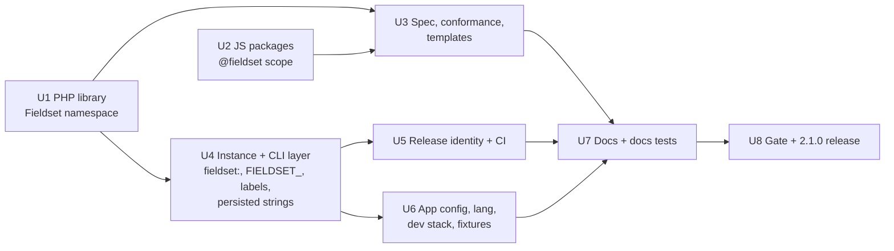

# refactor: Rename form-schema-app to Fieldset

## Summary

Rename the product, its CLI, its open form-definition format and its libraries from form-schema-app / Form Schema / `fsa` to **Fieldset** before the first public release, and release the result as 2.1.0. Nothing is published, so old names are removed without compatibility shims, except the 1.0 adoption names in R6. Historical records stay untouched.

---

## Problem Frame

The name `form-schema-app` is a working title (QUESTIONS 1). It is baked into the signer identity, the image name, every installer and every instance's Docker resources. A public package and signer identity cannot be changed after release (QUESTIONS 25). The human decided (QUESTIONS "Human decisions (2026-10-21)"):

- Product and repository: **Fieldset**, `beyerenrico/fieldset`.
- CLI: `fieldset`, replacing `fsa`.
- The format and its libraries are renamed too; the spec stays version 1.0 under a new `$id`.
- Release version 2.1.0; local tag `v2.0.0` stays unpublished.

---

## Requirements

- R1. No current-facing file, identifier, package name, Docker name/label, env var, artisan command or URL uses `form-schema-app`, `Form Schema`, `FormSchema`, `form_schema`, `fsa` or `FSA_`, except the exemptions in R6.
- R2. Signer identity, GHCR image, `install.sh`, `release.yml` and release manifest all name `beyerenrico/fieldset` and agree with each other.
- R3. The CLI is `fieldset` (shim, image path, installer link, artisan namespace `fieldset:`, JSON envelope `command`).
- R4. The format spec, conformance suite, templates and libraries use the Fieldset name and the new `$id`; spec version stays 1.0.
- R5. Internal persisted strings (backup format, HKDF info, Postgres role names, browser storage names, Docker labels, instance marker files) are renamed in lock-step, because they cannot change after release.
- R6. Old names are not rewritten in: docs/adr, docs/agent (existing JOURNAL, evidence, milestones and LEARNINGS entries; new entries are added as usual), docs/plans, docs/releases, the body of docs/guide/archive (only its redirect banners change), CHANGELOG entries before 2.1.0, and the 1.0 adoption defaults (`LegacyCheckout` project and database defaults, `tests/Support/Docker/V1Install.php`).
- R7. Every gate passes: full PHP suite, JS tests, conformance, phpstan, pint, rector, shellcheck, hadolint, actionlint, E2E, install journeys, Trivy.
- R8. Release 2.1.0 is cut locally per BUILD_PROMPT_V2 §15.10 (local tag only, never pushed).

---

## Key Technical Decisions

| Decision | Rationale |
|---|---|
| Rename internal persisted strings too (R5) | Free now, impossible after 2.1.0 without migrations. No published instance holds the old values. |
| Env var prefix `FIELDSET_`, Docker label prefix `app.fieldset.`, test prefix `fieldset-test-`, Compose project `fieldset-<slug>-<hex>` | One mechanical mapping per family keeps the change reviewable and greppable. |
| PHP namespace `Fieldset\`, package `fieldset/fieldset-php` in `packages/fieldset-php`; npm scope `@fieldset` with `fieldset-js`, `fieldset-react`, `field-app`, `builder-v2` | Mirrors the existing layout one-to-one. The npm packages are workspace-internal, so scope availability on npm is not a blocker (unverified whether `@fieldset` is free on npm). |
| Spec `$id`: `https://beyerenrico.github.io/fieldset/spec/form-definition/1.0/meta-schema.json` | Chosen by the human over a custom domain or a URN (2026-10-21). It becomes resolvable once the GitHub Pages docs site serves the spec. Moving the repo later would leave the `$id` stale; accepted. |
| Keep `LegacyCheckout::DEFAULT_PROJECT = 'form-schema-app'` and add `LegacyCheckout::DEFAULT_DATABASE = 'form_schema'` (used by `identifier()` instead of `InstanceSettings::DEFAULT_DATABASE`) | They describe the 1.0 template defaults that `adopt` must find (J09). The shared `InstanceSettings` default is renamed, so adoption needs its own constant. |
| 1.0 phone storage names and the SSO TXT record name are renamed without fallback | The human confirmed that no one but themselves runs 1.0 (2026-10-21). Their own 1.0 setup syncs phones and re-checks SSO domains before switching. |
| Docs-reference test keeps checking `docs/guide/archive/`; only the archive's redirect banners are updated to `fieldset` | The test deliberately covers the archive, and AGENTS.md forbids weakening a test. The archive names no renamed env var or artisan command (verified by review), so only the banners need edits. |
| `release.json` `upgrades_from` becomes `2.1.0-alpha.1`; `ReleaseHarness::TEST_VERSION`, the J07 version constants and the upgrade fixture move to the `2.1.0-*-test` series together | A manifest rejects an `upgrades_from` newer than its version, so harness versions must move with it. 2.0 instances would need an image-repository switch that no published release had. |
| One branch `rename-fieldset`, merged `--no-ff`, tag `rename-done`, then the 2.1.0 release | Matches the milestone convention in AGENTS.md. |
| New ADR records the rename and the exemptions | Decisions of this weight are recorded in `docs/adr/`. |

---

## High-Level Technical Design

Rename families and the units that own them. The CLI/instance layer (U4) is the largest and depends on the PHP library (U1) building first.

Name mapping (directional; the plan units own the details):

| Old | New |
|---|---|
| `form-schema-app` (product, repo, image, Compose name) | `fieldset` |
| `Form Schema` / `FormSchema\` / `form-schema-*` packages | `Fieldset` / `Fieldset\` / `fieldset-*` |
| `@form-schema-app/*` | `@fieldset/*` |
| `fsa`, `fsa:*`, `fsa_*` shell functions | `fieldset`, `fieldset:*`, `fieldset_*` |
| `FSA_*` | `FIELDSET_*` |
| `app.form-schema.*` | `app.fieldset.*` |
| `fsa-test-*` | `fieldset-test-*` |
| `form_schema*` databases | `fieldset*` |
| `fsa_backup`, `fsa_restore_*`, `fsa_upgrade_*` … | `fieldset_backup`, `fieldset_restore_*`, `fieldset_upgrade_*` … |

---

## Implementation Units

### U1. PHP library and namespace

**Goal:** The format library becomes `fieldset/fieldset-php` with namespace `Fieldset\`.

**Requirements:** R1, R4

**Dependencies:** none

**Files:**
- Move `packages/form-schema-php/` to `packages/fieldset-php/`; update its `composer.json`, README and docblocks
- Modify `composer.json` (name `fieldset/app`, require, path repository, the duplicate psr-4 entry), regenerate `composer.lock`
- Modify `phpunit.xml`, `phpstan-schema.neon`, `docker/app/Dockerfile` (package COPY)
- Modify every `use FormSchema\…` in `app/`, `tests/`, `database/factories/`, `scripts/perf/`

**Approach:** Directory move plus namespace rewrite in one commit so autoload never sees a half state. No class name is serialised anywhere (verified: no morph map, no queued job references it), so no data migration.

**Patterns to follow:** existing path-repository setup in `composer.json`.

**Test scenarios:**
- The package's own Pest suite passes under the new namespace.
- The app suite passes with no remaining `FormSchema\` reference.
- `composer validate` and a fresh `composer install` resolve `fieldset/fieldset-php` from the path repository.

**Verification:** No `FormSchema` or `form-schema-php` match outside R6 exemptions; phpstan and rector clean.

---

### U2. JS packages, Field App identifiers and preview protocol

**Goal:** npm workspaces use `@fieldset/*` and `packages/fieldset-{js,react}`; browser-side identifiers use the new prefix.

**Requirements:** R1, R4, R5

**Dependencies:** none

**Files:**
- Move `packages/form-schema-js/`, `packages/form-schema-react/` to `packages/fieldset-js/`, `packages/fieldset-react/`
- Modify root `package.json` (name, workspaces, scripts), each workspace `package.json`, regenerate `package-lock.json`
- Modify imports in `resources/field-app/` and `resources/builder-v2/`, including the `styles.css` imports
- Modify `packages/fieldset-js/src/spec-assets.ts` only if the spec path changes (it does not in this plan)
- Modify Field App storage names: `resources/field-app/src/lib/db/db.ts`, `lib/storage/local.ts`, lock/channel/sync names, `lib/pwa/sw-messages.ts`, `public/sw-sync.js`, PWA manifest name in `lib/pwa/pwa-options.ts`
- Modify the preview postMessage protocol together: `resources/builder-v2/src/preview.ts`, `resources/field-app/src/preview/protocol.ts`, `resources/views/filament/forms/preview.blade.php`
- Tests: existing Vitest suites in the moved packages and `resources/field-app`

**Approach:** The IndexedDB legacy-name hook is dropped rather than chained; the human confirmed no 1.0 users besides themselves. Service-worker tag and app message names change together, or background sync silently stops.

**Test scenarios:**
- JS unit tests and the Field App build pass.
- The Field App opens its IndexedDB under the new name and the outbox syncs (existing E2E offline journey).
- Builder preview: the iframe receives the renamed ready/preview messages and renders (existing preview E2E).
- Background sync tag registered by the app matches the one handled in `sw-sync.js` (assert in the existing SW message test, add one if absent).

**Verification:** `npm run -w resources/field-app build` succeeds; no `@form-schema-app` or `fsa-`/`fsa.` storage name remains.

---

### U3. Spec, conformance and templates

**Goal:** The format is "Fieldset Form Definition 1.0" with the new `$id` and template registry URN.

**Requirements:** R4

**Dependencies:** U1, U2

**Files:**
- Modify `spec/form-definition/1.0/{README.md,CHANGELOG.md,meta-schema.json}` (title, `$id`)
- Modify `spec/conformance/**` fixtures carrying the `$id`, `spec/conformance/meta-schema/uri-pattern.json` (URN)
- Modify `spec/templates/*.json` and `spec/templates/index.json` (registry `urn:fieldset:bundled-templates`)
- Modify `packages/fieldset-php/src/Validation/MetaSchemaValidator.php` (default id), `app/Domain/Forms/Templates/TemplateCatalog.php`, `app/Domain/Forms/.../BlankDefinition.php` (`$schema` to the new `$id`)
- Modify `tests/Fixtures/builder-v2/contract/*.json`, `tests/Feature/Forms/FieldTemplatesTest.php`

**Approach:** One commit per AGENTS.md rule (spec semantics and conformance together). The spec CHANGELOG notes a rename with no semantic change. Stored dev definitions keep the old URN; acceptable without back-compat.

**Test scenarios:**
- PHP and JS conformance runners pass on all fixtures with the new `$id`.
- A new blank definition carries `$schema` equal to the new `$id` and validates.
- Instantiating a bundled template records `source.registry = urn:fieldset:bundled-templates`.
- A definition whose `$schema` is the old localhost URI still validates (the property is pattern-only), confirming the rename carries no semantic change.

**Verification:** `npm run conformance` green; no `localhost/spec` or `form-schema` in `spec/`.

---

### U4. Instance and CLI layer

**Goal:** The `fieldset` CLI, its artisan namespace, env vars, Docker names and all persisted internal strings use the new names.

**Requirements:** R1, R3, R5

**Dependencies:** U1

**Files:**
- Rename `app/Domain/Instance/Console/FsaCommand.php`, `FsaContext.php` and all `#[Signature('fsa:…')]` to `fieldset:`; the envelope prefix strip
- Rename `docker/app/fsa` to `docker/app/fieldset`; modify `docker/app/entrypoint.sh`, `docker/app/Dockerfile` (shim path)
- Modify `distribution/shim.sh`, `distribution/install.sh` (functions, link name, default dirs `/opt/fieldset`, `~/fieldset`, tmpfs, labels)
- Modify `app/Domain/Instance/**`: `Docker/Labels.php`, `Compose/Services/EdgeService.php`, `State/InstanceState.php`, `State/InstanceDirectory.php`, `HostFacts.php`, `InstanceSettings.php`, `Compose/ServiceEnvironments.php`, `Backup/*` (format, HKDF info), `KeyFingerprint.php`, `LocalCaSite.php`, `Platform/Instance/BackupRole.php`, `DatabaseAdmin.php`, `UpgradeSessions.php`, `RestoreFinishCommand.php`, audit/security export formats, `RecordDigest`, `Tunnel/HarnessTunnel.php`, user-facing hints
- Modify every `FSA_*` env var in code, scripts, `playwright.config.ts`, workflows
- Tests: rename `tests/Support/Instance/FsaCommandFlags.php`, `tests/Unit/Instance/FsaCommandTest.php`, `tests/e2e/fsa-*.spec.ts` (and the regex in `playwright.config.ts`); update `tests/Support/Docker/*`, `RecordingDockerGateway.php`, `tests/Install/**`, `tests/Unit/Docker/ImageContractTest.php`, `tests/Unit/Instance/**`; `.gitignore`

**Approach:** Before renaming the test prefix, remove any leftover `fsa-test-` Docker resources so later cleanup filters do not orphan them. Do the persisted strings (backup format, HKDF info, CA name, role names) as one sub-step with a grep check that each old constant has zero remaining uses, since a single missed copy breaks backup verification silently. Postgres identifiers are capped at 63 bytes; `fieldset_` is 5 characters longer than `fsa_`, so recheck the role/database regex caps (`{1,40}`) and slug caps against the limit.

**Execution note:** Rename the test expectations first where a test pins a name, then the code, so each pinned name is seen failing.

**Test scenarios:**
- `ImageContractTest`: the shim's command list equals the registered `fieldset:*` commands; the image ships `/usr/local/bin/fieldset`.
- JSON envelope `command` is the bare name (`install`, not `fieldset:install`).
- Longest allowed slug still yields a Compose project, Postgres role and upgrade database name at or under 63 bytes (boundary test).
- Backup written and verified with the renamed format and HKDF info round-trips; a manifest with format `fsa-backup` is rejected with the existing "unknown format" error.
- Instance marker `.fieldset-instance` is created and recognised; a directory with only `.fsa-instance` is not treated as an instance.
- `adopt` still finds a 1.0 checkout with Compose project `form-schema-app` (J09, R6 exemption).
- `adopt` of a 1.0 checkout whose `.env` lacks `DB_DATABASE` and `DB_USERNAME` resolves both to `form_schema`.
- Install journeys create and clean up only `fieldset-test-` resources.

**Verification:** Install suite green; shellcheck and hadolint clean; no `fsa`/`FSA_`/`app.form-schema` outside R6.

---

### U5. Release identity and CI

**Goal:** Signer identity, image name, manifest and workflows all name `beyerenrico/fieldset`.

**Requirements:** R2

**Dependencies:** U4

**Files:**
- Modify `app/Domain/Instance/Release/SignerIdentity.php`, `distribution/install.sh` (identity regexp), `.github/workflows/release.yml` (image, identity regexp, comments)
- Modify `distribution/release.json` (image, notes URL, `upgrades_from: 2.1.0-alpha.1`), `distribution/manifest.schema.json` (`$id`)
- Modify `ReleaseHarness::TEST_VERSION`, the J07 version constants and the upgrade fixture versions (`tests/Support/Release/`, `tests/Install/Journeys/J07UpgradeTest.php`) to the `2.1.0-*-test` series
- Modify `.github/workflows/ci.yml` (image tags, postgres service DB names, env vars, cache key, shellcheck path)
- Tests: `tests/Unit/Release/**`, `tests/Unit/Distribution/InstallScriptTest.php`

**Approach:** Add or extend one consistency test asserting that `SignerIdentity`, the `install.sh` regexp and `release.yml` derive the same repository, so a later partial edit fails fast.

**Test scenarios:**
- Consistency: the three identity sources name `beyerenrico/fieldset` and the same workflow path.
- Manifest verification accepts a manifest signed with the test key for the new identity and rejects one signed for `beyerenrico/form-schema-app`.
- `release.json` validates against the renamed manifest schema.
- `release:manifest` succeeds for the harness test version with the committed `release.json`.
- actionlint passes.

**Verification:** Release unit tests green; no `beyerenrico/form-schema-app` outside R6.

---

### U6. App config, translations, dev stack and fixtures

**Goal:** App name, UI text, SSO DNS label, Keycloak demo and dev databases use the new name.

**Requirements:** R1

**Dependencies:** U4

**Files:**
- Modify `config/app.php`, `config/scramble.php`, `config/sso.php`, `.env.example`, `.env.production.example`
- Modify `app/Domain/Identity/Models/SsoDomain.php`, `VerifySsoDomain.php`, `PublicSuffixes.php` (TXT `_fieldset-verification`), `compose.dev.yaml`
- Modify `lang/{en,de}/{capture,instance,sso_admin}.php` (rephrase German compounds, not search-replace), `PdfTestCommand.php`, `PhoneTrustController.php`, `MigrationMutex.php`, `SentryHandler.php`, `StackFile.php`, `ConfigShow.php`, `ManifestVerifier.php`
- Rename `docker/keycloak/realm-form-schema.json` to `realm-fieldset.json`; modify `SsoDemoSeeder.php`, `IdentityProviderFactory.php`, `tests/e2e/support/keycloak.ts`, SSO tests
- Modify `compose.yaml` (project and image name, DB defaults), `docker/postgres/init/01-test-db.sql`, `phpunit.xml`
- Regenerate or rewrite `tests/Fixtures/restore/pg-restore-list.txt` with `DumpInspectorTest` and `BackupSetFixture`

**Approach:** Renaming the Compose project gives the dev stack new volumes, so Postgres and Keycloak start empty and run their init scripts. Record the reset steps in LEARNINGS and STATE. APP_NAME feeds Redis, cache, session and Horizon prefixes; dev sessions and queued jobs are dropped, which is acceptable.

**Test scenarios:**
- Filament brand and API title show "Fieldset".
- SSO domain verification looks up `_fieldset-verification.<domain>` and accepts `fieldset-verification=<token>`.
- Keycloak demo sign-in E2E passes against the renamed realm and client.
- German and English capture banner strings render the product name correctly (existing translation tests).
- Restore dump inspection passes on the regenerated fixture.

**Verification:** Full PHP suite and E2E green against a freshly created dev stack.

---

### U7. Current docs and docs tests

**Goal:** Current-facing docs describe Fieldset; the docs tests keep enforcing them and skip the archive.

**Requirements:** R1, R6

**Dependencies:** U3, U5, U6

**Files:**
- Modify `README.md`, `RELEASING.md`, `CONTRIBUTING.md`, `SECURITY.md`, `AGENTS.md`, `packages/*/README.md`, spec READMEs, `docker/keycloak/README.md`, `docs/api/field-app-v1.md`, `docs/guide/*.md` (not `archive/`)
- Modify the redirect banners at the top of `docs/guide/archive/1.0-*.md` (not their bodies)
- Modify `tests/Support/Docs/GuideReferences.php` and `tests/Unit/Docs/GuideReferencesTest.php` (hard-coded `fsa`, `fsa:` and the `FORM_SCHEMA_WEBHOOK_SECRET` exemption)
- `RELEASING.md` gains a pre-publish checklist: trademark check done; GitHub repo renamed to `beyerenrico/fieldset` before any tag push; push only the `v2.1.0` tag, never `--tags`
- Tests: `tests/Unit/Docs/AgentGuideBlocksTest.php`, `tests/Install/Journeys/J11AgentGuideTest.php`

**Approach:** The archive banners point to `fieldset` and say the archive describes 1.0 under its former name; the archive body is not edited. The archive stays covered by the references test.

**Test scenarios:**
- Every `fieldset` command, flag, env var and link named in README and current guides exists.
- A guide still naming `fsa install` fails the references test (guard against leftovers).
- Archive files stay in the check; their redirect banners name commands that exist.
- The agent guide's blocks run end to end (J11).

**Verification:** Docs tests and J11 green; repo-wide grep finds old names only under R6 paths.

---

### U8. Gate and 2.1.0 release

**Goal:** All gates pass and 2.1.0 is cut locally.

**Requirements:** R7, R8

**Dependencies:** U1–U7

**Files:**
- Create `docs/adr/NNNN-rename-to-fieldset.md`
- Modify `CHANGELOG.md` (2.1.0 entry: rename, breaking for any pre-release user, no compatibility), version sources used by `release:version`
- Modify `docs/agent/{STATE,PLAN,JOURNAL,LEARNINGS,QUESTIONS}.md`, evidence under `docs/agent/milestones/evidence/`

**Approach:** Run the full gate as in the 2.0.0 release (§15.10): full suite, JS, conformance, static checks, E2E, all install journeys with a multi-arch build, Trivy on all images. Merge `--no-ff`, tag `rename-done`, then tag `v2.1.0` locally. Never push.

**Test expectation:** none -- the unit runs existing gates; it adds no behavior.

**Verification:** Every gate green with evidence committed; `v2.1.0` exists locally only; no Docker test resources left behind.

---

## Scope Boundaries

- Not renamed: the files and paths in R6.
- Not done here: renaming the GitHub repository, the trademark check, publishing to GHCR (human steps). Order matters: the repo must be renamed before any tag push, or the release is signed under the old identity and every installer rejects it (U7 adds this to `RELEASING.md`).
- No migration or compatibility for 2.0 pre-release instances, devices or backups.

### Deferred to Follow-Up Work

- Serving the spec at the new `$id` URL: part of the GitHub Pages docs site plan.
- Renaming the local checkout folder `form-schema-app`: optional, human's choice.

---

## Risks

| Risk | Mitigation |
|---|---|
| A missed copy of a persisted string (HKDF info, backup format) breaks backups without a failing unit test | Grep check for zero old constants in U4, plus the J08 backup/restore journey in the gate. |
| Postgres 63-byte limit hit by the longer prefix | Boundary test in U4. |
| Service worker and app disagree on sync tag names | Assertion in U2, offline E2E. |
| Docs tests break on the untouched archive | Exemption in U7. |
| Dev stack starts empty after the Compose rename | Documented reset in U6; seeders recreate demo data. |
| Large mechanical diff hides a semantic change | One unit per family, each with its own green suite before the next. Per-unit greps cover only that unit's name family; the repo-wide check runs after U7. |

---

## Open Questions

### Deferred to Implementation

- Exact sequence and names of the 2.1.0 pre-release tags used during the gate.
- Whether `release:version` reads the version from a file the rename touches.
- Whether `@fieldset` is free on npm (irrelevant unless the libraries are published later).
