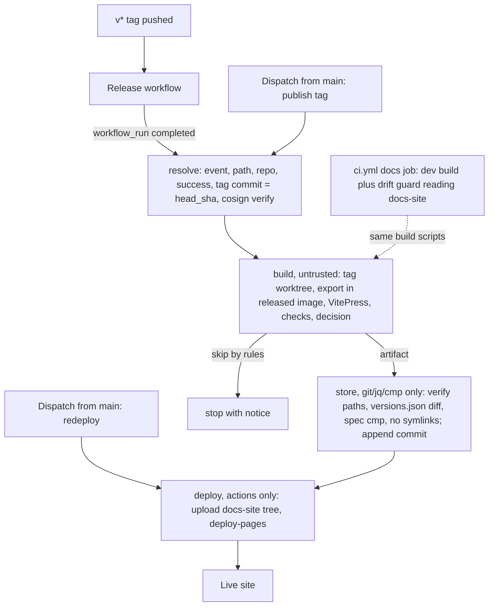

# feat: Versioned docs site on GitHub Pages

## Summary

Build a VitePress site at `https://beyerenrico.github.io/fieldset/` with one copy per minor version, a root home page and
the spec at its fixed `$id` URL. A new workflow publishes a release's copy after its signed release succeeds, through an
append-only storage branch that holds the whole deployable site. Untrusted build output is checked by privileged jobs that
run no repo code. CI builds the site on every run.

---

## Problem Frame

The guides are plain Markdown readable on GitHub, with no site, no search and no public API reference; the spec `$id`
returns 404 (see origin: `docs/brainstorms/2026-10-22-docs-site-requirements.md`). Research added constraints the origin
did not know: the signed release workflow cannot host a Pages deploy (`tests/Unit/Release/ReleaseWorkflowTest.php`,
ADR 0060), every Pages deploy replaces the whole site, the rc tag's guides contain raw `<placeholder>` text that breaks a
Vue-compiled build, VitePress anchors differ from GitHub's, and the OpenAPI export needs a migrated Postgres. The site is
also part of the install trust path: the home page's install command, the agent guide agents follow, and the `$id`.

---

## Requirements

Origin R1–R23 carry over (R2, R5, R8, R14, R18 and R19 amended; R20–R23 added at plan time with the user's
confirmation and recorded in the origin).

**Content**

- R1. Each copy contains every guide in `docs/guide/` (archive included), rendered from the tag's Markdown.
- R2. Each copy contains the Field App API contract and an interactive OpenAPI reference exported from the tag's code.
- R3. Each copy contains the changelog as of that tag.
- R4. The site renders the spec README and changelog for form-definition 1.0.
- R5. The meta-schema `$id` URL returns the meta-schema JSON, byte-identical to the file at the tag that last refreshed
  the root, whatever product versions exist.

**Versions**

- R6. Every minor version has its own copy; a version switcher on every page lists all copies and marks pre-releases.
- R7. A copy built from a release candidate shows a pre-release notice until the minor's final release replaces it.
- R8. `/latest/` and the home page's docs links open the newest final release, or the newest pre-release while no final
  exists.
- R9. Publishing one version never changes or removes another version's copy.
- R10. Versions before 2.1 get no copy.
- R20. A copy older than the newest final release shows a "newer version available" notice.
- R21. A pre-release never replaces a final copy; alpha and beta tags get no copy.

**Home page**

- R11. A site-only home page at the root: pitch, the install command for the newest release, key features with
  screenshots, links into guides, API docs, spec and changelog.
- R12. Screenshots show the product under the Fieldset name.
- R23. Screenshots use the English UI.

**Links and quality**

- R13. Links between guides, and to the API docs, spec and changelog, work on GitHub and on the site.
- R14. Links to content not on the site open the file on GitHub at the copy's tag.
- R15. Dead links and broken anchors fail the build; every CI run builds the site.
- R16. Full-text search covers the copy being viewed.
- R17. Generator, theme and plugins pass the license check.
- R22. The public API reference cannot send requests.

**Publishing**

- R18. A successful release run publishes its minor's copy; a publish can be re-run for the same tag.
- R19. The 2.1 copy goes live once from the rc tag after its release run succeeds; `v2.1.0` replaces it.

**Origin acceptance examples:** AE1 (rc-only state), AE2 (final plus newer rc), AE3 (doc fix waits for the patch tag),
AE4 (`$id` stable).

---

## Key Technical Decisions

### Toolchain and content

- **VitePress `2.0.0-alpha.20`, pinned exact, in its own package `docs/site/`.** User decision: 1.6 depends on Vite 5,
  which is out of support with an unfixed high advisory that fails the audit gate. A separate package with its own
  lockfile keeps the generator out of the root workspaces, the root lockfile and the image's assets stage
  (`docker/app/Dockerfile`).
- **Tooling from `main`, content from the tag.** A git worktree of the tag supplies the Markdown; `docs/site/` comes from
  `main`. This lets the rc tag, which predates the site, publish. Site-only root content (home page text, screenshots)
  comes from the tag when the tag contains `docs/site/root/`, and from `main` only for tags that predate the site (2.1).
- **The OpenAPI export runs inside the released app image.** A publish runs `migrate` and `scramble:export` in the image
  pinned by digest in the tag's signed `release-manifest.json`, against a fresh Postgres service. That gives the tag's
  code and the tag's PHP version without a Composer install in the workflow. CI exports the working tree with the local
  PHP setup of `php-tests`.
- **Links are resolved in a markdown-it core rule.** It runs before VitePress's link renderer, so the dead-link check and
  `base` see the result (`transformPageData` cannot change HTML; `transformHtml` risks hydration bugs). Staged targets
  become internal paths. Targets in another build (the root spec, the copy's static `api-reference.html`, other copies)
  become page-relative links with `target="_self"`: VitePress prefixes `base` to every `/` link and its router
  intercepts same-origin clicks without a target. Other existing repo paths become GitHub blob/tree URLs at the tag,
  and a missing target fails the build. The agent guide's `blob/main/docs/guide/*` links become internal on the
  site only; sources stay untouched because `sign` compares the release asset byte for byte.
- **GitHub-compatible anchors.** `github-slugger`'s stateless `slug()` replaces VitePress's slugify (8 of 134 headings
  differ, 93 fragment links exist); markdown-it-anchor's own dedupe adds `-1`, `-2` as GitHub does. A stateful slugger
  would also rewrite link fragments, which VitePress runs through the same function. A post-build fragment check fails on
  unknown anchors, which VitePress never checks.
- **Content pages render as text, not Vue.** Raw HTML tokens become escaped text and each content page is wrapped in
  `v-pre`, so `<organization>` and `{{org.name}}` stay literal. Staging rejects VitePress build-time features that run
  before markdown-it: front matter, `@include`, `<<<` snippet imports, `<script>` and `<style>` blocks.
- **Interactive reference: vendored Scalar standalone page.** The bundle is copied from the lockfile-checked
  `node_modules` at build time (never committed, never a CDN, per ADR 0040's SRI concern). `servers` becomes a
  `{server}` variable. The exported document is embedded as a JSON data block, so the page fetches nothing. A meta CSP
  (`default-src 'self'; style-src 'self' 'unsafe-inline'; img-src 'self' data:; connect-src 'none'; form-action 'none'`)
  enforces R22 whatever Scalar's options do; Scalar injects its CSS as `<style>` elements and uses `data:` images, and
  no inline script executes. Telemetry, default fonts, auth persistence and AI features are off. `vitepress-openapi` is pre-1.0,
  mishandles 3.1 examples (#349) and would couple to the VitePress alpha.

### Versions and URLs

- **Version rules decide every publish** (table in High-Level Technical Design). `build` parses and orders tags in JS;
  `store` re-checks the order with a minimal jq program (`X.Y.Z`, final above rc, numeric `rc.N`, the only channels that
  get copies) read from `main`, never from the artifact. The JS, the jq program and a PHP test through `ReleaseVersion`
  all run one shared vectors file. `sort -V` orders `2.1.0` before `2.1.0-rc.1` and is not used.
- **`versions.json` schema 1 is frozen, additive only.** Fields: `schema` (1), `latest` (minor), `copies[]` with
  `minor`, `version`, `tag`, `prerelease`, `builtWith` (tooling commit). Readers ignore unknown fields and fall back to
  baked values for `schema` above 1. `docs/site/schema/versions.schema.json` describes it; a frozen copy of each released
  reader must parse the current writer's output. It lives at `/fieldset/versions.json`, is updated on every publish and
  is fetched by literal path (`withBase` would point inside the copy).
- **Clients treat `versions.json` as hostile.** Old copies read it forever on an origin shared with every
  `beyerenrico.github.io` site. URLs are built only from a minor matching `^\d+\.\d+$` and must start with `/fieldset/`;
  labels render as text, never `v-html`.
- **Permanent URL shape.** `/fieldset/` home; `/fieldset/<minor>/` guide index; `/fieldset/<minor>/<guide>` and
  `/fieldset/<minor>/archive/<page>` (clean URLs); `/fieldset/<minor>/field-app-api-v1`, `/fieldset/<minor>/changelog`,
  `/fieldset/<minor>/api-reference.html`; `/fieldset/spec/form-definition/1.0/` with raw JSON beside it and
  `/fieldset/spec/form-definition/1.0/changelog`; `/fieldset/latest/`. A flat copy layout avoids an `api.html` file colliding with an `api/` directory. Working-tree
  builds use the reserved name `dev`, which no publish accepts.

### Publishing and trust

- **Publish in a new workflow `.github/workflows/docs.yml`, never in `release.yml`.** `ReleaseWorkflowTest` forbids
  `workflow_dispatch` and `id-token: write` outside `image`/`sign` there, and an extra OIDC job would mint tokens under the
  installer's signer identity (ADR 0060). `docs.yml` runs on `workflow_run` (Release, completed) and on
  `workflow_dispatch`, both on the default branch.
- **A `resolve` job proves the release before anything builds.** `workflow_run` matches workflows by name, so a fork can
  fire it. `resolve` requires event `push`, path `.github/workflows/release.yml`, the same repository, conclusion
  `success`, and a tag whose commit equals `head_sha`. It then runs `cosign verify-blob` on the tag's
  `release-manifest.json` with the installer's identity checks. It uses only git, gh and cosign. A dispatch passes the
  same checks for its tag input.
- **Jobs split by privilege; privileged jobs verify the untrusted build.** `build` (contents: read) runs npm, VitePress
  and the app image, so its output is untrusted. `store` (contents: write, environment `docs-store`) and `deploy`
  (pages: write, id-token: write, environment `github-pages`) run only git, jq, grep, cmp and pinned actions.
  `store` derives the allowed paths from the verified tag and rejects symlinks and other non-regular files. It
  recomputes with its jq program whether the root may refresh and `latest` may move, and accepts root-owned changes only
  then. Only that minor's `versions.json` entry and `latest` may change. On a root refresh every `spec/` JSON file must
  equal `git show <tag>:<path>`; otherwise `spec/` must stay unchanged. Every `install.sh` URL in the artifact must
  appear in the tag's staged Markdown (`git grep` at the tag) or be the generated `releases/download/v<tag>/install.sh`.
  Every `api-reference.html` must carry the exact CSP literal and no inline executable script, and no page may load
  scripts or stylesheets from other origins. Both jobs use `persist-credentials: false`; the token lives only in the
  push step's environment. `store` cannot prove that rendered pages or same-origin JS match the tag: that rests on exact
  pins, `npm ci` from the lockfile, `ignore-scripts=true` and the audit gate.
- **An append-only storage branch `docs-site` holds the complete deployable site.** Each Pages deploy replaces the whole
  site (deploy-pages issue #50), and old builds cannot be reproduced, so the stored tree is their only copy. One normal
  commit per publish: a fast-forward push fails if someone else wrote first, `git revert` undoes a bad publish, the diff
  shows what changed, and a ruleset can block force-push and deletion. Rejected: rebuilding every minor per deploy
  (re-renders old copies with new tooling, N exports, one broken old tag blocks every publish); release assets (`sign`
  compares assets byte for byte, the release is final before docs run, root parts have no tag); squashed history (deletes
  the only backup). Cost: clone growth of about one copy per publish (inferred).
- **Publishing waits for the release.** Docs appear about two and a half hours after a tag, never for a failed release.
  A workflow-level concurrency group `docs-pages` without cancellation serializes publishes; a reconcile step warns when a
  non-draft release is newer than its stored copy (a dropped pending run).
- **No Actions cache in `docs.yml`**, so a default-branch job cannot seed caches that tag runs restore.
- **CI guards tooling drift.** Tags are frozen while tooling changes, so CI also builds the newest published tag of each
  minor (content only) with the current tooling.
- **ADR 0094 supersedes ADR 0042's generator and hosting decision** and keeps its writing rules. It also records that a
  custom domain, a renamed account or a `beyerenrico.github.io` repository with a service worker would affect the `$id`.

---

## High-Level Technical Design

### Publish pipeline



### Version decision

| Incoming tag | Minor below 2.1 | Minor has a final copy | Minor has only an rc copy | Minor has no copy |
|---|---|---|---|---|
| alpha / beta | skip | skip | skip | skip |
| rc | skip | skip (R21) | publish if newer or equal | publish |
| final | skip (R10) | publish if newer or equal, else skip | publish (replaces rc) | publish |

The root refreshes when the published entry is the newest final overall, or when no final exists and it is the newest
rc. An equal re-run of the newest version therefore refreshes the root; that is how home-page fixes go live
(`RELEASING.md`). `versions.json` updates on every publish.

### Assembled site and ownership

```text
/fieldset/
  index.html, assets/, 404.html, latest/   root-owned: replaced whole on a root refresh
  versions.json                            store-owned: one entry and latest change per publish
  spec/form-definition/1.0/                spec: file-level add or update, never delete
  2.1/, 2.2/, ...                          copy-owned (^\d+\.\d+/): replaced whole by its minor's publish
```

`dev/` and any other top-level name are reserved and rejected by `store`.

---

## Output Structure

```text
docs/site/
  package.json, package-lock.json
  schema/versions.schema.json
  copy/.vitepress/config.mjs, copy/.vitepress/theme/      version copy
  root/.vitepress/config.mjs, root/index.md, root/404.md   root build
  root/public/screenshots/                                 English-UI screenshots
  lib/                                                     stage, links, slug, versions, openapi, checks
  scripts/build.mjs, scripts/screenshots.mjs
  test/                                                    node:test suites and fixtures
```

The tree shows the expected shape; per-unit file lists are authoritative.

---

## Implementation Units

### Phase A: site tooling

### U1. Toolchain, ADR and license coverage

**Goal:** Create the `docs/site/` package and record the decision.

**Requirements:** R17

**Dependencies:** none

**Files:**
- Create: `docs/site/package.json`, `docs/site/package-lock.json`, `docs/site/.npmrc`,
  `docs/adr/0094-docs-site-on-github-pages.md`
- Modify: `docs/adr/0042-documentation-site.md` (status line), `.gitignore`, `scripts/check-licenses.mjs`,
  `.github/workflows/ci.yml` (audit job)
- Test: `docs/site/test/licenses.test.mjs`

**Approach:**
- Pin `vitepress` `2.0.0-alpha.20`, `github-slugger`, `@scalar/api-reference` exactly; check peer ranges before adding
  (LEARNINGS 2/9). `docs/site/.npmrc` sets `ignore-scripts=true` and `audit=true`: npm reads project config only from
  the nearest package root, so the root `.npmrc` does not apply there.
- `check-licenses.mjs` takes an optional directory argument (default: repo root); the audit job runs it and
  `npm audit --audit-level=high` for `docs/site` too. Dual licenses take the allowed option.
- Ignore `docs/site/node_modules` and VitePress cache and output dirs, so Tailwind's source detection skips them.
- ADR 0094 uses the header lines of `docs/adr/0000-template.md`; ADR 0042 becomes "superseded by 0094 (generator and
  hosting); writing rules carried forward".

**Patterns to follow:** `scripts/check-licenses.mjs`, `docs/adr/0092-rename-to-fieldset.md` header lines.

**Test scenarios:**
- Happy path: the license script run against a fixture `node_modules` with MIT and ISC packages exits 0.
- Error path: a fixture package with a disallowed license makes it exit non-zero and name the package.
- Edge case: a dual license `(MIT OR CC0-1.0)` passes; the default run without an argument still scans the root.
- Happy path: `npm config get ignore-scripts` run in `docs/site` returns `true`.

**Verification:** `docs/site` installs from its lockfile; license and audit checks pass for root and `docs/site`.

---

### U2. Content staging and Markdown transforms

**Goal:** Stage a tag's content and render it with GitHub-compatible links and anchors, as text.

**Requirements:** R1, R3, R13, R14, R15

**Dependencies:** U1

**Files:**
- Create: `docs/site/lib/stage.mjs`, `docs/site/lib/links.mjs`, `docs/site/lib/slug.mjs`, `docs/site/lib/text-only.mjs`
- Test: `docs/site/test/stage.test.mjs`, `docs/site/test/links.test.mjs`, `docs/site/test/slug.test.mjs`

**Approach:**
- Staging copies an allowlist from a source root into a build dir, keeping repo paths: `docs/guide/**/*.md`,
  `docs/api/field-app-v1.md`, `CHANGELOG.md`. It wraps each page in a `v-pre` container, rejects the build-time
  features named in the KTDs, and writes a site descriptor (version, tag, minor, prerelease, repository).
- The links rule resolves each href against the source path (`env.realPath ?? env.path`) and applies the KTD mapping.
  Targets that exist in the repo but are not staged become `blob` (files) or `tree` (directories) URLs at the tag.
- The text-only rule turns `html_inline`/`html_block` tokens on content pages into text tokens.
- `slug.mjs` exposes `github-slugger`'s stateless `slug()`; markdown-it-anchor dedupes duplicate headings.

**Patterns to follow:** VitePress `markdown.config` and `markdown.anchor.slugify` hooks (v1.6.4 docs; confirm in the
alpha).

**Test scenarios:**
- Happy path: `install.md` linking `agent-guide.md` renders an internal link to the copy's agent-guide page.
- Happy path: `index.md` linking `../../CHANGELOG.md` renders the copy's changelog;
  `../../spec/form-definition/1.0/README.md` renders a page-relative link to the root spec page with `target="_self"`,
  from a top-level guide and from an archive page; the final rendered `href` carries no doubled `base`.
- Happy path: `../adr/` renders `https://github.com/beyerenrico/fieldset/tree/<tag>/docs/adr`; `../../SECURITY.md` a blob URL.
- Edge case: `archive/1.0-upgrade.md` linking `../../releases/1.0.0.md` resolves to a blob URL of `docs/releases/1.0.0.md`.
- Edge case: a link with a fragment keeps it after rewriting; a same-page `#anchor` stays unchanged.
- Edge case: the agent guide's `https://github.com/beyerenrico/fieldset/blob/main/docs/guide/install.md` becomes
  internal; other absolute URLs stay untouched.
- Error path: a relative link to a missing file fails the render naming source file and target.
- Happy path: slugs match GitHub for `Adopt a 1.0 install` (`adopt-a-10-install`), `1. Connect the identity provider`,
  `REST API (/api/v1)`, `## 2.1.0 — 2026-10-22 (…)` and an umlaut heading.
- Edge case: two identical headings on one page get `x` and `x-1`.
- Happy path: prose `Weiter mit <organization>` renders the literal text; `{{org.name}}` in inline code stays literal.
- Error path: a staged page with front matter, an `<!--@include: …-->` line, a `<<< @/…` line or a `<script setup>`
  block fails staging naming file and line.
- Happy path: staging the working tree copies the allowlist only and records `prerelease` from the descriptor input.

**Verification:** Rendering every guide at `v2.1.0-rc.1` produces no unresolved link and no Vue compile error.

---

### U5. Version rules and the `versions.json` contract

**Goal:** One tested implementation of the publish decision and the shared JSON contract.

**Requirements:** R6, R8, R9, R10, R18, R21

**Dependencies:** U1

**Files:**
- Create: `docs/site/lib/versions.mjs`, `docs/site/store/version-order.jq`, `docs/site/schema/versions.schema.json`,
  `docs/site/test/fixtures/version-vectors.json`, `docs/site/test/fixtures/versions-reader-v1.mjs`
- Test: `docs/site/test/versions.test.mjs`, `tests/Unit/Release/DocsVersionVectorsTest.php`

**Approach:**
- `versions.mjs` parses tags (the ReleaseVersion pattern), orders them, applies the decision table to the stored
  `versions.json`, and returns publish or skip with a reason, the new `versions.json`, and whether the root refreshes.
  It rejects `dev`.
- It also exports the browser reader used by U3 and U4: validate, ignore unknown fields, build safe URLs.
- The vectors file lists tag pairs with their expected order; the PHP test runs the same pairs through
  `ReleaseVersion::compare`.

**Execution note:** Implement test-first from the decision table.

**Test scenarios:**
- Happy path: empty store plus `v2.1.0-rc.1` publishes 2.1 (prerelease), sets `latest` 2.1 and refreshes the root.
- Covers AE2. Store {2.1.0 final} plus `v2.2.0-rc.1` publishes 2.2, keeps `latest` 2.1, root not refreshed.
- Happy path: store {2.1.0-rc.1} plus `v2.1.0` replaces 2.1 as final and refreshes the root.
- Edge case: store {2.1.0 final} plus `v2.1.1-rc.1` skips with reason "final copy exists".
- Edge case: store {2.2.0 final, 2.1.0} plus `v2.1.1` publishes 2.1; `latest` stays 2.2; root not refreshed.
- Edge case: a re-run of `v2.1.0` over {2.1.0} republishes and refreshes the root; `v2.1.0` over {2.1.1} skips as older.
- Edge case: `v2.2.0-beta.1` skips; `v2.0.5` skips (below 2.1); ordering puts `2.1.0` above `2.1.0-rc.10` above
  `2.1.0-rc.9`.
- Happy path: the PHP test and the jq program agree with every pair in the vectors file.
- Happy path: the frozen v1 reader parses the writer's output, including a future extra field.
- Error path: the reader given `latest: "javascript:alert(1)"`, a minor `//evil.example` or an HTML label yields no
  link outside `/fieldset/` and plain-text labels.
- Error path: the reader given malformed JSON or `schema: 2` falls back to the baked values.

**Verification:** Both test suites pass; the schema validates the writer's output for every scenario.

---

### U3. Version copy: config and theme

**Goal:** Build one copy with the permanent URL shape, search, switcher and notices.

**Requirements:** R6, R7, R16, R20

**Dependencies:** U2, U5

**Files:**
- Create: `docs/site/copy/.vitepress/config.mjs`, `docs/site/copy/.vitepress/theme/index.mjs`,
  `docs/site/copy/.vitepress/theme/VersionSwitcher.vue`, `docs/site/copy/.vitepress/theme/VersionNotice.vue`
- Test: `docs/site/test/theme-versions.test.mjs`

**Approach:**
- `base` comes from the descriptor (`/fieldset/<minor>/` or `/fieldset/dev/`); rewrites map `docs/guide/:page*` to
  `:page*`, `docs/api/field-app-v1.md` to `field-app-api-v1.md`, `CHANGELOG.md` to `changelog.md`. `cleanUrls` on,
  `lastUpdated` off, local search on. The sidebar follows the guide index's sections.
- The switcher (nav slot, client-only) uses the U5 reader on `/fieldset/versions.json` and links with full paths and
  `target="_self"`, so the client router does not swallow cross-copy links. If the fetch fails it shows the current
  version and a home link.
- The notice (layout-top slot, sets `--vp-layout-top-height`) shows the pre-release text with the exact install command
  for the copy's tag (baked), or "newer version available" when `latest` (the newest final) is newer than this copy
  (runtime).

**Patterns to follow:** VitePress default-theme layout slots (extending-default-theme docs).

**Test scenarios:**
- Happy path: with `versions.json` listing 2.2 (rc) and 2.1, the switcher model lists both, marks 2.2 as pre-release, and
  points 2.1's entry at `/fieldset/2.1/`.
- Covers AE1. A copy built from `v2.1.0-rc.1` shows the pre-release notice with
  `releases/download/v2.1.0-rc.1/install.sh`.
- Happy path: a 2.1 copy with `latest` 2.2 shows the newer-version notice; with `latest` 2.1 it shows none, also while
  2.2-rc.1 exists.
- Error path: a failed fetch yields a switcher with only the current version and home.
- Edge case: an rc copy that is also `latest` (no final anywhere) shows only the pre-release notice.

**Verification:** A local build of the working tree serves the guide index at `/fieldset/dev/` with search, switcher and
notices.

---

### U4. Root site: home page, spec, latest and 404

**Goal:** Build the unversioned root.

**Requirements:** R4, R5, R8, R11, R12

**Dependencies:** U2, U5

**Files:**
- Create: `docs/site/root/.vitepress/config.mjs`, `docs/site/root/index.md`, `docs/site/root/404.md`,
  `docs/site/root/latest/index.md`, `docs/site/lib/root-stage.mjs`
- Test: `docs/site/test/root.test.mjs`

**Approach:**
- `root-stage.mjs` stages the spec from the tag: the README as `spec/form-definition/1.0/index.md` and the changelog as
  `spec/form-definition/1.0/changelog.md` (both through the U2 rules), and every JSON file of that directory into
  `public/` unchanged.
- The home page uses the home layout and a baked install command for the newest release. Its text and screenshots
  come from the tag when the tag contains `docs/site/root/`, else from `main`.
- `build.mjs` writes a static fallback (links to `/fieldset/latest/` and `/fieldset/`) into the root `404.html` outside
  `#app`, because VitePress renders that page with an empty app container.
- `latest/` and `404` use the U5 reader with a baked fallback and a plain link. `/latest/<path>` goes to the same path in
  the latest copy; `/<known minor>/<missing>` goes to that copy's index; an unknown version such as `/2.0/` explains that
  it was never published and links to `latest` and the 1.0 archive guides.

**Patterns to follow:** U3 theme helpers.

**Test scenarios:**
- Covers AE4. The built root's `spec/form-definition/1.0/meta-schema.json` is byte-identical to the staged source.
- Happy path: the spec README renders at `/fieldset/spec/form-definition/1.0/`; its `meta-schema.json` link stays a raw
  file link; its `CHANGELOG.md` link opens `/fieldset/spec/form-definition/1.0/changelog`; `../../conformance` becomes a
  GitHub tree URL.
- Happy path: the latest target maps `/fieldset/latest/install` to `/fieldset/2.1/install` for `latest` 2.1.
- Edge case: `/fieldset/2.0/` and `/fieldset/1.0/install` produce the "never published" message.
- Edge case: `/fieldset/2.1/no-such-page` targets `/fieldset/2.1/`.
- Error path: a hostile `versions.json` sends `latest/` and `404` only to `/fieldset/` paths.
- Happy path: with no final in `versions.json`, the home page install command is the rc command labelled pre-release.
- Happy path: the built `404.html` contains the plain fallback links without JavaScript.

**Verification:** The root build serves the home page, the spec page, raw JSON and a working `latest` redirect.

---

### U11. OpenAPI export and reference page

**Goal:** A per-copy interactive reference that cannot send requests.

**Requirements:** R2, R22

**Dependencies:** U1

**Files:**
- Create: `docs/site/lib/openapi.mjs`, `docs/site/copy/public/api-reference.html` (template)
- Test: `docs/site/test/openapi.test.mjs`

**Approach:**
- `openapi.mjs` validates an exported document (OpenAPI 3.1, expected paths) and rewrites `servers` to
  `https://{server}/api/v1`.
- The reference page loads the Scalar bundle copied from `node_modules` at build time, embeds the exported document as
  a JSON data block with Scalar's options in its configuration attribute, carries the CSP from the KTD, and disables
  telemetry, fonts, auth persistence and AI features.
- Export runs where U13 says: inside the released image for a publish, the local PHP setup for CI.

**Test scenarios:**
- Happy path: an export with `servers: [{url: http://localhost:8080/api/v1}]` comes out with the `{server}` variable.
- Error path: an export without `/forms` or with `openapi` 3.0 fails.
- Happy path: the generated page's CSP equals the KTD literal, and its bundle hash equals the installed package file's
  hash.

**Verification:** The reference page renders styled, with the exported paths, and makes no network request.

---

### U12. Post-build checks

**Goal:** Prove each build before it leaves the build job.

**Requirements:** R5, R13, R15, R22

**Dependencies:** U2, U4, U11

**Files:**
- Create: `docs/site/lib/checks.mjs`
- Test: `docs/site/test/checks.test.mjs`

**Approach:** Every internal `href` with a fragment resolves to an `id` on the target page; listed literals are present;
the meta-schema is byte-identical; the reference page's CSP and bundle hash match; no output file is a symlink; every
image the home page references exists in `root/public/screenshots/` and every file there is referenced; `404.html`
carries its static fallback.

**Test scenarios:**
- Error path: a page linking `install#no-such-heading` fails naming page and fragment.
- Error path: a missing literal (`<organization>` rendered as an element) fails.
- Error path: a reference page without the CSP fails; a symlink in the output fails; a missing or unreferenced
  screenshot fails.
- Happy path: a fixture build with valid anchors, literals and spec passes.

**Verification:** The checks pass on a working-tree build and fail on each seeded defect.

---

### U13. Build orchestrator

**Goal:** One script builds a copy, and the root when due, from a tag or the working tree.

**Requirements:** R9, R15, R18

**Dependencies:** U3, U4, U5, U11, U12

**Files:**
- Create: `docs/site/scripts/build.mjs`
- Test: `docs/site/test/build.test.mjs`

**Approach:**
- Modes: `dev` (working tree, base `/fieldset/dev/`, blob links at the commit); `publish` (requires `--source` and
  `--tag` with no defaults, so a failed worktree step cannot publish `main`'s content as a release); `check` (requires
  `--source` and `--tag`, uses a stub export, makes no decision and writes no artifact; U12 skips only the reference
  checks).
- Steps: stage, take the export, build the copy, decide with U5, build the root when due, run U12, write the artifact by
  ownership class with the allowed-path list `store` re-derives.

**Test scenarios:**
- Integration: a `dev` build of the working tree with a stub export yields `dev/` plus root parts and passes all checks.
- Error path: `publish` without `--tag` or `--source` exits before staging.
- Covers AE3. Store {2.1.0} plus `v2.1.1` built from content with a fixed typo writes only `2.1/` and `versions.json`.
- Edge case: a skip decision writes no artifact and exits 0 with the reason.

**Verification:** `build.mjs` builds the working tree and `v2.1.0-rc.1` (content plus export) with all checks green.

---

### Phase B: automation

### U6. CI docs job and drift guard

**Goal:** Every CI run builds the site the same way the publish does.

**Requirements:** R15

**Dependencies:** U13

**Files:**
- Modify: `.github/workflows/ci.yml`, `tests/Unit/Release/ReleaseWorkflowTest.php`
- Test: `tests/Unit/Release/ReleaseWorkflowTest.php`

**Approach:**
- New `docs` job: Node with `cache-dependency-path: docs/site/package-lock.json`, PHP and a Postgres service like
  `php-tests`, `npm ci` and `npm test` in `docs/site`, migrate, export, then `build.mjs` in `dev` mode.
- Drift guard (pushes to `main`, and changes under `docs/site/**` or `ci.yml`): fetch `docs-site` and tags explicitly,
  read `versions.json`, check each tag against the version pattern before `git worktree add`, build each minor's newest
  tag with `build.mjs check`.
- The job also runs `store`'s jq ordering program against the shared vectors file. It skips only when `ls-remote` reports no `docs-site`; a malformed `versions.json` or a missing tag
  fails.
- Actions pinned by SHA with a version comment; `permissions: contents: read`; never the root `npm run build` (fonts
  plugin network fetch, LEARNINGS 166).

**Patterns to follow:** `php-tests` and `js-tests` jobs in `.github/workflows/ci.yml`; newer jobs' SHA pinning.

**Test scenarios:**
- Happy path: the pinning dataset covers the `docs` job; the job has only `contents: read`.
- Happy path: no workflow in `.github/workflows/` uses `pull_request_target`.
- Error path: an unpinned action in the `docs` job fails the pinning assertion.
- The job's behaviour itself is proven by a branch CI run (`maint-…` name), including the drift guard's skip on an
  empty store.

**Verification:** A branch run shows the `docs` job green.

---

### U7. Publish workflow

**Goal:** Publish after a verified, successful release, with redeploy and re-run by dispatch.

**Requirements:** R9, R18, R19, R21

**Dependencies:** U6, U13

**Files:**
- Create: `.github/workflows/docs.yml`
- Modify: `tests/Unit/Release/ReleaseWorkflowTest.php` (forbid `workflow_call` in `release.yml`)
- Test: `tests/Unit/Release/DocsWorkflowTest.php`

**Approach:**
- Triggers: `workflow_run` for `Release` with `types: [completed]`; `workflow_dispatch` with inputs `tag` and `mode`
  (`publish` or `redeploy`). Jobs: `resolve` → `build` → `store` → `deploy`; `redeploy` runs `deploy` only.
- `resolve` applies the KTD checks and outputs the verified tag, minor and commit.
- `build` re-checks the tag, creates the worktree from the verified commit, pulls the app image by the digest in the
  verified manifest, exports, reads `docs-site` read-only, runs `build.mjs publish`, uploads the artifact, and runs the
  reconcile warning. A skip ends green.
- `store` checks out `docs-site` (or starts it as an orphan on first publish) and `docs/site/store/version-order.jq`
  from `main` (sparse), applies the KTD verification, appends one commit and pushes without force.
- `deploy` checks out the stored commit without credentials, fails on symlink or submodule entries, runs
  `upload-pages-artifact` and `deploy-pages`.
- `permissions: {}` at the top with per-job grants; concurrency group `docs-pages` without cancellation; no cache steps.
  Every `${{ }}` value from `inputs`, `github.event` or `needs.*.outputs` reaches shell only through `env`.

**Patterns to follow:** `tests/Unit/Release/ReleaseWorkflowTest.php` (job blocks parsed from YAML text), the `sign` job's
"runs no repo code" rule and its cosign checks in `.github/workflows/release.yml`; `fieldset_install_verify` in
`distribution/install.sh` for the identity flags.

**Test scenarios:**
- Happy path: triggers are exactly `workflow_run` (Release, completed) and `workflow_dispatch`; no `push`, no
  `pull_request`; no `uses: ./.github/workflows/release.yml`.
- Happy path: top-level `permissions` is empty; `build` has only `contents: read`; only `store` has `contents: write`;
  only `deploy` has `pages: write` and `id-token: write`.
- Error path: any `run` step in `resolve`, `store` or `deploy` that invokes `npm`, `node`, `php`, `composer` or `docker`
  fails the test.
- Happy path: `resolve` checks event `push`, the release workflow path, the repository, conclusion `success`, the tag
  commit against `head_sha`, and runs `cosign verify-blob` with the certificate identity and workflow SHA flags.
- Happy path: no `run` step contains `${{ inputs.`, `${{ github.event.` or `${{ needs.`.
- Happy path: `store` and `deploy` use `persist-credentials: false`; `store` pushes without `--force`; `store` runs in
  environment `docs-store` and `deploy` in `github-pages`.
- Happy path: every `uses` is pinned by a 40-character SHA; no `actions/cache`; concurrency `docs-pages` with
  `cancel-in-progress: false`.
- Happy path: `store` reads its jq program from a `main` checkout and greps the CSP literal in every
  `api-reference.html`.
- Happy path: `release.yml` has no `workflow_call` trigger.

**Verification:** actionlint passes; `DocsWorkflowTest` passes; a dispatch from the branch proves `resolve` and `build`
(environments refuse `store` and `deploy` off `main`).

---

### Phase C: content and go-live

### U8. Guides and repository docs

**Goal:** Keep sources clean for both renderers and document the site.

**Requirements:** R5, R13, R18

**Dependencies:** U2

**Files:**
- Modify: `docs/guide/field-app-guide.md`, `docs/guide/troubleshooting.md`, `docs/guide/archive/1.0-troubleshooting.md`,
  `docs/api/field-app-v1.md`, `docs/guide/index.md`, `README.md`, `AGENTS.md`, `RELEASING.md`, `CHANGELOG.md`,
  `spec/form-definition/1.0/README.md`, `tests/Support/Docs/GuideReferences.php`, `docs/agent/QUESTIONS.md`
- Test: `tests/Unit/Docs/GuideReferencesTest.php`, `tests/Unit/Spec/MetaSchemaDigestTest.php`

**Approach:**
- Wrap the four raw placeholders in code spans; GitHub renders them as nothing today.
- New guide rule: no raw `<word>` outside code spans and blocks in `README.md` and `docs/guide/**`.
- The spec README states the meta-schema's sha256 and advises validators to bundle the schema rather than fetch it; a
  test keeps the hash current. No semantic change to the spec.
- `index.md` and `README.md` name the site URL; `AGENTS.md` adds the docs build and test commands; `RELEASING.md` gets a
  "Docs site" section (automatic publish, dispatch re-run and redeploy, root refresh by re-running the newest tag,
  removal by a revert on `docs-site`, one-time setup); `CHANGELOG.md` gets an Unreleased "Added" entry.
- `QUESTIONS.md` logs the human settings steps for review.

**Patterns to follow:** existing checks in `tests/Support/Docs/GuideReferences.php`.

**Test scenarios:**
- Happy path: the current guides pass the new rule after the four fixes.
- Error path: a fixture line `Weiter mit <organization>` outside code fails the rule naming file and line.
- Edge case: `<organization>` inside a code span or fenced block passes; an `<https://…>` autolink passes.
- Happy path: the README's sha256 equals the hash of `meta-schema.json`; a changed schema fails the test.

**Verification:** `GuideReferencesTest` and the digest test green; `docs/guide/agent-guide.md` unchanged.

---

### U9. Home page screenshots

**Goal:** Current English-UI screenshots under the Fieldset name.

**Requirements:** R11, R12, R23

**Dependencies:** U4

**Files:**
- Create: `docs/site/scripts/screenshots.mjs`, `docs/site/root/public/screenshots/*.png`
- Modify: `docs/site/root/index.md`

**Approach:** A manual Playwright script signs in with demo users on a freshly seeded dev stack (the dev database holds
E2E leftovers, LEARNINGS 127), switches the UI to English and captures the forms list, the builder, a rendered PDF and
the Field App on a phone viewport. It writes only into `docs/site/root/public/screenshots/`, never into milestone
evidence (LEARNINGS 159/160).

**Test expectation:** none -- manual asset capture; U12's checks verify the images exist and are referenced.

**Verification:** The home page shows four current screenshots with the Fieldset name in English.

---

### U10. Go-live

**Goal:** Turn on Pages with the protections the workflow relies on, and publish 2.1.

**Requirements:** R19, AE1, AE4

**Dependencies:** U1–U9, U11–U13

**Files:**
- Modify: `docs/agent/STATE.md`, `docs/agent/JOURNAL.md`, `docs/agent/PLAN.md`

**Approach:**
- Settings, each with the user's approval: Pages with GitHub Actions as the source; `github-pages` deployments from
  `main` only; environment `docs-store` limited to `main`; a ruleset blocking deletion and force-push of `docs-site`.
- Prove the branch run, merge `--no-ff` to `main`.
- The go-live tag is `v2.1.0-rc.2` (QUESTIONS 77e); `v2.1.0-rc.1` stays an unpublished draft and serves only as a
  content fixture in tests. After rc.2's release run succeeds, dispatch `publish` for it and check AE1 and AE4 live.
- Pushing `v2.1.0` needs separate approval; its release run then triggers the replacing publish.

**Test expectation:** none -- operational; verified on the live site.

**Verification:** The live root shows the home page, `/fieldset/latest/` opens 2.1 with the pre-release notice, and a
JSON Schema validator resolves the `$id`.

---

## System-Wide Impact

- **Security:** the site is in the install trust path; `build` is untrusted, `resolve`, `store` and `deploy` verify and
  run no repo code. Old copies read `versions.json` forever, so its readers are hardened once, before 2.1 goes live.
- **CI:** a new `docs` job with Postgres adds minutes per run; the drift guard grows with each minor but runs only on
  `main` and docs changes; the audit job scans a second lockfile.
- **Release flow:** `release.yml` gains only a test forbidding `workflow_call`; docs follow a successful release about
  2.5 hours after the tag.
- **Repository:** a new append-only `docs-site` branch of built HTML in every clone; ADR 0042 superseded; a new guide
  rule for raw HTML; new repository settings (U10).
- **Public contract:** URLs and `versions.json` schema 1 are permanent once the first copy is live.

---

## Risks & Dependencies

| Risk | Mitigation |
|---|---|
| A compromised npm package in `build` publishes altered content | `store` limits paths, re-checks ordering, `versions.json`, spec files, install URLs, the reference CSP and asset origins; rendered pages and same-origin JS rest on exact pins, lockfile installs, `ignore-scripts` and the audit gate |
| A fork fires `workflow_run` with a workflow named `Release` | `resolve` checks event, path, repository, tag commit and the cosign signature |
| Injection from `build` outputs into privileged jobs | Values reach shell only via `env`; a test forbids inline expressions |
| Symlinks in the stored tree publish runner files | `store` and `deploy` reject non-regular entries; no persisted credentials |
| Hostile `versions.json` causes XSS or redirects in every old copy | Reader builds URLs from validated minors only; hostile-fixture tests |
| VitePress alpha changes config or slot APIs | Exact pin; deliberate upgrades; the CI drift guard rebuilds published tags |
| `workflow_run` details (head ref for tags, re-run firing) differ from expectation | Verify on the first real run; dispatch `publish <tag>` is the fallback |
| A third queued publish cancels a pending one | Reconcile warning; re-run by dispatch; documented in `RELEASING.md` |
| The released image cannot run `scramble:export` as planned | Fallback: local PHP with the `PHP_VERSION` read from the tag's `release.yml` |
| Redirects depend on JavaScript (Pages has no server redirects) | `latest/` and `404` include a plain link fallback |
| The rc release is not public yet | Go-live waits for a successful release run (rc.2 after the pull-check fix) |

---

## Scope Boundaries

Carried from the origin: German docs, a "next" copy, republishing from `main`, ADRs/plans/README as pages, a custom
domain, copies before 2.1, pruning old copies.

### Deferred to Follow-Up Work

- `release.yml` `finalize` marks every final as GitHub's latest release; a late 2.1.x after 2.2.0 would move
  `releases/latest` backwards. The home page and the rc notice use versioned commands, but every copy's guides use
  `releases/latest/download/install.sh`, so this fix must land before a patch of an older minor ships after a newer
  minor's final.
- A `main` ruleset (force-push, deletion) and the repository's "require SHA pinning" setting; pin the 19 tag-pinned
  actions in `ci.yml` and drop the test's exemption first, or CI fails.
- `install-journeys.yml` restores caches by prefix on tag runs; restrict `restore-keys` on tags (release gate hardening).
- Automated removal or downgrade of a copy (a revert on `docs-site` plus redeploy covers it).
- Canonical links or `noindex` on old copies.

---

## Open Questions

### Deferred to Implementation

- Scalar's option names for telemetry, auth persistence and AI features in the pinned version (the CSP enforces R22
  regardless).
- Whether `v-pre` containers keep heading anchors and search sections intact in the alpha.
- How the app image runs `migrate` and `scramble:export` (entrypoint, minimal environment).
- How the demo users switch to the English UI for screenshots.

---

## Sources & Research

- Origin: `docs/brainstorms/2026-10-22-docs-site-requirements.md`.
- Release constraints: `tests/Unit/Release/ReleaseWorkflowTest.php`, `.github/workflows/release.yml` (header, `sign`),
  `docs/adr/0060-signed-images-and-release-manifest.md`, `distribution/install.sh` (`fieldset_install_verify`),
  `docs/agent/QUESTIONS.md` 77c.
- Doc rules: `docs/adr/0042-documentation-site.md`, `tests/Unit/Docs/GuideReferencesTest.php`,
  `tests/Support/Docs/GuideReferences.php`, `tests/Unit/Docs/AgentGuideBlocksTest.php`.
- Scramble: `config/scramble.php`, `vendor/dedoc/scramble/src/Console/Commands/ExportDocumentation.php`,
  `vendor/dedoc/scramble/src/Support/ResponseExtractor/ModelInfo.php`.
- Versions: `app/Domain/Instance/Release/ReleaseVersion.php`, `ReleaseVersionCommand.php`.
- VitePress 1.6.4 docs and source (routing, site config, markdown, layout slots, CLI); v1 docs at
  https://vuejs.github.io/vitepress/v1/; npm `vitepress@2.0.0-alpha.20` depends on `vite ^8.2.1` (npm registry).
- Pages: https://github.com/actions/deploy-pages/issues/50 (deploys replace the site),
  https://docs.github.com/en/pages/getting-started-with-github-pages/github-pages-limits;
  `actions/upload-pages-artifact` action.yml (tar dereferences links).
- Renderer: https://www.npmjs.com/package/@scalar/api-reference, https://github.com/enzonotario/vitepress-openapi/issues/349.
- Material for MkDocs status: https://squidfunk.github.io/mkdocs-material/blog/2025/11/05/zensical/.
